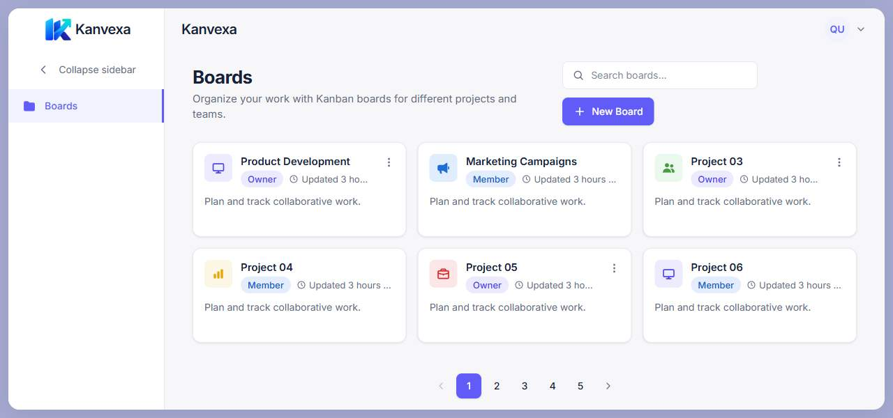
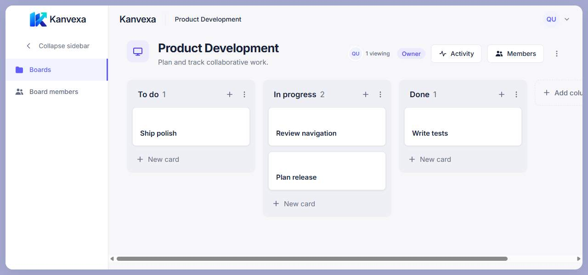

<p align="center">
  
</p>

# Kanvexa

**Shared boards. Clear tasks. Real-time collaboration.**

Kanvexa is an open-source Kanban application for organizing work together. Create boards, move cards through your workflow, discuss tasks, and follow changes as they happen. Built as a software engineering project, it combines a React interface with a NestJS API and PostgreSQL persistence.

[](https://github.com/duongkienvn/SE2026-T13/actions/workflows/ci.yml)
[](LICENSE)

**[Open Kanvexa](https://kanvexa.tech)** · [Project overview](docs/project-overview.md) · [Post-MVP roadmap](docs/roadmap/post-mvp.md)

## Key Features

The current MVP implementation includes:

- **Authentication and profiles:** email/password registration with email verification, sign-in, sign-out, profile editing, and optional Google Sign-In with explicit account linking.
- **Board management:** create and edit boards, search and paginate Active/Archived lists, archive boards, and restore them as an owner.
- **Board membership:** add registered users and manage board access through `OWNER` and `MEMBER` roles enforced by the backend.
- **Kanban workflow:** create and reorder columns; create, edit, move, reorder, and archive cards with descriptions, due dates, and multiple assignees.
- **Live collaboration:** synchronize board changes with Socket.IO and see who is currently viewing a board.
- **Comments and activity:** discuss cards, edit or delete your own comments, and browse a board's activity history.
- **Responsive navigation:** a collapsible sidebar and layouts for desktop and mobile, with pagination sized to the available space.

Approved Post-MVP features are described separately below; they are not part of this implemented feature list.

## Application Screenshots

These are existing captures of the running frontend with sample data, taken during implementation milestones. Earlier captures may show previous branding or navigation. They are separate from the approved design mockups.

| Boards                                                                                                                             | Kanban board                                                                                                                                         |
| ---------------------------------------------------------------------------------------------------------------------------------- | ---------------------------------------------------------------------------------------------------------------------------------------------------- |
|  |  |

Explore [card comments](docs/design/screens/implementation/comments-ui/comments-desktop.png), [activity history](docs/design/screens/implementation/activity-history/activity-1280x600.png), and the [design and implementation evidence index](docs/design/README.md) for more screens and their task records.

## Tech Stack & Architecture

| Layer                   | Technologies                                                                                                       |
| ----------------------- | ------------------------------------------------------------------------------------------------------------------ |
| Frontend                | React 19, TypeScript, Vite, Tailwind CSS, React Router, TanStack Query, dnd-kit, Socket.IO Client                  |
| Backend                 | NestJS, TypeScript, REST API, Socket.IO, TypeORM, JWT, Argon2                                                      |
| Database                | PostgreSQL 16                                                                                                      |
| Authentication services | Google Identity Services; Resend for verification email                                                            |
| Quality and delivery    | pnpm workspaces, Vitest, Testing Library, Jest, Supertest, ESLint, Prettier, Docker Compose, Caddy, GitHub Actions |

The backend is a modular monolith. REST handles commands, queries, and initial loading; Socket.IO broadcasts persisted changes and transient presence. PostgreSQL is the source of truth, and board membership governs both API access and realtime rooms. Schema changes use explicit TypeORM migrations with `synchronize: false`.

Shared contracts, types, enums, and event names live in `packages/shared`; backend entities and business rules stay in the backend. See the [architecture documents](docs/architecture/) and [backend developer guide](docs/architecture/backend-developer-guide.md) for the underlying conventions.

## Repository Structure

```text
apps/
├── frontend/       React application
└── backend/        NestJS REST API and realtime layer
packages/
└── shared/         Shared contracts, types, enums, and events
docs/
├── architecture/   Architecture and developer guides
├── deployment/     Deployment, CI/CD, and verification runbooks
├── design/         MVP evidence and approved Post-MVP design
├── roadmap/        Approved Post-MVP scope and phases
└── tasks/          Backend and frontend implementation records
scripts/           Deployment checks and tooling
.github/workflows/ CI and delivery workflows
```

## Prerequisites & Getting Started

- Node.js **22.13.0 or later**.
- pnpm **10.18.3**, as pinned in `package.json`.
- Docker with Docker Compose v2 for the local PostgreSQL service.

For a fresh clone:

```sh
git clone https://github.com/duongkienvn/SE2026-T13.git
cd SE2026-T13
pnpm install --frozen-lockfile
cp .env.example .env
```

On PowerShell, use `Copy-Item .env.example .env` to copy the example. Review `.env` and replace `JWT_SECRET` with a unique random secret of at least 32 bytes before starting the backend. See the environment configuration below for optional Google and email setup.

Start the development database:

```sh
docker compose up -d postgres
docker compose ps postgres
```

Wait until PostgreSQL is healthy, then build the shared package, apply migrations to your local development database, and start both applications:

```sh
pnpm --filter @kanban/shared build
pnpm --filter @kanban/backend migration:run
pnpm dev
```

| Service                       | Default local address                                                 |
| ----------------------------- | --------------------------------------------------------------------- |
| Frontend                      | <http://localhost:5173>                                               |
| REST API                      | <http://localhost:3000/api>                                           |
| API documentation             | <http://localhost:3000/api-docs> when Swagger is enabled              |
| Liveness / database readiness | <http://localhost:3000/health> / <http://localhost:3000/health/ready> |

Development Compose runs PostgreSQL only; the frontend and backend run on the host. Migrations do not run automatically when the backend starts. To inspect migration state, use `pnpm --filter @kanban/backend migration:show`.

## Environment Configuration

Both applications read the root [`.env.example`](.env.example) configuration through a local `.env` file. Keep credentials private; `VITE_*` values are public frontend build configuration.

| Variables                                                                               | Purpose                                                                                                                                                                                               |
| --------------------------------------------------------------------------------------- | ----------------------------------------------------------------------------------------------------------------------------------------------------------------------------------------------------- |
| `DATABASE_HOST`, `DATABASE_PORT`, `DATABASE_NAME`, `DATABASE_USER`, `DATABASE_PASSWORD` | Local PostgreSQL connection. The default host port is `5433`; the container listens on `5432`.                                                                                                        |
| `API_PORT`, `API_PREFIX`, `WEB_PORT`                                                    | Backend port, REST prefix, and Vite development port. Defaults are `3000`, `api`, and `5173`.                                                                                                         |
| `VITE_API_BASE_URL`, `CORS_ORIGINS`, `PUBLIC_APP_URL`                                   | Browser API endpoint, allowed frontend origins, and base URL for verification links. Update these together when changing local addresses.                                                             |
| `JWT_SECRET`                                                                            | Private signing secret; replace the example placeholder.                                                                                                                                              |
| `GOOGLE_CLIENT_ID`, `VITE_GOOGLE_CLIENT_ID`                                             | Optional matching Google Web client IDs. Leaving them empty disables Google Sign-In while retaining email/password authentication. No Google client secret is required.                               |
| `MAIL_TRANSPORT`, `MAIL_FROM`, `RESEND_API_KEY`                                         | Verification email delivery. Local `fake` transport captures mail in memory and sends nothing; use `resend` with a private API key and verified sender to complete registration through a real inbox. |
| `NODE_ENV`, `LOG_LEVEL`, `SWAGGER_ENABLED`                                              | Runtime mode, logging, and API documentation visibility.                                                                                                                                              |

For provider configuration and security requirements, see [email verification](docs/tasks/backend/email-verification.md) and [Google authentication and account linking](docs/tasks/backend/google-auth-account-linking.md). The backend always uses fake email delivery under `NODE_ENV=test`.

## Development Commands & Testing

Run these commands from the repository root:

| Command                                       | Purpose                                                              |
| --------------------------------------------- | -------------------------------------------------------------------- |
| `pnpm dev`                                    | Build shared contracts and run frontend/backend development servers. |
| `pnpm dev:frontend` / `pnpm dev:backend`      | Run one application after building the shared package.               |
| `pnpm lint`                                   | Check application and shared-package code with ESLint.               |
| `pnpm test`                                   | Build shared contracts and run the default workspace test suites.    |
| `pnpm build`                                  | Build all workspace packages.                                        |
| `pnpm format:check`                           | Check repository formatting without writing changes.                 |
| `pnpm --filter @kanban/frontend test`         | Run frontend Vitest tests.                                           |
| `pnpm --filter @kanban/backend test:unit`     | Run backend unit tests.                                              |
| `pnpm --filter @kanban/backend test:e2e`      | Run backend HTTP E2E tests.                                          |
| `pnpm --filter @kanban/backend test:database` | Verify migrations and persistence in an isolated temporary database. |
| `pnpm test:infra`                             | Check deployment configuration and CI/CD contracts.                  |

The default test command does not replace the separate PostgreSQL integration suites. Database integration scripts require a reachable PostgreSQL server and permission to create temporary databases. Feature-specific commands and prerequisites are documented in the [backend task records](docs/tasks/README.md).

## Documentation

| Document                                                                                        | What to read it for                                                                                                                                                                           |
| ----------------------------------------------------------------------------------------------- | --------------------------------------------------------------------------------------------------------------------------------------------------------------------------------------------- |
| [Project overview](docs/project-overview.md)                                                    | Current MVP scope, approved Post-MVP scope, domain terms, and architecture boundaries.                                                                                                        |
| [Architecture](docs/architecture/)                                                              | System, frontend, backend, database, and developer conventions. Some current-state notes describe earlier milestones; use the overview and source for the refreshed implementation inventory. |
| [Design index](docs/design/README.md)                                                           | Approved MVP references, implementation screenshots, and Post-MVP design handoff.                                                                                                             |
| [Task index](docs/tasks/README.md)                                                              | Implementation decisions and validation recorded by task. Records retain their historical context.                                                                                            |
| [Post-MVP roadmap](docs/roadmap/post-mvp.md)                                                    | The 25 approved workstreams, six phases, dependencies, and release criteria.                                                                                                                  |
| [Production deployment](docs/deployment/production.md)                                          | Runtime configuration, migrations, backup, and recovery.                                                                                                                                      |
| [CI/CD](docs/deployment/cicd.md) and [deployment verification](docs/deployment/verification.md) | Delivery gates, image checks, and smoke verification.                                                                                                                                         |

## Production Deployment

The production setup uses [Docker Compose](compose.prod.yml) with a Caddy frontend/reverse proxy, a NestJS backend, and PostgreSQL. Caddy provides HTTPS and forwards API and Socket.IO traffic on the application origin.

GitHub Actions runs quality checks and provides a gated image delivery workflow. Database migrations are an explicit deployment step. Follow the [production runbook](docs/deployment/production.md) and [CI/CD guide](docs/deployment/cicd.md) for reviewed configuration, backups, migration gates, smoke checks, and recovery procedures. The development `.env` example is not a production configuration.

## Development Workflow

Issue → branch from `main` → implement → commit → push branch → Pull Request → CI and review → merge.

Use focused branches and Conventional Commits such as `feat:`, `fix:`, `docs:`, and `test:`. Do not push directly to `main`. Read [AGENTS.md](AGENTS.md), the [project overview](docs/project-overview.md), and the relevant architecture and design documents before making changes. Preserve existing board permissions, persistence rules, and realtime behavior when extending the product.

## Post-MVP Roadmap

Post-MVP planning approves **25 feature/workstream groups across six phases (0–5)**. This is an implementation plan, not a list of released capabilities; individual implementation dates are not yet approved.

| Phase | Focus                              |
| ----- | ---------------------------------- |
| 0     | MVP Stabilization & Design Handoff |
| 1     | Application & Account Foundation   |
| 2     | Workspace & Access Control         |
| 3     | Board & Card Enhancements          |
| 4     | Productivity & Collaboration       |
| 5     | Views, Data & Polish               |

Planned areas include workspaces and invitations, richer cards, Home Dashboard, My Tasks, global search, notifications, account settings, Light/Dark/System themes, exports, and Calendar/Table views. `/` is a public landing page for guests and signed-in users ([Issue #84](https://github.com/duongkienvn/SE2026-T13/issues/84), [task record](docs/tasks/frontend/public-landing-page.md)).

Read the [roadmap](docs/roadmap/post-mvp.md), [Product & UX Blueprint](docs/design/product-ux-blueprint.md), [Post-MVP design guidelines](docs/design/design-guidelines.post-mvp.md), and [visual reference register](docs/design/post-mvp/visual-reference-register.md) before implementation. Approved mockups guide appearance; they do not expand scope. Preserve Kanvexa branding and the working MVP. Free plans, upgrades, pricing, and subscriptions are outside the approved scope.

## Contributors

Kanvexa is developed by the contributors to this repository. See the [contributor history](https://github.com/duongkienvn/SE2026-T13/graphs/contributors) for recorded contributions.

## License

Distributed under the [MIT License](LICENSE). Copyright © 2026 Kanvexa Contributors.
