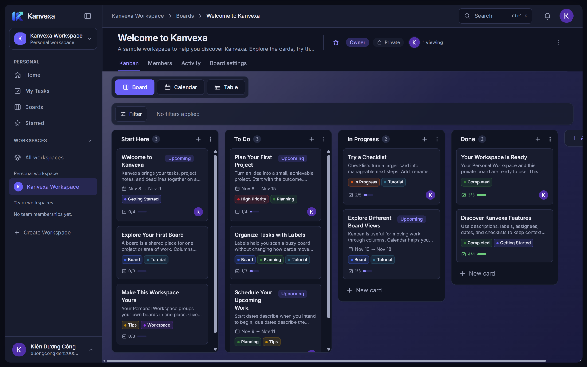
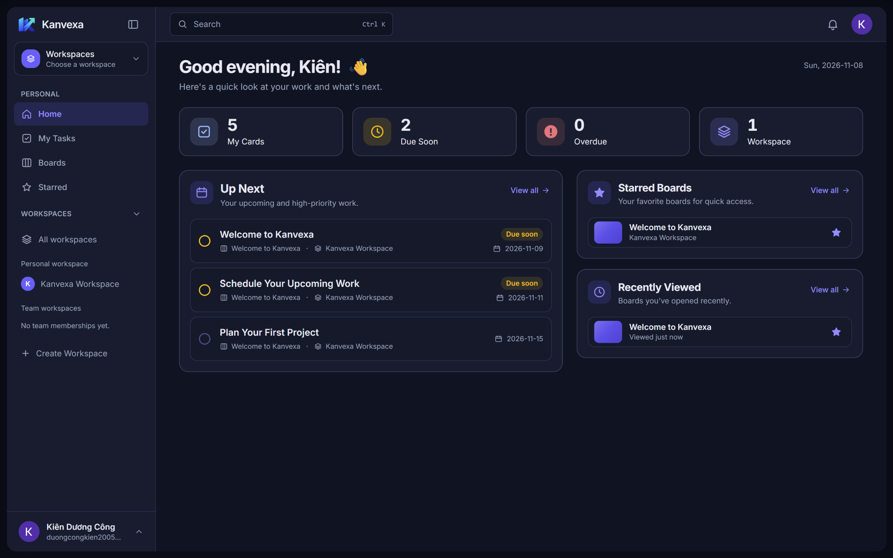
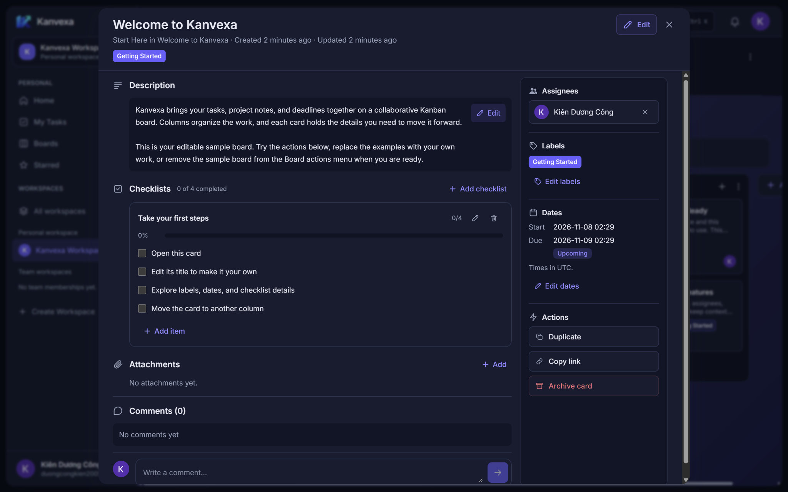

<p align="center">
  
</p>

# Kanvexa

**Shared boards. Clear tasks. Real-time collaboration.**

Kanvexa is an open-source collaborative Kanban web application for organizing personal and team work. Plan across Workspaces, manage detailed Cards in Kanban, Calendar and Table views, and keep everyone connected through live updates, comments and notifications.

**[Open Kanvexa →](https://kanvexa.tech)** · [Getting started](#getting-started) · [Documentation](#documentation)

[](https://github.com/duongkienvn/SE2026-T13/actions/workflows/ci.yml)
[](LICENSE)

## Features

### Accounts and security

- Email/password registration, email verification, password recovery and password changes.
- Google sign-in and explicit account linking, profile editing and avatar uploads.
- Verified email changes with fresh identity proof and session invalidation after credential changes.
- Account deletion with reauthentication and ownership checks; shared work is retained with an anonymized author.

### Workspaces and Boards

- Personal and team Workspaces with Overview, Boards, Members, Guests, invitations and administrative settings.
- Separate Workspace `ADMIN`/`MEMBER` and Board `OWNER`/`MEMBER` roles, with private and Workspace-visible Boards and read-only access where appropriate.
- Board discovery with search, filters, sorting, pagination, starred Boards and recently viewed Boards.
- Board backgrounds, settings, membership management, archive/restore and authorized moves between Workspaces.

### Views and Cards

- Kanban drag-and-drop, Calendar and Table views of the same Board data.
- Card descriptions, multiple assignees, checklists, Board-scoped labels, start/due dates and computed due states.
- Card filtering, direct links, duplication, archive and restore.
- URL attachments and configurable private file uploads with image previews and download authorization.

### Collaboration and productivity

- Realtime Board updates, presence, comments, mentions, Board activity and Workspace activity.
- Home Dashboard with assigned-work summaries, upcoming work, starred Boards and recent Boards.
- My Tasks with search and filters, plus global search across accessible Boards and Cards.
- In-app notifications, unread counts and read controls, with configurable task reminders and optional email delivery.

### Settings and privacy

- Light, dark and system appearance; time zone, date format and week-start preferences.
- Account security, connected accounts, notification preferences and a keyboard-shortcut reference.
- Account metadata export as JSON and owner-authorized Board exports as JSON or CSV.
- Responsive desktop and mobile-browser layouts, keyboard navigation and accessible dialogs.

File storage, Google sign-in and email delivery depend on the self-hosted instance's configuration. The application does not require these providers for every workflow; see [environment configuration](#environment-configuration).

## Product preview

<p align="center">
  
  <br>
  <strong>Kanban Board</strong><br>
  Organize work across columns with labels, checklists and due dates.
</p>

<table>
  <tr>
    <td width="50%" align="center" valign="top">
      
      <br>
      <strong>Home Dashboard</strong><br>
      See summary metrics, upcoming work and your go-to Boards.
    </td>
    <td width="50%" align="center" valign="top">
      
      <br>
      <strong>Card Detail</strong><br>
      Keep descriptions, checklists, assignments, labels and dates together.
    </td>
  </tr>
</table>

See the [design and implementation evidence index](docs/design/README.md) for screen references and captures. Older captures retain their original context and may show superseded layouts.

## Technology stack

| Area                        | Technologies                                                                                 |
| --------------------------- | -------------------------------------------------------------------------------------------- |
| Frontend                    | React 19, TypeScript 5, Vite 8, Tailwind CSS 4, React Router 7                               |
| Client data and interaction | TanStack Query 5, dnd-kit, Socket.IO Client 4                                                |
| Backend                     | NestJS 11, TypeORM 0.3, PostgreSQL 16, Socket.IO 4                                           |
| Authentication              | JWT access tokens, Argon2id, Google Identity Services                                        |
| Files and email             | Private AWS S3 storage, Sharp image processing, Resend; isolated development/test transports |
| Testing and quality         | Vitest, Testing Library, Jest, Supertest, ESLint, Prettier                                   |
| Delivery                    | pnpm workspaces, Docker Compose, Caddy, GitHub Actions, AWS EC2 and SSM                      |

Versions above describe the package/configuration families used in this repository. Exact dependency resolutions are recorded in `pnpm-lock.yaml`.

## Architecture overview

Kanvexa uses a NestJS modular monolith with PostgreSQL as the authority for persistent data. The React frontend uses REST for commands and queries, TanStack Query for server state, and Socket.IO for realtime hints and transient presence. The server enforces resource authorization and archived/read-only rules for both REST and socket access. Business mutations commit before events are published; reconnecting clients resynchronize through REST.

`apps/frontend` owns browser UI and session-scoped caches. `apps/backend` owns business rules, entities, migrations and authorization. `packages/shared` contains cross-application contracts, types and event names, without backend entities or services. Caddy serves the built frontend and proxies REST and Socket.IO on the same HTTPS origin. Private object storage is optional.

Read the [system architecture](docs/architecture/system-architecture.md), [frontend architecture](docs/architecture/frontend-architecture.md), [backend architecture](docs/architecture/backend-architecture.md) and [database design](docs/architecture/database-design.md) for details.

## Repository structure

```text
apps/
├── frontend/       React app, browser fixtures and frontend tests
└── backend/        NestJS API, realtime, migrations and integration tests
packages/
└── shared/         Shared contracts, types, enums and event names
docs/
├── architecture/   System architecture and developer guides
├── deployment/     Production, storage, CI/CD and recovery runbooks
├── design/         Design references and implementation evidence
├── roadmap/        Historical planning and scope records
└── tasks/          Backend and frontend implementation records
scripts/           Deployment validation and development verification tools
.github/workflows/ CI and delivery workflows
```

## Getting started

### Prerequisites

- Node.js **22.13.0 or later** and pnpm **10.18.3**.
- Docker Engine or Docker Desktop with Docker Compose v2 for local PostgreSQL.
- Git.

### Clone and install

```sh
git clone https://github.com/duongkienvn/SE2026-T13.git
cd SE2026-T13
pnpm install --frozen-lockfile
cp .env.example .env
```

In PowerShell, use `Copy-Item .env.example .env`. Replace the `JWT_SECRET` placeholder with a unique random secret of at least 32 bytes. Review the settings below before enabling external providers. Do not commit `.env` or credentials.

### Start the database and application

```sh
docker compose up -d postgres
docker compose ps postgres
```

Wait for PostgreSQL to become healthy. Confirm `.env` points to your **local development database**, then apply the explicit migrations and start both applications:

```sh
pnpm --filter @kanban/shared build
pnpm --filter @kanban/backend migration:run
pnpm dev
```

Development Compose runs PostgreSQL only; Node runs the frontend and backend on the host. Migrations never run automatically at application startup. Inspect their state with `pnpm --filter @kanban/backend migration:show`.

| Service                       | Default local URL                                                     |
| ----------------------------- | --------------------------------------------------------------------- |
| Web app                       | <http://localhost:5173>                                               |
| REST API                      | <http://localhost:3000/api>                                           |
| API documentation             | <http://localhost:3000/api-docs> when Swagger is enabled              |
| Liveness / database readiness | <http://localhost:3000/health> / <http://localhost:3000/health/ready> |

### Environment configuration

The backend and Vite read the root `.env`; [`.env.example`](.env.example) documents the available settings. Never put secrets in `VITE_*` variables: those values are public browser build configuration.

| Settings                                              | Purpose                                                                                             |
| ----------------------------------------------------- | --------------------------------------------------------------------------------------------------- |
| `DATABASE_*`                                          | PostgreSQL connection; the local container publishes port `5433` by default.                        |
| `API_PORT`, `API_PREFIX`, `WEB_PORT`                  | Backend port, REST prefix and Vite development port.                                                |
| `VITE_API_BASE_URL`, `CORS_ORIGINS`, `PUBLIC_APP_URL` | Browser API address, allowed origins and the application origin used in email links.                |
| `JWT_SECRET`                                          | Private JWT signing secret, at least 32 bytes.                                                      |
| `GOOGLE_CLIENT_ID`, `VITE_GOOGLE_CLIENT_ID`           | Optional matching Google Web client IDs; no client secret.                                          |
| `MAIL_TRANSPORT`, `RESEND_API_KEY`, `MAIL_FROM`       | Email transport and sender configuration.                                                           |
| `WORKSPACE_INVITATION_ACCEPT_PATH`                    | Invitation email destination; the implemented route is `/invitations/workspace`.                    |
| `AVATAR_*`, `ATTACHMENT_*`                            | Separate storage settings; private Card uploads also require the attachment policy acknowledgement. |
| `TASK_NOTIFICATION_*`, `VITE_TASK_EMAIL_ENABLED`      | Independently controlled reminder jobs, email dispatch and the public email-preferences UI flag.    |

Local `MAIL_TRANSPORT=fake` captures messages in memory and never logs or delivers verification links. To complete email-based signup, recovery or invitation flows in a browser, configure Resend with a verified sender. Tests and development harnesses can inspect their injected fake mailers; there is no public inbox endpoint. Test mode always uses fake delivery.

The example uses in-memory avatar storage, which is cleared on restart, and disables private Card file storage. For production S3 uploads and optional task email, follow the [production runbook](docs/deployment/production.md) and [private attachment runbook](docs/deployment/private-card-attachments.md). Enabling a UI capability in code does not configure these services for an instance.

## Development and testing

Run commands from the repository root:

| Command                                       | Purpose                                                       |
| --------------------------------------------- | ------------------------------------------------------------- |
| `pnpm dev`                                    | Build shared contracts and start both development servers.    |
| `pnpm dev:frontend` / `pnpm dev:backend`      | Build shared contracts and start one application.             |
| `pnpm lint`                                   | Run ESLint across application and shared code.                |
| `pnpm test`                                   | Build shared contracts and run default workspace tests.       |
| `pnpm build`                                  | Build shared, backend and frontend packages.                  |
| `pnpm format:check`                           | Check repository formatting without modifying files.          |
| `pnpm --filter @kanban/frontend test`         | Run frontend Vitest tests.                                    |
| `pnpm --filter @kanban/backend test:unit`     | Run backend unit tests.                                       |
| `pnpm --filter @kanban/backend test:e2e`      | Run backend HTTP/Socket.IO E2E tests.                         |
| `pnpm --filter @kanban/backend test:database` | Run the database foundation and migration integration checks. |
| `pnpm test:infra`                             | Check deployment configuration and CI/CD contracts.           |

The default test command does not run the separate PostgreSQL integration scripts. Some suites own disposable Docker containers; others require an explicitly designated test server and create temporary databases. Check the selected script's prerequisites and cleanup before running it. Use the [backend developer guide](docs/architecture/backend-developer-guide.md) and [task records](docs/tasks/README.md) for domain-specific commands. Never use production as a test target.

## Deployment

The production site runs on AWS EC2 using Docker Compose: Caddy serves the web app and terminates HTTPS, NestJS handles REST and Socket.IO, and PostgreSQL stores application data. Private uploads use S3 when configured.

GitHub Actions checks changes and publishes release images. Production delivery requires approval, verifies release image identity and backend configuration before downtime, applies migrations explicitly, then checks application health. Backup, recovery and storage enablement remain deliberate operator procedures.

Follow the [production deployment runbook](docs/deployment/production.md) and [CI/CD guide](docs/deployment/cicd.md). Development configuration is not a production configuration.

## Documentation

- [Project overview](docs/project-overview.md): product capabilities, access model and domain boundaries.
- [Architecture index](docs/architecture/README.md): system, application and database guides.
- [System architecture](docs/architecture/system-architecture.md): application components and data flows.
- [Frontend architecture](docs/architecture/frontend-architecture.md) and [backend architecture](docs/architecture/backend-architecture.md): implementation conventions.
- [Database design](docs/architecture/database-design.md): core relationships and schema extensions.
- [Design index](docs/design/README.md): branding, approved references and implementation evidence.
- [Task index](docs/tasks/README.md): feature contracts, decisions and historical verification records.

## Contributing

Use focused branches from `main`, Conventional Commits and pull requests. Read [AGENTS.md](AGENTS.md), the relevant developer guide and the affected feature's task records before changing behavior. Preserve authorization, existing data, session isolation and realtime contracts. Include relevant checks and document any environment blockers. See [the development workflow](docs/WORKFLOW.md) for repository conventions.

Kanvexa is developed by the contributors to this repository. See the [contributor history](https://github.com/duongkienvn/SE2026-T13/graphs/contributors) for recorded contributions.

## License

Distributed under the [MIT License](LICENSE). Copyright © 2026 Kanvexa Contributors.
