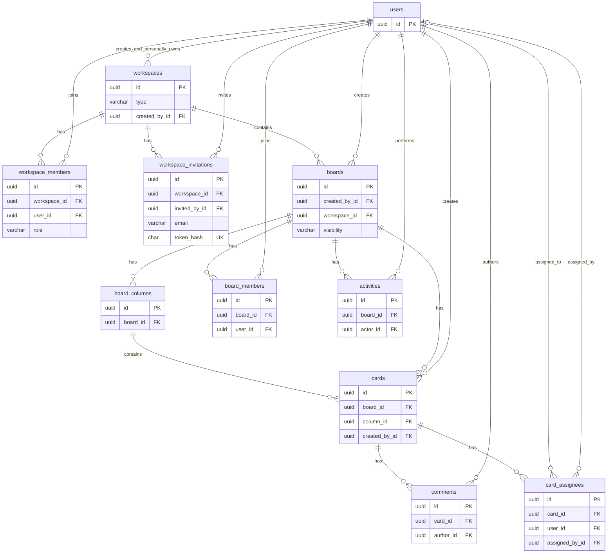

# Database Design — Kanvexa

## Tổng quan

Tài liệu này chốt schema và các ràng buộc dữ liệu cho MVP, làm cơ sở cho task triển khai TypeORM entities và migration đầu tiên. PostgreSQL lưu persistent business state; TypeORM dùng migrations với `synchronize: false`. Tám bảng domain gồm `users`, `boards`, `board_members`, `board_columns`, `cards`, `card_assignees`, `comments` và `activities`; K2 và #79 bổ sung `email_verification_tokens` và `google_identities` thuộc auth.

P2-01 bổ sung persistence foundation `workspaces`, `workspace_members`,
`workspace_invitations`, cùng `boards.workspace_id` và `visibility`. Các extension
preferences/password/avatar được mô tả bên dưới. Schema sau migration có 16 entity
tables; Workspace API/UI và quyền Workspace-visible chưa được triển khai trong
foundation này. Xem [migration, rollout và verification](../tasks/backend/workspace-data-foundation.md).

Mọi bảng dùng UUID primary key. Tên bảng/cột trong database dùng `snake_case`, property TypeScript dùng `camelCase`. Các timestamp dùng PostgreSQL `timestamptz` và lưu theo UTC.

## ER Diagram

Diagram chỉ hiển thị khóa và quan hệ; các cột còn lại nằm trong bảng chi tiết bên dưới. `assigned_by_id` là FK nullable; các FK khác trong diagram là bắt buộc.

## Chi tiết bảng

Trong các bảng dưới đây, `Không` ở cột Nullable nghĩa là `NOT NULL`. `created_at` và `updated_at` đều là timestamp persistent; không mặc định thêm field khác ngoài danh sách.

### `users`

| Cột                 | PostgreSQL type | Nullable | Ràng buộc / ý nghĩa                                                     |
| ------------------- | --------------- | -------- | ----------------------------------------------------------------------- |
| `id`                | `uuid`          | Không    | Primary key.                                                            |
| `email`             | `varchar`       | Không    | Unique; định danh đăng nhập.                                            |
| `password_hash`     | `varchar`       | Có       | Argon2id cho local account; NULL cho Google-only (#79).                 |
| `auth_version`      | `integer`       | Không    | Default 0; atomic increment on password reset/change (#93).             |
| `display_name`      | `varchar`       | Không    | Tên hiển thị.                                                           |
| `avatar_url`        | `varchar`       | Có       | Legacy external HTTPS avatar; preserved until upload/removal (#103).    |
| `avatar_object_key` | `varchar`       | Có       | Stable private object key in the owning User namespace; unique (#103).  |
| `avatar_revision`   | `integer`       | Không    | Default 0, nonnegative; serializes photo replace/remove (#103).         |
| `email_verified_at` | `timestamptz`   | Có       | K2 verification gate; Google authority chỉ áp dụng lúc tạo account mới. |
| `created_at`        | `timestamptz`   | Không    | Thời điểm tạo.                                                          |
| `updated_at`        | `timestamptz`   | Không    | Thời điểm cập nhật.                                                     |

### Private avatar extension (#103)

`avatar_uploads` persists each owner-bound UUID intent, generated pending/active
keys, expected MIME/byte size, base avatar revision, state, creation/expiry and
next cleanup time. User FK uses NO ACTION; keys are unique. CHECKs bound bytes,
MIME, revision, state and expiry. User row locks precede intent locks; storage IO
stays outside transactions. No signed URL, raw filename or image bytes are stored
in PostgreSQL. Migration is additive and preserves `avatar_url`; down refuses
while private avatar pointers exist. See [API, failure recovery and rollback](../tasks/backend/profile-avatar-upload.md).

### Auth identity extension (#79)

`google_identities`: UUID `id`, UUID `user_id`, varchar(255) `google_sub`,
`created_at` timestamptz. Unique constraints trên từng `google_sub` và `user_id`
giữ quan hệ một user–một Google identity. FK `user_id → users.id` dùng NO ACTION,
không âm thầm xóa identity khi xóa user. Auth entities không làm thay đổi quan hệ
board/card. Migration `1792850400000-GoogleIdentity` giữ hash hiện có; down khóa
bảng và từ chối nếu còn identity hoặc NULL password. Xem [transaction và rollback](../tasks/backend/google-auth-account-linking.md).

### User preferences extension (P1-01)

`user_preferences` stores account appearance/display choices separately from
profile and authentication. `user_id` is the UUID primary key and one-to-one FK to
`users.id` (`NO ACTION`, matching the current safe account deletion policy).
`theme`, `date_format` and `week_starts_on` are non-null varchar fields with CHECK
constraints; `time_zone` is non-null `varchar(100)` validated as an IANA name by
the API. Defaults are `system`, `YYYY-MM-DD`, `monday` and `UTC`, respectively.
`created_at`/`updated_at` use `timestamptz`. Missing rows read as defaults without
backfill; writes lock the parent User row in a transaction to preserve concurrent
partial updates. Migration `1792886400000-UserPreferences` only adds the table;
down refuses populated data under a table lock. See the
[API, concurrency tests and rollout/rollback](../tasks/backend/user-preferences.md).

### Password recovery extension (#93)

Migration `1792922400093-PasswordRecoverySecurity` adds `users.auth_version` and
`password_reset_tokens`, independently of verification and Google identity.
The recovery table has UUID `id`, unique `user_id` (FK to users, ON DELETE CASCADE),
unique SHA-256 `token_hash` (`char(64)`), `created_at`, indexed `expires_at`, nullable
`consumed_at`/`sent_at`, `window_started_at` (`timestamptz`) and integer `attempts`.
It retains one current proof and its issuance quota per account. No plaintext proof
is persisted. Its rollback refuses to discard any recovery row or nonzero auth
version. See [lifecycle and deployment details](../tasks/backend/password-recovery-security.md).

### `boards`

P2-01 thêm UUID `workspace_id NOT NULL` (FK → `workspaces.id`, NO ACTION,
index `IDX_boards_workspace_id`) và varchar `visibility NOT NULL DEFAULT 'PRIVATE'`
(CHECK chỉ nhận `PRIVATE`/`WORKSPACE_VISIBLE`). Board thuộc đúng một Workspace;
`created_by_id` vẫn là người tạo Board, không thay bằng Workspace owner.
Existing response DTOs và Board authorization tiếp tục chỉ dùng Board membership.

| Cột             | PostgreSQL type | Nullable | Ràng buộc / ý nghĩa         |
| --------------- | --------------- | -------- | --------------------------- |
| `id`            | `uuid`          | Không    | Primary key.                |
| `name`          | `varchar`       | Không    | Tên board.                  |
| `description`   | `text`          | Có       | Mô tả board.                |
| `created_by_id` | `uuid`          | Không    | FK → `users.id`; người tạo. |
| `is_archived`   | `boolean`       | Không    | Mặc định `false`.           |
| `archived_at`   | `timestamptz`   | Có       | Thời điểm archive.          |
| `created_at`    | `timestamptz`   | Không    | Thời điểm tạo.              |
| `updated_at`    | `timestamptz`   | Không    | Thời điểm cập nhật.         |

Khi tạo `Board`, tạo cả `BoardMember` cho người tạo với role `OWNER`. Các bước persistence này phải nhất quán, dự kiến trong cùng transaction. Normal user flow dùng archive; hard delete không phải operation mặc định của MVP.

Tạo Board hiện gọi `WorkspacesService.ensurePersonalWorkspace(currentUserId,
manager)` trong cùng transaction trước khi lưu Board PRIVATE và Board OWNER.
Client chưa được chọn Team Workspace hoặc đổi visibility tại đây.

### Workspace foundation (P2-01)

| Table                   | Columns / invariants                                                                                                                                                                                                                                                                                                                                                                               |
| ----------------------- | -------------------------------------------------------------------------------------------------------------------------------------------------------------------------------------------------------------------------------------------------------------------------------------------------------------------------------------------------------------------------------------------------- |
| `workspaces`            | UUID `id`; varchar `type` PERSONAL/TEAM; nonblank `name varchar(120)`; nullable text `description`; UUID `created_by_id` FK User, NO ACTION; `created_at`/`updated_at` timestamptz. Creator là durable owner của PERSONAL. Partial unique `UQ_workspaces_personal_creator(created_by_id) WHERE type='PERSONAL'`; index creator cho lookup/FK. Icon representation để P2-02 chốt, chưa thêm cột.    |
| `workspace_members`     | UUID `id`; UUID workspace/user FKs NO ACTION; varchar `role` ADMIN/MEMBER; `joined_at`/`created_at`/`updated_at` timestamptz. Unique `(workspace_id,user_id)`; indexes `user_id`, `(workspace_id,role)`. Personal owner được provision ADMIN; không copy Board collaborators.                                                                                                                      |
| `workspace_invitations` | UUID `id`; UUID workspace/inviter FKs NO ACTION; normalized `email varchar(320)` (lowercase, trimmed, basic email shape); varchar role ADMIN/MEMBER; unique SHA-256 lowercase hex `token_hash char(64)` (excluded from default entity SELECT); required `expires_at`; nullable `consumed_at`/`revoked_at`; `created_at`/`updated_at` timestamptz. Indexes `(workspace_id,email)`, expiry, inviter. |

Invitation expiry phải sau creation; consumed time thuộc `[created_at,expires_at)`;
revocation không trước creation; consumed và revoked loại trừ nhau. Không có
plaintext token, issuance/acceptance/mail API, hoặc computed state column.
Pending là chưa consumed/revoked và chưa expired; P2-03 chịu trách nhiệm khóa,
verified-email binding, single-use và chính sách pending duplicates trong service.

Mọi FK mới dùng NO ACTION: xóa Workspace không cascade Board/Card/User.
Workspace ADMIN không có Board grant. Last-admin protection, Team management và
Workspace-visible read policy phải được triển khai qua các issue tương ứng.

`public.ensure_personal_workspace(uuid)` là persistence primitive SECURITY INVOKER
dùng chung cho service, migration và old-writer bridge. Partial unique upsert khóa
Workspace rồi insert/repair owner ADMIN; repeat giữ IDs/timestamps nếu grant đã
đúng. Service nhận trusted identity, cung cấp lookup và transaction participation.
Không có Workspace REST controller hay socket contract mới.

Migration expand `1793145600000-WorkspaceFoundation` thêm nullable Board FK và
trigger `TR_boards_workspace_bridge` để lệnh cũ thiếu Workspace được gán Personal
và PRIVATE trước khi kiểm tra constraints. Migration
`1793145600001-LegacyBoardWorkspaces` provision mọi User, backfill Board theo creator,
verify rồi SET NOT NULL dưới Board lock. Raw SQL không sửa legacy timestamps.
New users bootstrap lazily khi tạo Board đầu tiên, dù tạo account bằng email hay
Google. Bridge phải được giữ qua application rollback/cutover; production dùng
maintenance window đã drain writers. Xem [runbook](../deployment/workspace-foundation.md).

### `board_members`

| Cột          | PostgreSQL type | Nullable | Ràng buộc / ý nghĩa        |
| ------------ | --------------- | -------- | -------------------------- |
| `id`         | `uuid`          | Không    | Primary key.               |
| `board_id`   | `uuid`          | Không    | FK → `boards.id`.          |
| `user_id`    | `uuid`          | Không    | FK → `users.id`.           |
| `role`       | `enum`          | Không    | Chỉ `OWNER` hoặc `MEMBER`. |
| `joined_at`  | `timestamptz`   | Không    | Thời điểm tham gia board.  |
| `created_at` | `timestamptz`   | Không    | Thời điểm tạo record.      |
| `updated_at` | `timestamptz`   | Không    | Thời điểm cập nhật record. |

`UNIQUE(board_id, user_id)` ngăn membership trùng. `board_members` là nguồn dữ liệu chính để backend xác thực board-level authorization.

### `board_columns`

| Cột          | PostgreSQL type  | Nullable | Ràng buộc / ý nghĩa        |
| ------------ | ---------------- | -------- | -------------------------- |
| `id`         | `uuid`           | Không    | Primary key.               |
| `board_id`   | `uuid`           | Không    | FK → `boards.id`.          |
| `name`       | `varchar`        | Không    | Tên column.                |
| `position`   | `numeric(20,10)` | Không    | Thứ tự column trong board. |
| `created_at` | `timestamptz`    | Không    | Thời điểm tạo.             |
| `updated_at` | `timestamptz`    | Không    | Thời điểm cập nhật.        |

### `cards`

| Cột             | PostgreSQL type  | Nullable | Ràng buộc / ý nghĩa                       |
| --------------- | ---------------- | -------- | ----------------------------------------- |
| `id`            | `uuid`           | Không    | Primary key.                              |
| `board_id`      | `uuid`           | Không    | FK → `boards.id`.                         |
| `column_id`     | `uuid`           | Không    | FK → `board_columns.id`; column hiện tại. |
| `created_by_id` | `uuid`           | Không    | FK → `users.id`; người tạo.               |
| `title`         | `varchar`        | Không    | Tiêu đề.                                  |
| `description`   | `text`           | Có       | Mô tả.                                    |
| `position`      | `numeric(20,10)` | Không    | Thứ tự trong column.                      |
| `due_date`      | `timestamptz`    | Có       | Deadline.                                 |
| `is_archived`   | `boolean`        | Không    | Mặc định `false`.                         |
| `archived_at`   | `timestamptz`    | Có       | Thời điểm archive.                        |
| `created_at`    | `timestamptz`    | Không    | Thời điểm tạo.                            |
| `updated_at`    | `timestamptz`    | Không    | Thời điểm cập nhật.                       |

Giữ `board_id` trực tiếp trên `Card` để query card theo board, kiểm tra quyền và route realtime event đơn giản hơn, đồng thời tránh join qua column ở một số query. Mỗi khi gán column cho card — lúc tạo card, move card hoặc bất kỳ operation nào đổi `column_id` — backend phải validate column thuộc cùng board với `cards.board_id` và giữ bất biến `card.board_id == column.board_id`. MVP không có field `status`; column hiện tại là state/status của card. Normal user flow dùng archive.

### `card_assignees`

| Cột              | PostgreSQL type | Nullable | Ràng buộc / ý nghĩa                   |
| ---------------- | --------------- | -------- | ------------------------------------- |
| `id`             | `uuid`          | Không    | Primary key.                          |
| `card_id`        | `uuid`          | Không    | FK → `cards.id`.                      |
| `user_id`        | `uuid`          | Không    | FK → `users.id`; assignee.            |
| `assigned_by_id` | `uuid`          | Có       | FK → `users.id`; người assign nếu có. |
| `created_at`     | `timestamptz`   | Không    | Thời điểm assign.                     |

`UNIQUE(card_id, user_id)` ngăn assign trùng. Một card có thể có nhiều assignee. Đây là continuing invariant: user chỉ được tồn tại trong `card_assignees` của card khi hiện là `BoardMember` của board chứa card. Backend phải kiểm tra membership khi tạo assignment.

Khi remove member khỏi board, backend phải xóa tất cả `card_assignees` của user đó trên các card thuộc board và remove `BoardMember` một cách nhất quán, dự kiến trong cùng transaction. Sau khi operation thành công, backend có thể tạo `MEMBER_REMOVED` `Activity` theo activity model hiện tại. User đã bị remove không được tiếp tục là assignee của card trong board đó.

### `comments`

| Cột          | PostgreSQL type | Nullable | Ràng buộc / ý nghĩa                   |
| ------------ | --------------- | -------- | ------------------------------------- |
| `id`         | `uuid`          | Không    | Primary key.                          |
| `card_id`    | `uuid`          | Không    | FK → `cards.id`.                      |
| `author_id`  | `uuid`          | Không    | FK → `users.id`; tác giả.             |
| `content`    | `text`          | Không    | Nội dung comment.                     |
| `created_at` | `timestamptz`   | Không    | Thời điểm tạo.                        |
| `updated_at` | `timestamptz`   | Không    | Thời điểm cập nhật.                   |
| `deleted_at` | `timestamptz`   | Có       | Soft delete; `NULL` khi còn hiệu lực. |

### `activities`

| Cột           | PostgreSQL type | Nullable | Ràng buộc / ý nghĩa                                      |
| ------------- | --------------- | -------- | -------------------------------------------------------- |
| `id`          | `uuid`          | Không    | Primary key.                                             |
| `board_id`    | `uuid`          | Không    | FK → `boards.id`.                                        |
| `actor_id`    | `uuid`          | Không    | FK → `users.id`; người thực hiện.                        |
| `action_type` | `enum`          | Không    | Loại business action.                                    |
| `entity_type` | `enum`          | Không    | Loại entity liên quan.                                   |
| `entity_id`   | `uuid`          | Có       | ID entity liên quan; không phải FK tới một bảng cố định. |
| `metadata`    | `jsonb`         | Có       | Structured context để render activity.                   |
| `created_at`  | `timestamptz`   | Không    | Thời điểm xảy ra action.                                 |

`Activity` lưu audit data có cấu trúc, không chỉ một chuỗi văn bản đã render. Backend tạo activity sau khi business action thành công. Các giá trị enum dự kiến:

| `action_type`                                                        | `entity_type` |
| -------------------------------------------------------------------- | ------------- |
| `BOARD_UPDATED`                                                      | `BOARD`       |
| `MEMBER_ADDED`, `MEMBER_REMOVED`, `ROLE_CHANGED`                     | `MEMBER`      |
| `COLUMN_CREATED`, `COLUMN_UPDATED`, `COLUMN_MOVED`, `COLUMN_DELETED` | `COLUMN`      |
| `CARD_CREATED`, `CARD_UPDATED`, `CARD_MOVED`, `CARD_ARCHIVED`        | `CARD`        |
| `COMMENT_CREATED`, `COMMENT_UPDATED`, `COMMENT_DELETED`              | `COMMENT`     |

Danh sách này chỉ gồm các giá trị thuộc scope hiện tại; có thể refine ở task implementation nếu business rule yêu cầu.

## Delete / Archive Strategy

- `Board`: archive trong normal flow; hard delete không phải thao tác mặc định của MVP.
- `Card`: archive trong normal flow; hard delete không phải thao tác mặc định của MVP.
- `Comment`: soft delete bằng `deleted_at`; normal flow không xóa vật lý ngay.
- `Column`: không hard delete nếu còn **bất kỳ card nào** tham chiếu, kể cả active và archived card; backend trả HTTP `409 Conflict`. Muốn hard delete column, phải move tất cả card đang tham chiếu sang column khác trước. Archive card một mình không xóa `column_id` và không làm cho column có thể bị hard delete.

## FK / Cascade Strategy

| FK                       | Hướng `ON DELETE` | Lý do                                               |
| ------------------------ | ----------------- | --------------------------------------------------- |
| `board_members.board_id` | `CASCADE`         | Membership phụ thuộc board.                         |
| `board_columns.board_id` | `CASCADE`         | Column thuộc board.                                 |
| `cards.board_id`         | `CASCADE`         | Card thuộc board.                                   |
| `cards.column_id`        | `RESTRICT`        | Chặn xóa column khi bất kỳ card nào còn tham chiếu. |
| `card_assignees.card_id` | `CASCADE`         | Assignment phụ thuộc card.                          |
| `comments.card_id`       | `CASCADE`         | Comment phụ thuộc card.                             |

Các rule trên là hướng cho trường hợp hard delete hiếm gặp; archive board/card không kích hoạt cascade. Chỉ các FK được liệt kê ở trên mới có planned `CASCADE`/`RESTRICT` behavior này. Các FK khác không được cascade tự động khi chưa có business rule; implementation nên giữ behavior an toàn mặc định (`NO ACTION`/`RESTRICT` theo mapping phù hợp của PostgreSQL/TypeORM) cho đến khi requirement được chốt. Khi cần hard delete board, phải xử lý card trước column vì `cards.column_id RESTRICT`; không thể giả định các cascade từ `boards` tự giải quyết toàn bộ đồ thị quan hệ.

## Constraint và Index Strategy

| Constraint / index                        | Query pattern hoặc lý do                               |
| ----------------------------------------- | ------------------------------------------------------ |
| `users.email UNIQUE`                      | Đảm bảo email duy nhất; hỗ trợ tìm user khi đăng nhập. |
| `board_members(board_id, user_id) UNIQUE` | Kiểm tra membership và liệt kê member của board.       |
| `card_assignees(card_id, user_id) UNIQUE` | Chặn assign trùng và liệt kê assignee của card.        |
| `board_columns(board_id, position)`       | Tải column của board theo thứ tự.                      |
| `cards(board_id)`                         | Tải card theo board.                                   |
| `cards(column_id)`                        | Tải/kiểm tra card thuộc column.                        |
| `cards(board_id, column_id)`              | Lọc card trong một column của board.                   |
| `comments(card_id)`                       | Tải comment theo card.                                 |
| `activities(board_id, created_at)`        | Tải lịch sử board theo thời gian.                      |

`board_members.user_id` có query pattern khi liệt kê board của user, nên cần xem xét index riêng. Không cần tự động thêm `board_columns(board_id)` vì đã được cover bởi tiền tố của `(board_id, position)`. Tương tự, `cards(board_id)` có thể redundant nếu `(board_id, column_id)` đáp ứng các query thực tế; task implementation cần kiểm tra query plan trước khi giữ cả hai. Composite index không thay thế `cards(column_id)` cho truy vấn chỉ lọc `column_id`.

## Position Strategy

`board_columns.position` và `cards.position` dùng `NUMERIC(20,10)` để hỗ trợ fractional ordering. Ví dụ các position `100`, `200`, `300`: chèn giữa `100` và `200` dùng `150` thay vì cập nhật toàn bộ record phía sau. Column Management E1 dùng arithmetic chính xác theo fixed scale, không dùng JavaScript floating-point; khi khoảng cách không còn biểu diễn được trong 10 chữ số thập phân, service rebalance toàn bộ thứ tự trong cùng transaction.

Các operation create/reorder/delete Column khóa dòng `Board` trong transaction
trước khi đọc và tính position. Vì vậy các create/reorder đồng thời trên cùng
Board được serialize mà không cần Redis hoặc distributed lock. API trả
`position` dạng string để giữ nguyên độ chính xác của PostgreSQL `numeric`.

## Source of Truth và Realtime Consistency

PostgreSQL là source of truth cho persistent business state. Socket.IO event và presence không thay thế dữ liệu lưu bền. Backend chỉ broadcast event sau khi business operation và persistence thành công; operation cần transaction thì broadcast sau khi transaction thành công.

## Naming Convention

| Database (`snake_case`) | TypeScript (`camelCase`) |
| ----------------------- | ------------------------ |
| `created_by_id`         | `createdById`            |
| `display_name`          | `displayName`            |

Timestamp persistent dùng `timestamptz` và lưu theo UTC; việc hiển thị múi giờ thuộc phía client.

## Ngoài phạm vi database MVP

Chưa có labels, attachments, checklist, card priority, notification system,
calendar, time tracking, analytics, automation rules hoặc CRDT state. Workspace và
invitation persistence đã có ở P2-01; Workspace management/invitation workflow và
visibility authorization còn thuộc các issue tiếp theo.
