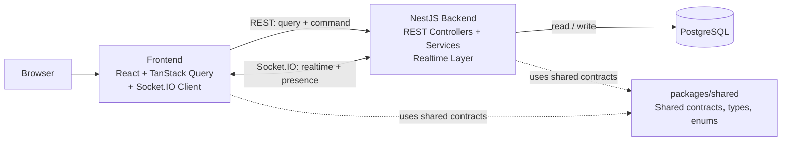

# System Architecture

## 1. Tổng quan hệ thống

Kanvexa là ứng dụng Kanban cộng tác với Personal/team Workspaces, Board discovery, Kanban/Calendar/Table views, Card content, collaboration, productivity và account/privacy settings. Xem [project overview](../project-overview.md) cho inventory sản phẩm hiện có.

Kiến trúc là một modular monolith với PostgreSQL làm nơi lưu trữ persistent business state. Frontend chạy trong trình duyệt, backend cung cấp REST API và realtime layer, còn `packages/shared` chứa các contract hoặc kiểu dữ liệu thực sự dùng chung giữa frontend và backend.

Đây là kiến trúc của ứng dụng đã triển khai, không phải skeleton hoặc đề xuất feature tương lai. [Entities](../../apps/backend/src/api/), [migrations](../../apps/backend/src/database/migrations/) và [frontend routes](../../apps/frontend/src/app/routes.tsx) thể hiện các boundary thực tế; task records giữ lịch sử triển khai của từng phần.

## 2. High-level component architecture



### Frontend

Frontend là ứng dụng React chạy local trong trình duyệt. Frontend chịu trách nhiệm:

- render board, column, card, comment và các trạng thái giao diện;
- nhận thao tác của user và gửi query hoặc business command qua REST;
- quản lý server state và cache bằng TanStack Query;
- sử dụng Socket.IO Client để nhận realtime updates, presence và collaboration events;
- cập nhật hoặc invalidate cache sau khi nhận response REST hoặc realtime event.

Frontend không phải source of truth cho persistent business state. Optimistic UI là cơ chế phản hồi tạm thời; kết quả cuối cùng phải do backend xác nhận. Cache và late responses được scope theo session và Board access để logout hoặc mất quyền không giữ dữ liệu riêng tư.

### Backend

Backend là NestJS modular monolith. Backend chịu trách nhiệm:

- authentication và kiểm tra authorization ở server;
- nhận REST query và command qua controller;
- thực hiện business logic trong service hoặc business module tương ứng;
- đọc và ghi persistent state qua TypeORM và PostgreSQL;
- tạo `Activity` cho các business action phù hợp;
- điều phối realtime layer sau khi business operation đã persist thành công.

Các API area hiện có gồm `auth`, `users`, `workspaces`, `boards`, `board-members`, `columns`, `cards`, `labels`, `comments`, `activities`, `productivity`, `search`, `notifications`, `exports` và `health`. `realtime` là cross-cutting layer, không chứa core business logic. Private storage, mail, reminder/delivery workers và cleanup thuộc backend.

### PostgreSQL

PostgreSQL lưu persistent business state của hệ thống, gồm các domain concept như `User`, `Board`, `BoardMember`, `Column`, `Card`, `CardAssignee`, `Comment` và `Activity`.

Backend là nơi truy cập database và là authority cho các thay đổi nghiệp vụ. TypeORM dùng migrations; `synchronize` được giữ ở trạng thái `false` để schema không bị thay đổi ngầm theo entity.

### `packages/shared`

`packages/shared` chỉ chứa những thành phần thực sự dùng chung giữa frontend và backend, chẳng hạn shared types, contracts, enums và realtime event names.

Package này xuất ESM và CommonJS cho các consumer hiện có; không chứa TypeORM entities, repositories, services, credentials hoặc code chỉ thuộc backend.

### Realtime layer

Realtime layer sử dụng Socket.IO cho:

- broadcast business changes đến các client đang xem cùng board;
- presence và collaboration events;
- quản lý board room theo convention `board:{boardId}`.

Client chỉ được join hoặc listen board room sau khi backend xác nhận user có quyền truy cập board. Realtime layer không thay thế REST, database transaction hoặc authorization ở backend.

## 3. REST request flow

REST được dùng cho initial data loading, query và command/business operation.

```text
User action
    → Frontend
    → REST request
    → Controller
    → Service / business module
    → validate authentication, authorization và business rules
    → TypeORM repository
    → PostgreSQL
    → HTTP response
    → Frontend cập nhật hoặc invalidate cache
```

Ví dụ, khi user di chuyển một `Card`, frontend gửi command đến backend. Backend kiểm tra user có quyền trên `Board`, kiểm tra `Column` đích thuộc đúng board và kiểm tra các business rule khác. Chỉ khi database persist thành công, backend mới trả kết quả thành công và phát realtime event cho các client liên quan.

## 4. Realtime flow

Realtime event được phát sinh từ một business operation đã được xử lý bởi backend, không phải từ một thay đổi chỉ tồn tại ở client.

```text
User action
    → Frontend gửi command qua REST
    → Backend xác thực và kiểm tra authorization
    → Service xử lý business rules
    → PostgreSQL persist thành công
    → Realtime layer broadcast event vào board:{boardId}
    → Các client trong board room nhận event
    → Frontend cập nhật hoặc invalidate cache
    → UI hiển thị state mới
```

Nguyên tắc bắt buộc là persistence before broadcast: backend chỉ broadcast sau khi business operation và transaction cần thiết đã thành công. Socket.IO event chỉ là thông báo để đồng bộ giao diện; PostgreSQL vẫn là source of truth cho persistent business state. Nếu client bị mất event, client có thể dùng REST để tải lại state từ backend.

Presence là trạng thái realtime tạm thời, không phải persistent business data. Presence vẫn phải tuân thủ authentication và board-level authorization.

## 5. Authentication và authorization boundary

- Protected API yêu cầu user đã được authentication.
- Backend luôn enforce authorization; frontend không được tự quyết định quyền truy cập cuối cùng.
- Board membership dùng `OWNER`/`MEMBER`; Workspace membership dùng `ADMIN`/`MEMBER` độc lập.
- Workspace administration không tự cấp quyền vào private Board. Workspace-visible Boards có thể cho Workspace member đủ điều kiện quyền read-only mà không tạo Board membership.
- `BoardAuthorizationService` kiểm tra resource relationships, read/write/owner capabilities và archived/read-only rules; Workspace services kiểm tra membership và policies của Workspace.
- Backend phải xác nhận quyền trước khi client join hoặc listen room `board:{boardId}`.

REST và Socket.IO kiểm tra JWT/authVersion và quyền hiện tại. Credential changes và account deletion cũng revoke receive grants của socket cũ trong backend process hiện tại. Reconnect resync qua REST; hints không phải một durable replay log.

## 6. Development runtime hiện tại

Môi trường development hiện tại gồm:

- **Frontend:** chạy local bằng Vite, mặc định tại `http://localhost:5173`.
- **Backend:** chạy local bằng NestJS, mặc định tại `http://localhost:3000`.
- **PostgreSQL:** chạy trong Docker container và được backend truy cập qua published host port.

Development Compose chỉ chạy PostgreSQL; mặc định localhost port `5433`. Vite và NestJS đọc root `.env`; TypeORM tắt schema synchronization và chỉ chạy migrations qua thao tác tường minh. Xem [Getting started](../../README.md#getting-started) cho lệnh setup.

Production dùng Caddy phục vụ frontend và proxy REST/Socket.IO trên cùng HTTPS origin, NestJS và PostgreSQL trong Docker Compose trên EC2. GitHub Actions delivery có approval, image verification, backend configuration preflight trước downtime, explicit migrations và health checks. [Production](../deployment/production.md) và [CI/CD](../deployment/cicd.md) là hướng dẫn vận hành; sơ đồ trên không thay thế backup/recovery procedures.

## 7. Architectural principles

### Server authoritative

Backend quyết định kết quả cuối cùng của business operation. Frontend không tự trở thành authority cho persistent state.

### Database as source of truth

PostgreSQL là source of truth cho state lưu bền. Cache frontend và realtime event chỉ hỗ trợ hiển thị, truyền tải và đồng bộ state.

### REST + WebSocket hybrid

REST phục vụ initial fetch, query và command. Socket.IO phục vụ realtime updates, presence và collaboration events. Hệ thống không được thiết kế theo hướng socket-only.

### Persistence before broadcast

Business change phải được validate và persist thành công trước khi realtime event được broadcast. Event không thay thế database transaction.

### Modular monolith

Ứng dụng được tổ chức thành các module trong một backend NestJS. Core business logic nằm trong module/service, không nằm trong Socket.IO gateway.

### Tránh premature infrastructure

Chỉ thêm infrastructure mới khi có requirement và workload phù hợp. Room coordination, active session revocation và in-memory rate limiting hiện có boundary của một backend process, không phải distributed infrastructure.

## 8. Những thành phần không có trong kiến trúc hiện tại

Các thành phần sau không thuộc current architecture:

- Redis;
- Kafka;
- microservices;
- CQRS;
- CRDT;
- offline-first architecture.

Đây không phải các dependency cần thêm để chạy ứng dụng. Chúng chỉ được xem xét khi có requirement và đánh giá kiến trúc riêng.

## 9. Storage, workers và scaling

Phân biệt các extension đã có với hạ tầng scaling chỉ được xem xét khi có yêu cầu:

- **Redis Socket.IO adapter:** có thể xem xét khi backend chạy nhiều instance và cần chia sẻ realtime room giữa các instance.
- **Object storage đã có:** avatars và private Card files dùng storage drivers, với private S3 cho production khi được cấu hình. Memory drivers phục vụ development/tests, không phải production persistence.
- **Background processing đã có:** backend xử lý reminder/delivery và cleanup với durable database state. Distributed queue infrastructure sẽ là quyết định riêng, không phải điều kiện để các worker hiện có hoạt động.

Mỗi hướng mở rộng cần được chốt bằng requirement riêng, đánh giá về consistency, vận hành và chi phí trước khi triển khai.

## 10. Trạng thái source và assumption

Các module nghiệp vụ và UI hiện có được mô tả trong [project overview](../project-overview.md). Provider-dependent capabilities như S3 uploads, invitation mail, reminder jobs và task email vẫn cần operator configuration/enablement; có code không tự chứng minh cấu hình của một deployment.

[Roadmap gốc](../roadmap/post-mvp.md), [foundation gap analysis](backend-foundation-gap-analysis.md) và [task records](../tasks/README.md) được giữ lại theo ngữ cảnh lịch sử. Chúng không phải inventory tính năng hiện tại hoặc chứng nhận production QA cho một release mới.
