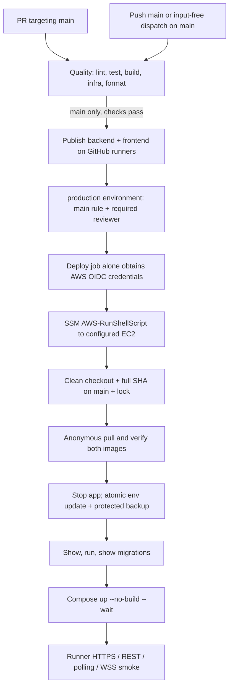

# Production CI/CD — Issue #68

Scope: [issue #68](https://github.com/duongkienvn/SE2026-T13/issues/68).
The application already runs on one `linux/amd64` EC2 at https://kanvexa.tech.
This change adds delivery code; it does not provision AWS or perform a rollout.
Use [production.md](production.md) for topology, secrets, backup/restore and
operator smoke details. No business, schema, Compose topology or Dockerfile changes.

## Events, jobs and approval



PRs and dispatches on branches other than `main` run quality only. There are no
dispatch inputs for a SHA, shell command, host or env path. A main dispatch reruns
all quality checks and publishes its exact event SHA before seeking approval.
`publish` needs successful `quality`; `deploy` needs both and uses
`environment: production`. The reviewer/branch restriction is the existing GitHub
Environment setting, not a protection that YAML can create itself.

Workflow concurrency cancels superseded PR checks only. Main runs do not cancel
an active migration; deploy jobs also share `kanvexa-production` with
`cancel-in-progress: false`. GitHub concurrency can replace a _pending_ run; it is
not a FIFO release queue. Review the SHA actually awaiting approval. A host `flock`
also serializes SSM/manual operations using `/run/lock/kanvexa-deploy.lock`.
Do not click Cancel during migrations. A workflow cancellation or lost runner
does not prove a remote process/container stopped.

## Identity and existing infrastructure

Only the publish job has `packages: write`; it logs into GHCR with the ephemeral
`GITHUB_TOKEN`. Images have full event-SHA tags and OCI source/revision labels:

- `ghcr.io/duongkienvn/kanvexa-backend:<40-character-sha>`
- `ghcr.io/duongkienvn/kanvexa-frontend:<40-character-sha>`

Build context is the exact checkout, target `linux/amd64`, public Vite build arg
`VITE_API_BASE_URL=/api`. No production env enters a build. Build-record artifact
upload is disabled. SHA tag names are a release convention, not registry-enforced
immutability: retain release digests for incident review and restrict package
write access. A rerun can rebuild the same tag against updated base-image patch
tags; avoid republishing releases currently being approved/deployed.

The production Environment already contains:

| Variable          | Consumer                                              |
| ----------------- | ----------------------------------------------------- |
| `AWS_ROLE_ARN`    | `configure-aws-credentials`, short-lived role session |
| `AWS_REGION`      | Credential action / AWS CLI region                    |
| `EC2_INSTANCE_ID` | SSM request, exactly one validated EC2 instance ID    |

Only `deploy` grants `id-token: write`. Keep the existing IAM trust scoped to
GitHub's provider, audience `sts.amazonaws.com` and subject
`repo:duongkienvn/SE2026-T13:environment:production`. Enforce the Environment's
`main` branch rule and required reviewer; environment subjects replace the usual
branch subject. Verify these controls before approving, without sharing tokens.

The role needs `ssm:SendCommand` limited to the AWS-RunShellScript document and
the designated instance ARN, plus `ssm:GetCommandInvocation` (this read action
uses `Resource: "*"` where resource scoping is unsupported). No role permissions
to modify IAM/EC2, no SSH rule and no long-lived AWS/GHCR credentials are added.
The EC2 instance's existing instance profile and SSM Agent provide the managed
node connection; EC2 does not assume the GitHub publisher identity. SSM must run
as root. Outbound access to GitHub, GHCR, SSM and application HTTPS is required.

Host prerequisites: Git/Bash/Python 3/flock, Docker Engine with Compose plugin
supporting `--wait` and `run --pull never`; clean repository at `/opt/kanvexa` with
origin `https://github.com/duongkienvn/SE2026-T13.git`; root-owned 0600 env in a
protected root-owned `/etc/kanvexa`; existing healthy PostgreSQL. The bootstrap
sets Git `safe.directory` for this fixed checkout per command, without editing
global Git configuration. No Node/pnpm installation is required on EC2.

## One-time public GHCR bootstrap

1. After normal PR review/merge, let the main CI run pass quality and publish
   **both** images. Leave the deployment waiting at the production approval gate.
   If packages with these names already exist, verify the repository has Actions
   write access to them; do not add a PAT as a workaround.
2. In the owner's GitHub Packages UI open `kanvexa-backend` and
   `kanvexa-frontend`, each **Package settings → Change visibility → Public**.
   Confirm the linked source repository. A public repository does not make its
   packages public; a first push commonly creates private packages.
3. From a trusted Docker workstation verify both exact tags anonymously using an
   empty Docker config (this does not change the default Docker login):

   ```bash
   set -euo pipefail
   RELEASE_SHA='<full SHA from the successful main run>'
   [[ "$RELEASE_SHA" =~ ^[a-f0-9]{40}$ ]]
   anonymous_config=$(mktemp -d)
   chmod 0700 "$anonymous_config"
   trap 'rmdir "$anonymous_config"' EXIT
   for service in backend frontend; do
     docker --config "$anonymous_config" pull --platform linux/amd64 \
       "ghcr.io/duongkienvn/kanvexa-$service:$RELEASE_SHA"
   done
   ```

4. Review migration code/SQL and schema compatibility with the current release.
   Record the previous release SHA, image digests and protected env backup path.
   Confirm a recent verified off-host DB backup and the maintenance window.
   Where a migration needs a quiesced backup, an authorized operator must stop
   application traffic and take/export that backup using `production.md` **before
   approving**. Backup automation remains outside this issue. The deployment will
   stop the app again idempotently. PostgreSQL is never stopped/recreated by CD.
5. Approve the **production** environment deployment for that SHA. Watch the SSM
   command ID/status, Compose completion and runner smoke in Actions. The first
   approved release automatically verifies anonymous access again on EC2 before
   stopping any running app container or editing env.
6. Run `pnpm smoke:production https://kanvexa.tech` from an operator workstation;
   manually verify login, Board access and two-session realtime behavior. The
   automatic smoke uses no credentials or persistent writes; it verifies SPA,
   readiness, REST 401, polling, CORS rejection and Socket.IO rejection over WSS.
   Authenticated smoke remains an optional operator check using a short-lived
   test-account token in a protected process environment. Never paste a token.

If either image remains private/missing, the approved run **fails before downtime**.
Changing visibility afterward does not resume a failed command; first verify state,
then use an input-free main dispatch/re-run and a new environment approval.

## What the remote command does

1. Acquires the nonblocking host lock, creates a root-only diagnostic log under
   `/var/log/kanvexa` (0700 directory, 0600 log). Only its path and safe completion
   messages go to SSM. The runner requests only status and response code, never
   invocation stdout/stderr. No CloudWatch/S3 output upload is configured.
2. Checks origin, rejects tracked/untracked dirt, fetches `origin/main`, validates
   the full SHA exists and is its ancestor, then checks out that exact SHA detached.
   Checkout may change even if later preflight fails; services/env stay untouched.
   No reset, clean, stash or force deletion repairs a dirty worktree automatically.
3. Runs the committed Python script in isolated mode with a sanitized environment.
   This avoids inherited variables overriding Compose's explicit env file. Checks
   protected env syntax/permissions, Compose config quietly, healthy existing DB
   and absence of a leftover `kanvexa-migrate` container.
4. Uses a temporary empty Docker config to pull both images anonymously even if
   root previously logged in. Checks each local image's OS/architecture and OCI
   source/revision. Any failure leaves the app/env untouched. Cached images alone
   do not qualify: a registry pull must succeed for each tag.
5. Stops only `frontend backend`, backs up the exact original env bytes to a
   unique `/etc/kanvexa/production.env.backup-<new-sha>.*` file, then writes/fsyncs a
   0600 temporary file and atomically replaces env. Only `IMAGE_TAG`,
   `BACKEND_IMAGE`, `FRONTEND_IMAGE` change; other lines remain byte-for-byte.
   Duplicate release keys, multiline/ambiguous dotenv syntax and unsafe permissions
   require operator correction. The file is never sourced or printed. The backup
   contains secrets and needs the same protections/retention as production.env.
6. Runs `migration:show`, explicit `migration:run -d dist/database/data-source.js`,
   then `migration:show` through the existing one-shot `migrate` service. CLI output
   stays in protected host diagnostics. Pending migrations afterward fail delivery.
   The named `kanvexa-migrate` container prevents a blind retry over a leftover
   migration. Automatic migration execution remains disabled at backend startup;
   `synchronize: false` and `migrationsRun: false` stay unchanged.
7. Starts only app services with `up --no-build --pull never --no-deps -d --wait
--wait-timeout 180 backend frontend`. Keeps project `kanvexa`, PostgreSQL and all
   named volumes. Runner smoke executes only after SSM returns Success **and**
   response code zero; smoke failure fails the job with no automatic rollback.

SSM delivery timeout is 60 seconds; document execution timeout is 1800 seconds.
The runner polls every five seconds for up to 1980 seconds, tolerating initial
`InvocationDoesNotExist` eventual consistency and bounded transient API failures.
Each CLI request has a 30-second local bound, with at most three AWS attempts.
The job has a 40-minute bound. AWS timeout/cancellation can leave a Docker-run
migration container alive: inspect it before retrying, even after the host lock
has released. Never infer database state from the workflow conclusion alone.

## Failure handling and manual controls

| Failure                                                       | Expected state / response                                                                                                                               |
| ------------------------------------------------------------- | ------------------------------------------------------------------------------------------------------------------------------------------------------- |
| Quality/build/push fails                                      | No deploy approval/job. A single published image is insufficient. Fix and rerun checks.                                                                 |
| Approval rejected                                             | No AWS role session or SSM command. Existing release continues.                                                                                         |
| OIDC denied / SSM unavailable                                 | Check environment vars, trust subject/audience, region, target and SSM online state. No secrets needed in logs.                                         |
| Dirty checkout / SHA not on main / env invalid / DB unhealthy | Preflight fails; app/env untouched. Operator inspects and resolves deliberately.                                                                        |
| GHCR private/missing/network/platform/labels fail             | No stop/env mutation. Publish/fix public visibility and verify anonymous pulls.                                                                         |
| Env write fails after stop                                    | App stays stopped; env is original or atomically new. Inspect protected backups/state before proceeding.                                                |
| Migration show/run/pending fails                              | No app startup; DB may already have changed. Keep traffic stopped, inspect transaction and migration history; review a forward fix or approved restore. |
| Compose health fails                                          | Some app containers may be running/unhealthy. Inspect actual status; stop app traffic manually if needed. Do not stop PostgreSQL or delete volumes.     |
| HTTPS/REST/WSS smoke fails                                    | New app may be running. Check DNS/TLS/proxy, readiness and transports, then operator decides fix or compatible app rollback.                            |
| API/poll/job timeout or cancellation                          | Remote state unknown. Find the recorded command ID in SSM, inspect protected log and migration container before retry. Never blindly cancel/re-run.     |

For protected diagnostics use an authorized SSM administrator session, become
root and inspect `/var/log/kanvexa/deploy-<sha>.*.log`, `docker compose ... ps` and
`docker ps -a --filter name=kanvexa-migrate`. Migration SQL/error messages may
contain sensitive operational data; do not copy raw logs/env/inspect into Actions,
PRs, screenshots or uploaded artifacts. SSM success reports process completion,
not schema compatibility. Stop and escalate uncertain migration state. Remove a
leftover migration container **only after** verifying it is not running and
database state is understood. No script prunes volumes, calls `down -v`, enables
schema sync or reverts migrations.

Manual dispatch is available in Actions → CI → Run workflow → branch **main**.
It accepts no operator shell inputs and repeats checks/publish/approval. To withhold
a release, reject/leave approval pending. To retry, resolve the failure and check
there is no live SSM/migration operation first. Do not change Environment protections
to bypass approval. Avoid competing manual commands; use the same host lock.

## Controlled application rollback

An image rollback does **not** roll back schema/data. Decide whether the previous
app accepts the current schema; review applied migrations/SQL, verify a backup and
obtain operator authorization. Use a forward fix or deliberate database restore
if incompatible; restore can lose writes since the backup. Never auto-revert
migrations, fake migration history or restore an entire old env over newer secrets.

In an authorized root session, use the same lock. Validate the previous full SHA
on main, checkout cleanliness and both previous images before stopping traffic.
For GHCR releases the same approved deployment script can target the previous
main SHA **only after** the operator has confirmed that running that release's
`migration:show/run` against current migration history is safe. Prefer the following
manual app-only procedure when schema compatibility is established:

1. Acquire `flock -n /run/lock/kanvexa-deploy.lock` in a maintained root shell/file
   descriptor. Keep it held across the entire procedure. Record current state;
   verify no active SSM command or `kanvexa-migrate` container.
2. Fetch main, verify `git merge-base --is-ancestor <previous-full-sha> origin/main`
   and a clean checkout, then checkout that exact SHA. Pull both previous GHCR
   images with an empty Docker config as above and verify platform/source/revision.
3. `dc stop frontend backend` using the explicit project/env/production Compose
   function in `production.md`. Atomically update the three image keys, preserving
   all current secrets. The helper from a reviewed CI/CD checkout can be used from
   a root Python session (`previous_sha` is a validated, operator-selected full SHA):

   ```python
   import runpy
   helper = runpy.run_path('/opt/kanvexa/scripts/deployment/release_env.py')
   backup = helper['update_release']('/etc/kanvexa/production.env', previous_sha)
   # Do not print env contents. Record only the backup path in protected notes.
   ```

   If the previous checkout predates this helper, keep a reviewed copy in a
   root-only temporary directory before checkout. For the pre-GHCR baseline, use
   its retained/verified local images and restore their three exact image keys
   with the same atomic 0600 procedure, not the helper's fixed GHCR image names.
   The secure env backup records the original keys for local operator inspection.

4. Run `dc config --quiet`, then `dc up --no-build --pull never --no-deps -d --wait
--wait-timeout 180 backend frontend`. Do **not** run migration revert. Run HTTPS,
   REST, polling/WSS smoke and operator login/two-session checks. Record the result.

Retain previous images/env backups until the rollback window closes; clean up only
explicitly identified old artifacts under an agreed retention policy. No blanket
Docker or volume prune is part of deployment/recovery.

## Verification and limits

Run `pnpm lint`, `pnpm test`, `pnpm build`, `pnpm test:infra`, `pnpm format:check`.
Infra tests include isolated Python fault injection for env preservation/atomic
replace/0600 policy (POSIX), both pull failures before stop, dirty/non-main checkout,
stale migration/DB failure, migration failure/pending and health failure. Node
tests cover workflow gates, single-target SSM request, actual status waiting,
eventual consistency, terminal failures and unknown-state timeouts.

Build local images and run `pnpm verify:images` / `pnpm test:infra:smoke` only with
the isolated project and random secrets documented in `production.md`. Local HTTP
smoke cannot prove real production TLS, package permissions, AWS trust/SSM access
or the existing environment reviewer settings. Verify those during the controlled
first release; no live deployment is needed to review this change.

Primary references:
[GHCR authentication and public access](https://docs.github.com/en/packages/working-with-a-github-packages-registry/working-with-the-container-registry),
[AWS OIDC environment trust](https://docs.github.com/en/actions/how-tos/secure-your-work/security-harden-deployments/oidc-in-aws),
[SSM invocation status and eventual consistency](https://docs.aws.amazon.com/systems-manager/latest/APIReference/API_GetCommandInvocation.html),
[Run Command timeouts](https://docs.aws.amazon.com/systems-manager/latest/userguide/monitor-commands.html).
