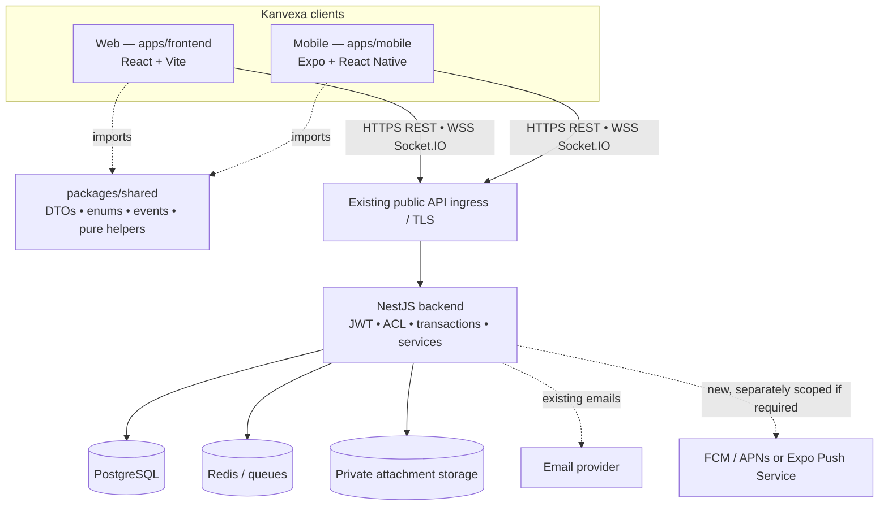
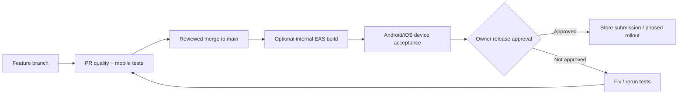

# Kanvexa Mobile — Technical Architecture & API Compatibility Audit

> **File:** `KANVEXA_MOBILE_ARCHITECTURE.md`\
> **Version:** 1.0 — implementation proposal + code-verified API audit\
> **Date:** 2026-11-07 (Asia/Bangkok)\
> **Product:** Kanvexa Mobile for Android and iOS\
> **Repository:** [`duongkienvn/SE2026-T13`](https://github.com/duongkienvn/SE2026-T13)\
> **Design baseline:** [`KANVEXA_MOBILE_DESIGN_SPEC.md`](./KANVEXA_MOBILE_DESIGN_SPEC.md) and its ten approved reference groups\
> **Intended audience:** product owner, mobile developers, backend maintainers, Codex, reviewers and QA\
> **Scope decision:** **One complete mobile application with feature parity to Kanvexa Web. No separate Mobile MVP/Post-MVP.** Engineering phases will only sequence implementation and integration.

---

## 0. Executive decision

**Recommended architecture:** Add **`apps/mobile`** as a **React Native + Expo + TypeScript** application in the existing **pnpm monorepo**, using **Expo Router**, **TanStack Query**, **Socket.IO client**, **Expo SecureStore**, and a **native UI implementation of the approved mockups**. Reuse the existing NestJS API, PostgreSQL, Redis, attachment storage, access-control rules and TypeScript contracts; **do not** create a parallel backend, database or independently synchronized Card model.

**Critical technical decisions:**

1. `apps/frontend` (Web) and `apps/mobile` (native) are separate clients of **the same** `/api` and `/socket.io` server. Keep backend and deployment architecture stable unless a verified capability gap requires an additive contract.
2. **All business data is server-owned**. TanStack Query caches are disposable; mobile may cache only non-sensitive UI preferences without violating session boundaries. No speculative offline writes.
3. Share `@kanban/shared` **types/contracts and pure cross-platform helpers** after an Expo/Metro compatibility spike; **never** import Web's React DOM, browser storage, CSS, or entire hooks into native.
4. **Preserve approved mobile UI** and four tabs: **Home / My Tasks / Boards / Inbox**. Search, Calendar, Card Detail, Settings and Auth live in stacks/sheets as specified by Design Spec.
5. **Security and API reality override illustrative mockup elements.** No fake completed states, imaginary 2FA switch, imaginary push subscription, simulated board updates or new priority field. A missing parity capability becomes an explicit, bounded prerequisite; it does **not** start a separate product roadmap.
6. Build from a version-pinned, Expo-compatible dependency set. This document deliberately does **not** hard-code an Expo/RN release combination or assume all Metro dependencies already resolve.
7. Respect `AGENTS.md`, existing PR workflow, CodeRabbit/Codex review conventions, and the owner-approved UI. **Do not access production, push, create PRs, deploy, migrate, or alter Web UX as part of a planning/setup task without authorization.**

### 0.1 Status terminology

| Mark           | Meaning                                                                                                                                                                             |
| -------------- | ----------------------------------------------------------------------------------------------------------------------------------------------------------------------------------- |
| **R — Reuse**  | A concrete matching backend route/contract is visible in default-branch source; native client/UI still needs implementation and testing.                                            |
| **A — Adapt**  | Backend capability exists, but native transport, device APIs, screen semantics or orchestration require work.                                                                       |
| **G — Gap**    | Requested presentation/feature has no corresponding verified server capability, or the existing API does not express it. Must explicitly resolve before shipping an active control. |
| **V — Verify** | Partially confirmed, behavior/authorization/deployment/limits must be checked at implementation time.                                                                               |

“Route exists in source” **does not** prove it is deployed to production. This is a read-only, file-backed audit, **not** a physical-device test, production request, complete repository crawl, threat-model sign-off or deployment verification. Re-open affected source files on current `main` before coding.

### 0.2 Source-of-truth precedence

1. Security invariants, authoritative backend behavior and verified permissions.
2. The ten **owner-approved visual references** and official Kanvexa K logo.
3. `KANVEXA_MOBILE_DESIGN_SPEC.md` (layout, navigation, states and touch interactions).
4. The **current Web application** for exact business rules and functional parity.
5. This architecture (integration patterns and engineering constraints).
6. Proposed roadmap/issue documents for sequencing; issues may not silently override earlier product decisions.

If these disagree, write a **variance record** with observed source, impact, options and recommended resolution. Get owner approval for product/UI changes.

---

## 1. Baseline: what already exists

The following was checked through the connected GitHub repository on 2026-11-07; the linked paths point to the default branch and may advance afterward.

| Existing part        | Verified anchor                                                                                                                                                                                                                                                                                                    | Architectural consequence                                                                                                                                 |
| -------------------- | ------------------------------------------------------------------------------------------------------------------------------------------------------------------------------------------------------------------------------------------------------------------------------------------------------------------ | --------------------------------------------------------------------------------------------------------------------------------------------------------- |
| pnpm monorepo        | [`package.json`](https://github.com/duongkienvn/SE2026-T13/blob/main/package.json), [`pnpm-workspace.yaml`](https://github.com/duongkienvn/SE2026-T13/blob/main/pnpm-workspace.yaml)                                                                                                                               | Existing workspaces match `apps/*` and `packages/*`; add `apps/mobile` without relocating other applications.                                             |
| Web client           | [`apps/frontend/package.json`](https://github.com/duongkienvn/SE2026-T13/blob/main/apps/frontend/package.json)                                                                                                                                                                                                     | React + Vite + TanStack Query + Socket.IO; patterns are useful, DOM/CSS/browser APIs are not reusable native components.                                  |
| Server               | [`apps/backend/package.json`](https://github.com/duongkienvn/SE2026-T13/blob/main/apps/backend/package.json)                                                                                                                                                                                                       | NestJS modular monolith; keep current REST/Socket.IO and database operations.                                                                             |
| Shared package       | [`packages/shared/package.json`](https://github.com/duongkienvn/SE2026-T13/blob/main/packages/shared/package.json)                                                                                                                                                                                                 | Publishes ESM and CJS through package exports; test Metro resolution and React Native compatibility instead of assuming success.                          |
| JWT Web lifecycle    | [`AuthProvider.tsx`](https://github.com/duongkienvn/SE2026-T13/blob/main/apps/frontend/src/features/auth/AuthProvider.tsx), [`cross-tab-authentication.md`](https://github.com/duongkienvn/SE2026-T13/blob/main/docs/tasks/frontend/cross-tab-authentication.md)                                                   | Web holds fixed-expiry bearer JWT, historically one hour, **no refresh-token flow**; native must not invent refresh tokens.                               |
| Auth and Google      | [`auth.controller.ts`](https://github.com/duongkienvn/SE2026-T13/blob/main/apps/backend/src/api/auth/auth.controller.ts), [`google-auth.controller.ts`](https://github.com/duongkienvn/SE2026-T13/blob/main/apps/backend/src/api/auth/google-auth.controller.ts)                                                   | Existing email/password, verification and **Google ID-token → Kanvexa JWT** exchange can support native after Google client/audience checks.              |
| Search               | [`search.controller.ts`](https://github.com/duongkienvn/SE2026-T13/blob/main/apps/backend/src/api/search/search.controller.ts), [`p4-global-search.md`](https://github.com/duongkienvn/SE2026-T13/blob/main/docs/tasks/backend/p4-global-search.md)                                                                | Grouped Workspace/Board/Card search exists; **server has no `workspaceId` or `boardId` search query filters** today.                                      |
| Home and My Tasks    | [`productivity.controller.ts`](https://github.com/duongkienvn/SE2026-T13/blob/main/apps/backend/src/api/productivity/productivity.controller.ts), [`p4-my-tasks-home-api.md`](https://github.com/duongkienvn/SE2026-T13/blob/main/docs/tasks/backend/p4-my-tasks-home-api.md)                                      | Home summaries and assigned active Cards exist; Tasks groups are **ALL / OVERDUE / NEXT_7_DAYS / LATER / NO_DUE_DATE**, not a Completed group.            |
| Inbox/preferences    | [`notifications.controller.ts`](https://github.com/duongkienvn/SE2026-T13/blob/main/apps/backend/src/api/notifications/notifications.controller.ts), [`notification-preferences.ts`](https://github.com/duongkienvn/SE2026-T13/blob/main/apps/backend/src/api/notifications/notification-preferences.ts)           | In-app inbox/read and bounded notification preferences exist. **No verified mobile device push-token registration/delivery API.**                         |
| Board views          | [`BoardViews.tsx`](https://github.com/duongkienvn/SE2026-T13/blob/main/apps/frontend/src/features/boards/components/BoardViews.tsx), [`CalendarBoard.tsx`](https://github.com/duongkienvn/SE2026-T13/blob/main/apps/frontend/src/features/boards/components/CalendarBoard.tsx)                                     | Web offers Board, Calendar, Table. Current Calendar is largely **due-date/day grouping**, not a timed meeting scheduler.                                  |
| Private attachments  | [`card-attachments.controller.ts`](https://github.com/duongkienvn/SE2026-T13/blob/main/apps/backend/src/api/cards/card-attachments.controller.ts), [`card-attachment-uploads.controller.ts`](https://github.com/duongkienvn/SE2026-T13/blob/main/apps/backend/src/api/cards/card-attachment-uploads.controller.ts) | Existing URL + verified private upload/download protocol; Expo file APIs must preserve authentication, limits, leases and hash/validation expectations.   |
| Data export/deletion | [`exports.controller.ts`](https://github.com/duongkienvn/SE2026-T13/blob/main/apps/backend/src/api/exports/exports.controller.ts), [`account-deletion.controller.ts`](https://github.com/duongkienvn/SE2026-T13/blob/main/apps/backend/src/api/users/account-deletion/account-deletion.controller.ts)              | Account/Board exports and guarded irreversible deletion already exist; native download/share and reauthentication UX are required.                        |
| Existing CI          | [`.github/workflows/ci.yml`](https://github.com/duongkienvn/SE2026-T13/blob/main/.github/workflows/ci.yml)                                                                                                                                                                                                         | PR CI runs root `pnpm lint`, `pnpm test`, `pnpm build`, `pnpm test:infra`, `pnpm format:check`; adding mobile impacts these jobs unless scoped carefully. |

**Important:** Existing production optimizations being completed in [`#233`](https://github.com/duongkienvn/SE2026-T13/issues/233) (API traffic/realtime) and [`#234`](https://github.com/duongkienvn/SE2026-T13/issues/234) (Board loading) must inform mobile fetch/invalidation design. Do not replicate an old all-Cards/sequential-pagination strategy or Web-specific caching problem without measuring and validating current main.

---

## 2. Architecture at a glance



### 2.1 Invariants

- **Identity:** one user account across clients; server JWT subject and verified user determine authority.
- **Data:** same Workspace/Board/Card UUIDs, ordering, assignments, ACL, archives, activity, notifications and time preferences across clients.
- **Realtime:** server events signal updates; authoritative REST remains the source for refreshed state.
- **Files:** server-authorized private storage; never ship permanent private-storage keys into the client.
- **Permissions:** each REST endpoint guards itself; UI role checks are only presentation, not security enforcement.
- **Production isolation:** mobile builds and store releases are independent of Web deploy approvals. Native onboarding must not disturb production CI/CD or DB by default.

### 2.2 Recommended directory layout

```text
SE2026-T13/
├── apps/
│   ├── backend/                    # existing NestJS — unchanged ownership
│   ├── frontend/                   # existing Web — unchanged UX
│   └── mobile/                     # NEW native client
│       ├── app.config.ts           # EAS/env, scheme, bundles, plugins
│       ├── eas.json
│       ├── package.json
│       ├── tsconfig.json
│       ├── assets/
│       │   └── brand/             # exact owner-approved Kanvexa logo
│       ├── src/
│       │   ├── app/               # Expo Router file routes
│       │   ├── components/        # native design-system primitives
│       │   ├── features/
│       │   │   ├── auth/          # screens, session coordinator, API
│       │   │   ├── home/
│       │   │   ├── workspaces/
│       │   │   ├── boards/
│       │   │   ├── columns/
│       │   │   ├── cards/
│       │   │   ├── checklists/
│       │   │   ├── comments/
│       │   │   ├── attachments/
│       │   │   ├── labels/
│       │   │   ├── activity/
│       │   │   ├── tasks/
│       │   │   ├── notifications/
│       │   │   ├── search/
│       │   │   ├── calendar/
│       │   │   └── settings/
│       │   ├── infrastructure/
│       │   │   ├── api/           # REST transport/errors, binary
│       │   │   ├── auth/          # SecureStore/token/session-generation
│       │   │   ├── realtime/      # socket coordinator/subscriptions
│       │   │   ├── query/         # query client, keys, invalidation
│       │   │   ├── linking/       # URL/deep-link mapping
│       │   │   ├── files/         # device picker, upload, downloads
│       │   │   ├── network/       # AppState/reachability
│       │   │   └── notifications/  # device permissions/tokens if enabled
│       │   ├── theme/            # approved design tokens
│       │   └── testing/          # factories, native mocks, fixtures
│       └── test/
├── packages/
│   └── shared/                     # existing platform-neutral contracts
├── docs/
│   └── mobile/                     # design + architecture + future roadmap
└── pnpm-workspace.yaml             # already matches apps/*
```

Do not create separate `mobile-backend`, `mobile-db`, `mobile-shared` duplicates unless a specific future library boundary is justified. Existing `@kanban/shared` package has `dist/esm`, `dist/cjs`; introduce a React Native export condition **only if tested need is demonstrated** and backward compatibility preserved.

---

## 3. Technology decision register

| Concern                 | Decision                                                                              | Evidence/constraints                                                                                      |
| ----------------------- | ------------------------------------------------------------------------------------- | --------------------------------------------------------------------------------------------------------- |
| Native runtime          | **Expo-managed/CNG React Native + TypeScript**, stable compatible SDK pinned at setup | Expo documents pnpm monorepo/automatic Metro configuration; test actual Node/RN versions.                 |
| Navigation              | **Expo Router**, stacks, 4-tab shell, bottom sheets                                   | Supports protected client navigation and deep links; API still authorizes every request.                  |
| Design                  | React Native primitives, approved tokens, optional small styling layer                | Do not port Tailwind Web CSS; use **one** native styling approach; NativeWind optional, not mandatory.    |
| Data fetching           | **TanStack Query v5**                                                                 | Strong fit with existing Web patterns; separate mobile client/cache and native focus/reconnect handling.  |
| Local ephemeral UI      | React state / small typed context or state store where justified                      | No broad global store duplicating server-owned data.                                                      |
| Realtime                | **socket.io-client** compatible major with existing backend                           | Short-lived foreground connection; REST reconciliation on reconnect.                                      |
| Credentials             | **expo-secure-store**                                                                 | Store access JWT and expiry only; treat iOS keychain persistence, Android uninstall and errors correctly. |
| Lightweight preferences | Existing `/users/me/preferences` + native appearance APIs                             | Date/time zone, theme and week start derive from server.                                                  |
| Files                   | Expo file/document/image picker + backend attachment protocol                         | Explicit MIME/size/checksum constraints, memory-safe downloads and no public exposure.                    |
| Animation/gesture       | React Native Gesture Handler / Reanimated **if tested compatible**                    | Preserve accessibility and performance; no “animate everything”.                                          |
| Lists                   | FlatList/SectionList; virtualized alternative only when measured                      | Dense Boards, cards and Inbox must not render unbounded data.                                             |
| Tests                   | Unit/components + authenticated mocked API + real backend integration + device E2E    | Validate permission, forms, navigation, realtime and native file/UI flows.                                |
| Builds                  | **EAS Build** development/preview/production profiles                                 | Store build signing, native config and App Store/Play Store submission independent from Web deployment.   |
| Updates                 | Versioned native release; optional EAS Update with runtime compatibility              | No JS OTA rollout outside compatible native runtime; explicit rollback policy.                            |

**Dependency gate:** At setup, compare current stable Expo SDK, React Native/React versions, Node requirements, Metro support, pnpm linker mode, Socket.IO, native modules and Windows toolchains. Pin a verified matrix in `apps/mobile/package.json`; no made-up exact versions in this planning document.

**Official external references:**

- Expo monorepos: <https://docs.expo.dev/guides/monorepos/>
- Expo Router protected navigation: <https://docs.expo.dev/router/advanced/protected/>
- Expo SecureStore: <https://docs.expo.dev/versions/latest/sdk/securestore/>
- Native Google integration: <https://docs.expo.dev/guides/google-authentication/>
- Expo Push: <https://docs.expo.dev/push-notifications/push-notifications-setup/>
- EAS Build: <https://docs.expo.dev/build/introduction/>

---

## 4. Navigation and screen topology

The approved shell has **exactly four tabs**. Any calendar/table/search shortcut belongs to a stack or an existing Board's view switcher. Navigation adapts to native safe areas, screen size and Android back button.

```text
root
├── (public)
│   ├── sign-in
│   ├── sign-up
│   ├── forgot-password
│   ├── reset-password / verify-email callback
│   └── check-email
├── (authenticated)
│   ├── (tabs)
│   │   ├── home
│   │   ├── my-tasks
│   │   ├── boards
│   │   └── inbox
│   ├── workspaces/[workspaceId]
│   │   ├── overview / boards / members / invitations / activity
│   │   └── settings / policies / guests
│   ├── boards/[boardId]
│   │   ├── index                       # Kanban
│   │   ├── calendar                    # Board-filtered view
│   │   ├── table                       # Functional parity even if not in 10 hero images
│   │   ├── members / activity / settings / labels / archive
│   │   └── cards/[cardId]              # Card detail deep link
│   ├── search
│   ├── calendar                        # Entry if supported by design/API semantics
│   ├── notifications/preferences
│   ├── settings
│   │   ├── profile / appearance / preferences / security
│   │   ├── notifications / connected-accounts
│   │   └── data-privacy
│   └── invitation / external-link-resolver
└── unavailable / no-access / not-found
```

This is a **conceptual route inventory**. Exact Expo Router filenames and route nesting must be derived from current Expo version; do not copy this directory diagram blindly.

**Navigation rules:**

- Root router hydrates secure session, checks expiry, obtains `/users/me` as appropriate, then reveals authenticated tree. Avoid flashes of other users' cached content.
- Tab switching preserves expected state and scroll position only while the same user and permissions remain valid.
- Opening Card from Board/Tasks/Search/Inbox routes through the same `boardId/cardId` destination; a refresh or universal link checks authorization again.
- Native share should prefer canonical `https://kanvexa.tech/...` URLs where supported; app/universal links must be verified via asset links/association files and proper domain configuration. Custom `kanvexa://` scheme can serve internal tests but is not a substitute for trusted HTTPS universal links.
- Pending deep link before login is held as **untrusted destination data**, validated and revisited after authentication; never bypass ownership checks.
- When a Board/Card becomes inaccessible, replace sensitive views with explicit access-denied/unavailable state, clear protected caches and return safely to Boards.
- Sheets support swipe dismissal, explicit close, keyboard escape/back, safe areas and accessible focus semantics.
- Preserve multi-step draft forms with explicit discard confirmation.

---

## 5. Networking, typed API client and caches

### 5.1 Transport boundary

Implement **one mobile API adapter** (conceptually `infrastructure/api/client.ts`) with:

- Environment-based **HTTPS base URL** for staging/production. Local dev may use local LAN host or Android emulator networking explicitly; no assumption that emulator `localhost` is a Windows host.
- Bearer auth on authorized calls, and session generation check **before sending and after receiving** a response.
- Abort/cancel support on route unmount, logout, access revoke and superseded search.
- Parse REST success envelope and normalized safe error envelope. Do not treat an empty HTTP body or malformed JSON as successful mutation; support legitimate `204` no-content correctly. Match Web reliability fix behavior on current `main`.
- Dedicated **binary response** handling for file export/download; these are _not_ REST success-envelope JSON.
- Distinguish 400 validation, 401 unauthorized/expired, 403 forbidden, 404 access-safe not found, 409 revision/archive conflicts, 413 limits, 429 throttling, 503 temporarily unavailable, timeouts/offline and unexpected server faults.
- Never log credentials, proof tokens, email recovery links, private file URLs, raw sensitive request bodies or attachments.
- Retries: conservative for idempotent reads with bounded backoff; **no automatic non-idempotent POST/PATCH/DELETE retry**, except server-supported idempotency contracts with explicit keys and verified behavior.

### 5.2 Query key and invalidation design

Suggested hierarchy:

```ts
['mobile', userId, sessionGeneration, 'home'][
  ('mobile', userId, sessionGeneration, 'tasks', normalizedFilters)
][('mobile', userId, sessionGeneration, 'workspaces', scope)][
  ('mobile', userId, sessionGeneration, 'boards', workspaceId, filters)
][('mobile', userId, sessionGeneration, 'board', boardId, 'columns')][
  ('mobile', userId, sessionGeneration, 'board', boardId, 'cards', query)
][('mobile', userId, sessionGeneration, 'card', boardId, cardId)][
  ('mobile', userId, sessionGeneration, 'notifications', 'unreadCount')
][('mobile', userId, sessionGeneration, 'notifications', filter, page)][
  ('mobile', userId, sessionGeneration, 'search', query, type, page)
];
```

- Scope every private query by user/session and resource ID. Destroy protected data synchronously on session change; don't carry it into another account.
- Use `staleTime`/focus policies based on sensitivity; don't globally refetch the whole app on every icon tap or one mutation.
- Target invalidations to affected resources. Reuse learned fixes from PERF-01 and PERF-02; socket and local mutation must not create repeated full-Board fetches.
- UI may optimistically move/check Card with rollback and server confirmation **only after** tests prove conflict/order semantics. If unsure, update after response.
- Pagination uses server metadata. Avoid eager `fetchAllPages` for every large Board. Preserve exact column ordering and complete Calendar/Table records; if API cannot support efficient view-specific loading, document a focused server contract change instead of silently dropping Cards.
- On 401, logout only the matching session generation; older in-flight responses cannot terminate a newly logged-in user.

### 5.3 App foreground/background/offline

| Event                        | Expected behavior                                                                                                                                    |
| ---------------------------- | ---------------------------------------------------------------------------------------------------------------------------------------------------- |
| Foreground and authenticated | Establish/re-establish socket as needed; refresh focused stale high-value queries.                                                                   |
| App backgrounds              | **Disconnect or suspend application-managed Socket.IO**; do not assume continuous background WebSocket delivery.                                     |
| App resumes                  | Validate token expiry/session generation, reconnect if eligible, refresh authoritative resources, apply missing notifications through REST.          |
| Network offline              | Show honest offline status; display already authorized in-memory data only with careful privacy boundaries.                                          |
| Expired JWT while offline    | Do not keep presenting protected work as if the account is still authenticated; clear protected data and direct to sign in when expiration is known. |
| Mutation attempted offline   | Explicitly block/report retry instead of queuing destructive edits without conflict semantics.                                                       |
| Membership removed remotely  | Clear Board/Workspace-related protected state and disable edits; refetch access snapshot.                                                            |

**Offline is read-only/transient resilience, not a new offline-first data engine.** Future durable offline editing would require a distinct conflict protocol, encryption/storage decision and backend work; it must not creep into initial mobile parity unnoticed.

---

## 6. Authentication & account security

### 6.1 Verified current contract

Source: [`auth.controller.ts`](https://github.com/duongkienvn/SE2026-T13/blob/main/apps/backend/src/api/auth/auth.controller.ts), [`password-security.controller.ts`](https://github.com/duongkienvn/SE2026-T13/blob/main/apps/backend/src/api/auth/password-security.controller.ts), [`google-auth.controller.ts`](https://github.com/duongkienvn/SE2026-T13/blob/main/apps/backend/src/api/auth/google-auth.controller.ts), [`AuthProvider.tsx`](https://github.com/duongkienvn/SE2026-T13/blob/main/apps/frontend/src/features/auth/AuthProvider.tsx).

| Operation                               | Route                                                                  | Status                                          |
| --------------------------------------- | ---------------------------------------------------------------------- | ----------------------------------------------- |
| Register                                | `POST /api/auth/register`                                              | R                                               |
| Login                                   | `POST /api/auth/login`                                                 | R                                               |
| Email verification                      | `POST /api/auth/verify-email`                                          | A: native link handling                         |
| Resend verification                     | `POST /api/auth/resend-verification`                                   | R                                               |
| Forgot/reset password                   | `POST /api/auth/forgot-password`, `POST /api/auth/reset-password`      | A: callback/deep-link routing                   |
| Change password                         | `POST /api/auth/change-password`                                       | R; server invalidation behavior applies         |
| Google authentication                   | `POST /api/auth/google` accepts Google ID token credential             | **A: native OAuth and audience validation**     |
| Google linking / linked status          | `POST /api/auth/google/link`, `GET /api/auth/linked-providers`         | A                                               |
| Logout                                  | `POST /api/auth/logout`                                                | R; never assume refresh-token revocation exists |
| Current user                            | `GET /api/users/me`                                                    | R                                               |
| Automatic JWT renewal                   | **No verified refresh-token API; Web has fixed-lifetime access token** | **G**                                           |
| List/manage independent device sessions | No verified session-registry endpoints                                 | **G**                                           |
| Enable/disable 2FA                      | No verified server 2FA setup/verification API                          | **G**                                           |

### 6.2 Session model — approved engineering recommendation

1. Successful login returns Kanvexa access token and expiry. Store a **small credential record** through `expo-secure-store` (token, absolute expiry, version if needed); not `AsyncStorage`, MMKV plaintext, Query persistence or Expo config.
2. In-memory session manager keeps an increasing `generation` and verified user identity. On login/logout/account switch, synchronously disconnect sockets, cancel network, clear all private caches, invalidate pending work and then publish next session.
3. On cold app launch: read SecureStore; discard invalid/malformed/expired record; if still valid, perform `/users/me` validation before showing protected content; handle network errors separately from 401.
4. Access JWT is **not refreshed** unless backend introduces an approved rotation/refresh contract. Expect reauthentication at expiry and make expiry UX predictable (do not unexpectedly discard an unsent draft without a warning when feasible).
5. Android SecureStore data disappears on app uninstall; iOS Keychain may survive uninstall/reinstall. **Always revalidate credentials** and treat a fresh installation as sensitive; evaluate explicit cleanup/app-install marker instead of relying on uninstall semantics.
6. Use HTTPS only in staging/production. Native credentials are never placed in URLs, push payloads, debug logs, analytics or screenshots.
7. For sign-out and password/email/account-security changes, follow current backend auth-version and socket revocation semantics; never claim cross-device session management exists without a verified server registry.

**Important product decision:** Fixed one-hour login may feel poor on mobile, but do **not** add a frontend-only “refresh” button that exchanges nothing. If seamless long-lived sessions are required for a finished mobile UX, propose a **security-reviewed additive backend refresh-token/rotation design** as an explicit prerequisite (persistent hashed token or session registry, revocation, expiry, theft detection, migration, audit/tests and impact on Web). Until such a contract exists, implement honest fixed-expiry login with graceful reauthentication.

### 6.3 Google native sign-in

- Web GIS button/iframe and popup **cannot be reused directly** on Android/iOS.
- Use an Expo-compatible native Google authentication library or secure browser/OIDC flow; use separate Android/iOS OAuth client configuration as required.
- Return a **Google ID token** to the existing `POST /api/auth/google` only after verifying the backend accepts the chosen native client audience. Backend must perform issuer/audience/expiry/signature checks; never substitute a Google access token or trust the mobile result blindly.
- For linking, honor existing password reauthentication requirements. Test account-link collisions, unverified email, cancellation and compromised link recovery.
- Do not use an embedded password WebView or expose client secrets in the app binary.

### 6.4 Email links and privacy-sensitive navigation

- Evaluate canonical Web verification/reset links and their domain scheme. Support secure app/universal link → token extraction → post to existing backend endpoint, or use an authenticated external-browser fallback if no native association is deployed.
- Never store link proof tokens in navigation history/persistent analytics; clear after use.
- Unknown/deleted/expired links get explicit actionable error; anti-enumeration responses retain server wording.

---

## 7. Realtime, collaboration and access control

### 7.1 Socket lifecycle

Existing socket client illustrates `io(serverOrigin, { path: '/socket.io', autoConnect: false, auth: async token callback })` in [`socket-client.ts`](https://github.com/duongkienvn/SE2026-T13/blob/main/apps/frontend/src/features/realtime/socket-client.ts).

**Native implementation contract:**

1. Use same backend origin/socket path and current access token in handshake; Web's `window.location.origin` helper is not valid native code.
2. Open socket when session is verified and app foregrounds; join Board-specific subscriptions only while authorized and relevant.
3. Treat emitted events as **invalidation hints**, never as permission grants or proof that a local optimistic mutation committed.
4. On reconnect, refetch Board/Column/Card snapshots and notifications as needed. Presence is ephemeral: show currently connected participants only when authoritative live presence confirms them.
5. On access/auth change, perform immediate local cache cleanup and socket teardown where relevant; reconnecting must re-check permissions.
6. Avoid `isMutating() > 0` global lock patterns; restrict serialization to overlapping resources and ensure unrelated Board work is not blocked.
7. Deduplicate equivalent local-mutation/socket refetch triggers without losing other-tab/other-device updates.
8. Instrument actual REST request counts and bytes for 0/100/101/250+ Card Boards before deciding pagination or virtualization strategy.

### 7.2 Permissions matrix (presentation; enforcement remains server-side)

| Context                     | UI behavior                                                                                      |
| --------------------------- | ------------------------------------------------------------------------------------------------ |
| Board OWNER                 | Show supported management actions including owner-only export where applicable.                  |
| Board MEMBER                | Show permitted edits, omit/disable owner-only operations.                                        |
| Workspace ADMIN/MEMBER      | Do **not** infer automatic access to PRIVATE Boards; follow current ACL/policies.                |
| Guest/board-specific access | Show only resources explicitly granted; don't expose workspace rosters beyond policy.            |
| Archived Board/Card         | Clearly show read-only/archived state; allow restore only when exact server policy permits.      |
| Revoked/missing resource    | Access-safe unavailable state; do not reveal existence or private details through cached titles. |

Explicitly test Board/Workspace invitations, archive/restore, cross-workspace moves, membership revocation, simultaneous editing, role downgrade, notification link after access loss, and session expiry.

---

## 8. File uploads, downloads and export

### 8.1 Private attachment upload

The existing protocol is an owned **upload intent → upload bytes → complete/verify** pipeline, not a naive public S3 upload. Use [`card-attachment-uploads.controller.ts`](https://github.com/duongkienvn/SE2026-T13/blob/main/apps/backend/src/api/cards/card-attachment-uploads.controller.ts) as authoritative implementation source.

- Respect existing limits: **10 MiB/file, 20 slots/Card, 100 MiB/Board** (as documented in controller), MIME constraints, hash/size and checksum/verification rules.
- Use device picker and native file reader; avoid converting large files into base64 strings in React state.
- Preserve idempotency key when retrying an upload intent; never create duplicate attachments after uncertain network outcomes.
- Treat short-lived upload grants/leases as short-lived. Failed complete/upload must offer safe retry or cancel and not show an ACTIVE attachment prematurely.
- For private download, call the authorized server endpoint with JWT and stream bytes to an app-controlled temporary file. No public object URL, permanent presigned access or guessed direct bucket path.
- Clear temporary private files on logout/account change and lifecycle boundaries where feasible; use native share sheet with user consent and correct permissions.
- Feature parity includes **HTTPS URL attachments**, private files, editing metadata and delete actions within current ACL.

### 8.2 Data exports

Verified [`exports.controller.ts`](https://github.com/duongkienvn/SE2026-T13/blob/main/apps/backend/src/api/exports/exports.controller.ts):

- `GET /api/boards/:boardId/export?format=json|csv`: **explicit Board OWNER-only**; active/archived when authorized; max **10,000 Cards / 20 MiB**, no silent truncation.
- `GET /api/users/me/export`: account metadata in JSON (max **20 MiB**). **Not** a complete independent export of every Board file byte; those require separate authorized download.
- Both return **attachment bytes, not `{success,data}` JSON**. Use native file writing + share/save sheet; filename from trusted server-controlled metadata or deterministic safe fallback, sanitize output location and never save an error response as a document.
- Revalidate user/session after long export. Show 403, 404, 413 and 503 correctly. No background export job or new storage queue should be assumed.

---

## 9. API compatibility matrix — approved screen groups

**Legend:** R = reusable backend, A = native adaptation, G = server gap, V = verify exact implementation. All routes below include `/api` and require current server authorization except public auth routes. Routes with `:id` mean actual typed IDs.

### 9.1 01 — Home Dashboard

| UI function                 | Current source/endpoint                                      | Assessment | Native action                                                                     |
| --------------------------- | ------------------------------------------------------------ | ---------- | --------------------------------------------------------------------------------- |
| Personalized summary counts | `GET /api/users/me/home`                                     | R          | Render server `summary` fields; no locally invented count.                        |
| Up Next                     | `GET /api/users/me/home`                                     | R          | Use server at-most-six list and canonical Card destination.                       |
| Starred/recent Boards       | `GET /api/users/me/home`                                     | R          | Show actual server references and preview state; don't count inaccessible Boards. |
| Tap task/Board              | `/boards/:boardId/cards/:cardId`, `GET /api/boards/:boardId` | A          | Route to native stack, re-check access.                                           |
| Greeting                    | User profile/local clock                                     | A          | Timezone-aware; no API for motivational banner required.                          |

### 9.2 02 — Boards & Workspace switcher

| UI function                            | Current source/endpoint                                                            | Assessment | Native action                                                                |
| -------------------------------------- | ---------------------------------------------------------------------------------- | ---------- | ---------------------------------------------------------------------------- |
| List/switch Workspaces                 | `GET /api/workspaces`; `GET /api/workspaces/personal`                              | R          | Personal/team labels and permission-aware selector.                          |
| Workspace details, Board lists         | `GET /api/workspaces/:workspaceId`, `GET /api/workspaces/:workspaceId/boards`      | R          | Paginate/empty states based on real response.                                |
| Create/edit Workspace                  | `POST /api/workspaces`, `PATCH /api/workspaces/:workspaceId`                       | R          | Role-gated native form.                                                      |
| Workspace members/invitations/activity | `/api/workspaces/:id/members`, `/invitations`, `/activity`, `/guests`, `/policies` | R/V        | Check each role and invitation proof/cancel semantics.                       |
| Create/list/update Board               | `POST/GET /api/boards`, `PATCH /api/boards/:boardId`                               | R          | Keep Workspace and visibility defaults from server.                          |
| Star Board and background              | `/api/boards/:boardId/star`, `/background`, `/background-presets`                  | R          | Native star/preset picker, real user state.                                  |
| Archive/restore Board                  | `POST /api/boards/:boardId/archive`, `/restore`                                    | R          | Preserve existing data and safety warnings.                                  |
| Workspace move/visibility              | `/api/boards/:boardId/move-workspace`, `PATCH /api/boards/:boardId/visibility`     | R/V        | Only enable per capabilities and policy.                                     |
| Remove starter/sample Board            | `/api/boards/:boardId/sample-removal`                                              | R/V        | Verify special safeguards and confirmation; do not expose as generic delete. |

### 9.3 03 — Board Detail / Kanban / Table

| UI function                                   | Current source/endpoint                                                       | Assessment | Native action                                                                                           |
| --------------------------------------------- | ----------------------------------------------------------------------------- | ---------- | ------------------------------------------------------------------------------------------------------- |
| Board/header/permissions                      | `GET /api/boards/:boardId`, policy capability endpoint                        | R          | Show live status, membership and read-only state.                                                       |
| Columns list/create/edit/reorder/delete       | `GET/POST/PATCH/DELETE /api/boards/:boardId/columns`, `PATCH /:columnId/move` | R          | Horizontal column pager, accessible move controls.                                                      |
| Cards list/detail/create/edit/archive/restore | `/api/boards/:boardId/cards` and `/:cardId`                                   | R          | Order-preserving list and UI states.                                                                    |
| Move/reorder card                             | `PATCH /api/boards/:boardId/cards/:cardId/move`                               | R/A        | Touch-safe drag **or equivalent native move sheet**; same backend ordering.                             |
| Duplicate Card                                | `POST /api/boards/:boardId/cards/:cardId/duplicate`                           | R          | Scope copied fields per server contract.                                                                |
| Labels and preview summaries                  | `/api/boards/:boardId/labels`, `/card-preview-summaries`, Card labels routes  | R          | Avoid per-card N+1 metadata fetches.                                                                    |
| Board filter/search                           | Current Board filter query contracts                                          | R/V        | Validate supported query params; do not reuse unsupported Web-only URL assumptions.                     |
| Table View                                    | Current Web TableView consumes Card backend                                   | A          | Native dense/scrollable table presentation, selection/access parity; mockup not a reason to omit Table. |
| Board options/activity/archived               | Board activity, archives and Board service endpoints                          | R/V        | Match permissions, menus and latest Web.                                                                |

**Board loading warning:** Current Web full-Board Card retrieval has been identified as a performance risk. Before mobile optimization, check #233/#234 merged behavior and test large Board consistency. A multi-page offset load under concurrent edits can duplicate/miss rows; don't naïvely parallelize and claim a consistent snapshot.

### 9.4 04 — Card Detail

| UI function                      | Current source/endpoint                                                | Assessment | Native action                                                                               |
| -------------------------------- | ---------------------------------------------------------------------- | ---------- | ------------------------------------------------------------------------------------------- |
| Card read/edit/date fields       | `GET/PATCH /api/boards/:boardId/cards/:cardId`                         | R          | Full-screen scrolling detail; save/cancel/draft guard.                                      |
| Assignees                        | `POST /api/boards/:boardId/cards/:cardId/assignees`, `DELETE /:userId` | R          | Member picker, ACL checks.                                                                  |
| Labels                           | `/api/boards/:boardId/cards/:cardId/labels` + Board label catalog      | R          | Real color/name; no separate Priority field.                                                |
| Checklist/items/progress/reorder | `/api/boards/:boardId/cards/:cardId/checklists` + nested item routes   | R          | Optimistic toggle only with rollback and revision validation.                               |
| Comments/mentions/edit/delete    | `/api/boards/:boardId/cards/:cardId/comments`                          | R/V        | Native rich mention composer must respect UTF-16 spans and recipient validity.              |
| URL/file attachments             | Card attachments and upload endpoints                                  | A          | Native picker, secure view/download and owned leases.                                       |
| Card activity                    | Board activities and Card detail stream/filters as provided            | V          | Match available audit granularity; don't promise per-Card event endpoint without verifying. |
| Duplicate/archive/restore        | Card-specific endpoints                                                | R          | Role-gated, read-only archived state.                                                       |
| Date rendering                   | ISO instants with offset → UTC, user timezone                          | R/A        | Never silently convert date-only values to a different API contract.                        |

### 9.5 05 — My Tasks

| UI function                        | Current source/endpoint                                             | Assessment | Native action                                                                                                                               |
| ---------------------------------- | ------------------------------------------------------------------- | ---------- | ------------------------------------------------------------------------------------------------------------------------------------------- |
| Cross-Board assigned task list     | `GET /api/users/me/tasks`                                           | R          | Server pagination; no full local Board aggregation.                                                                                         |
| Groups and counts                  | `group=ALL                                                          | OVERDUE    | NEXT_7_DAYS                                                                                                                                 | LATER | NO_DUE_DATE`; `groupCounts`          | R   | Map display “Due soon” to next-seven-days semantics **only when copy makes that clear**. |
| Workspace/Board/label/date filters | Documented `workspaceId`, `boardId`, `labelIds`, `dueFrom`, `dueTo` | R          | Fetch filtered authoritative data.                                                                                                          |
| Sort                               | `dueDate                                                            | updatedAt  | board`                                                                                                                                      | R     | Preserve server deterministic order. |
| Completed tab/filter (in mockup)   | Endpoint only returns **active assigned Cards**, no Completed group | **G**      | Do not fabricate Completed. Clarify explicit parity requirement; if needed, write new server contract or adjust mockup with owner approval. |
| Group by Board display             | API supports `sort=board`, returns `boardName`                      | A          | Client section headings only over _currently loaded authorized rows_, not pretend global Board aggregates.                                  |
| Tap task                           | `permalink` + Board/Card ID in response                             | R          | Convert to native Card route; new permission check.                                                                                         |

### 9.6 06 — Inbox & Notification Preferences

| UI function                                         | Current source/endpoint                                                             | Assessment               | Native action                                                                         |
| --------------------------------------------------- | ----------------------------------------------------------------------------------- | ------------------------ | ------------------------------------------------------------------------------------- |
| List All/Unread                                     | `GET /api/notifications?filter=all                                                  | unread&page=N&limit=...` | R                                                                                     | Paginated grouping by day; unread styling. |
| Unread count                                        | `GET /api/notifications/unread-count`                                               | R                        | Use server count, not loaded-page length.                                             |
| Mark one/read all                                   | `PATCH /api/notifications/:notificationId/read`, `POST /api/notifications/read-all` | R                        | Optimistic readAt only if safe; refetch.                                              |
| Preferences in-app/email                            | `GET/PATCH /api/users/me/notification-preferences`                                  | R                        | Render **6 in-app + 3 email** leaves; account/security mail isn't optional.           |
| Push toggle, device tokens                          | No verified device-token registry or push dispatch                                  | **G**                    | Add scoped backend/device management only if actually shipping push; no inert toggle. |
| Quiet hours                                         | No verified preference or scheduled push behavior                                   | **G**                    | Needs backend policy/timezone or explicit removal with owner approval.                |
| “Comments” or “Board activity” general push toggles | Not matching current typed preference leaf list                                     | **G/V**                  | Avoid inventing broader notification kinds.                                           |
| Background alert while app suspended                | Socket.IO alone insufficient                                                        | **G**                    | Requires FCM/APNs push path and notifications permission.                             |

**Currently verified preference kinds:** `cardAssigned`, `commentMentioned`, `workspaceInvited`, `boardInvited`, `membershipChanged`, `dueReminder` (in-app); `cardAssigned`, `commentMentioned`, `dueReminder` (email). Some reserved kinds may not currently be emitted. Confirm server feature flags for optional email dispatch.

### 9.7 07 — Global Search

| UI function                         | Current source/endpoint                                                | Assessment | Native action                                                                                                                                               |
| ----------------------------------- | ---------------------------------------------------------------------- | ---------- | ----------------------------------------------------------------------------------------------------------------------------------------------------------- |
| Grouped results                     | `GET /api/search?q=...&type=all&limit=1..10`                           | R          | Groups of Workspaces/Boards/Cards; no external search service.                                                                                              |
| Type-specific pagination            | `type=workspaces                                                       | boards     | cards&page=N&limit=1..50`                                                                                                                                   | R   | Only specific-type mode supports `page`. |
| Search query                        | Literal case-insensitive substring, `q` max 120 Unicode code points    | R          | Debounce, trim, encode with `URLSearchParams`, cancel superseded calls.                                                                                     |
| Search Workspace/Board filter sheet | **No `workspaceId` or `boardId` query support**, unknown keys rejected | **G**      | Do not silently filter a truncated page and call result exhaustive. Either design adjustment or **additive ACL-safe API filter** with owner-approved scope. |
| Recent searches                     | No backend per-user recent-query API                                   | A          | Optional on-device, short-lived, non-sensitive; clear on logout. Query text may be sensitive; avoid persistent history by default.                          |
| Tap result                          | Server `path` / ID; target route ACL validated                         | R/A        | Normalize only internal known destinations.                                                                                                                 |

### 9.8 08 — Calendar (Month/Week)

| UI function                              | Current source/endpoint                                        | Assessment | Native action                                                                                                                              |
| ---------------------------------------- | -------------------------------------------------------------- | ---------- | ------------------------------------------------------------------------------------------------------------------------------------------ |
| Board Calendar content                   | Current Board/Card APIs and Web `CalendarBoard.tsx`            | A          | Month/week selection and due-date grouping.                                                                                                |
| Start/due instants                       | Card `startDate`, `dueDate` ISO with UTC persistence           | R          | User timezone/date format; preserve exact instant.                                                                                         |
| Timed meeting-style blocks (10:00–11:30) | No verified meeting duration/time-block model                  | **G**      | Mockup is **visual illustration**. If schedule truly means due-time instant, render accurate instant markers; don't invent task durations. |
| Calendar span across multiple days       | Dates exist but current Web grouping may be due-date-centric   | **V**      | Verify parity and rules; any multi-day spanning change needs explicit semantics.                                                           |
| Calendar filters                         | Existing Board filter contracts                                | R/V        | Only expose actual supported parameters.                                                                                                   |
| Personal cross-Board Calendar            | Home/Tasks endpoints are not a complete windowed Card Calendar | **G/V**    | Board Calendar can be reused; cross-workspace calendar requires approved authorized date-range aggregation API.                            |
| Table view                               | Web Board Table exists                                         | **A**      | Must be present for Web feature parity even if no standalone Table hero mockup.                                                            |

### 9.9 09 — Authentication

| UI function               | Current source/endpoint                                                                 | Assessment | Native action                                                                                      |
| ------------------------- | --------------------------------------------------------------------------------------- | ---------- | -------------------------------------------------------------------------------------------------- |
| Login/registration        | `/api/auth/login`, `/register`                                                          | R          | Keyboard/paste/password rules and server validation.                                               |
| Forgot/reset verification | `/api/auth/forgot-password`, `/reset-password`, `/verify-email`, `/resend-verification` | A          | Native verified URL callback or Web fallback.                                                      |
| Continue with Google      | `POST /api/auth/google`                                                                 | A          | Native OAuth, correct client IDs/audience; no Web iframe.                                          |
| Persistent sessions       | One-hour access JWT, no refresh flow                                                    | **G**      | Honor current expiry; separately propose secure refresh support only if product decision requires. |
| Terms/Privacy             | Verify actual canonical documents before publishing                                     | V          | Link to real documents; don't fabricate legal acceptance logic.                                    |

### 9.10 10 — Profile / Settings / Security / Data

| UI function                            | Current source/endpoint                                                      | Assessment | Native action                                                                                                 |
| -------------------------------------- | ---------------------------------------------------------------------------- | ---------- | ------------------------------------------------------------------------------------------------------------- |
| Profile update                         | `GET/PATCH /api/users/me`                                                    | R          | Exact allowed fields; dirty draft guard.                                                                      |
| Avatar upload/delete                   | `/api/users/me/avatar/uploads` flow; `DELETE /api/users/me/avatar`           | A          | Native image picker, crop/quality, verification.                                                              |
| Theme/timezone/date format/week starts | `GET/PATCH /api/users/me/preferences`                                        | R          | Use `light                                                                                                    | dark                                                        | system`, IANA timezones, current accepted formats. |
| Notification preferences               | `/api/users/me/notification-preferences`                                     | R          | Use real backend leaves.                                                                                      |
| Linked Google account                  | `GET /api/auth/linked-providers`, `POST /api/auth/google/link`               | A          | Native OAuth and current-password reauthentication.                                                           |
| Password change                        | `POST /api/auth/change-password`                                             | R          | Secure text inputs; handle session invalidation.                                                              |
| Change email                           | Current P5 account/email-change feature needs latest controller verification | **V**      | Verify exact new/confirm email route, confirmation token, post-change login semantics at implementation time. |
| Export account data                    | `GET /api/users/me/export`                                                   | A          | Secure binary download/share.                                                                                 |
| Export Board                           | `GET /api/boards/:boardId/export?format=json                                 | csv`       | A                                                                                                             | OWNER-only in Board settings, not a generic account export. |
| Delete account                         | `DELETE /api/users/me` + reauthentication and blocking resources             | R/A        | Exact confirmation, current password or fresh linked Google proof, blockers workflow; 204 clear session.      |
| Bio/Language in mockup                 | No verified matching profile Bio/locale business contract                    | **G/V**    | Do not display editable field as persisted unless supported.                                                  |
| Device sessions, 2FA, login activity   | No verified supporting registry/2FA/audit endpoints                          | **G**      | No fake security toggle, active sessions list or history.                                                     |

**Scope conclusion:** Verified **core Web business features** can mostly be reused; gaps are concentrated in **native distribution/transport**, **ambitious mockup controls not supported by server**, and any **not-yet-shipped parity work**. The product goal remains complete feature parity, not a reduced mobile MVP. Resolve genuine gaps as explicit issues and decide whether they require additive backend functionality or approved UI copy changes.

---

## 10. Additional Web feature parity inventory (beyond ten hero mockups)

These capabilities should appear in the eventual roadmap even if the image set shows only primary screens. Re-check each against current Web and roles before creating issue details.

| Domain        | Mandatory parity review items                                                                                                                                                                                          |
| ------------- | ---------------------------------------------------------------------------------------------------------------------------------------------------------------------------------------------------------------------- |
| Account       | Email verification/recovery, Google sign-in and linked accounts, profile/avatar, date/time/theme settings, account export and deletion, email change when available.                                                   |
| Workspace     | Personal/team Workspace, create/rename, overview, members, invitations accept/decline/cancel, role changes, leave/delete, guest access, policies, activity, ownership/permission error states.                         |
| Board         | Create/list, archive/restore, star/recent, backgrounds (colors/presets), visibility/privacy, move Workspace, manage members/roles, Board activity, archived Cards, Board export, starter/sample Board special removal. |
| Cards/Columns | CRUD, ordering and move, duplicate Card, restore/archive, filters, due/start dates, labels, assignees, checklists, comments/mentions, URL + private file attachments, preview metadata and activity.                   |
| Productivity  | Home, My Tasks across Boards, Global Search, Calendar, Table, sort/filter, notifications/inbox/read/preferences, deep links.                                                                                           |
| Collaboration | Realtime changes, reconnect/presence, multi-device concurrency, invitation links, role revocation, access-safe notifications, privacy.                                                                                 |
| Operation     | Loading/error/empty/offline, accessibility, account switch, sign-out, file permission failures, notification prompt/cancellation, build updates and rollback.                                                          |

**No unsupported feature inflation:** A screenshot showing Priority, custom per-task time block, 2FA, recent login activity, language or push is **not** authorization to design new server business modules. If Web parity requires an existing feature, implement it; if the image adds a new business feature, record it as a design/backend discrepancy and request a concrete product decision before coding.

---

## 11. Push notifications — capability gap and safe integration plan

Current in-app notifications are DB records and socket-based invalidation. A _native push_ is a **separate delivery channel**. It does not automatically appear simply because Expo Notifications can request permission.

**If push delivery is included in the complete mobile application, required additive design:**

1. Native permission prompt after user action/use-case, and `expo-notifications` device token acquisition only after app installation/configuration.
2. Authenticated backend device registration endpoint(s); store token hash/secure token value as appropriate with **user ID, platform, environment/build, last seen, disabled/revoked status**. Never accept a userId from an untrusted body as authority.
3. Unregister on logout/account deletion; handle token rotation, invalidation and stale devices. Do not leak a previous user's pushes after account switch.
4. Outbox/async producer triggered **after transaction commits** from existing notification events; controlled deduplication, delivery retry/rejection and provider receipts; do not produce duplicate application notifications just to send push.
5. Respect in-app preferences and new **explicit push preferences** only after back-end contract exists; map categories to actually generated notification kinds. Quiet hours require IANA timezone + scheduling semantics if implemented.
6. Payload must be privacy-conservative: no private Card description, comments, invitation proof, auth token, private attachment URL, or sensitive cross-user context. Prefer generic title/body plus internal opaque IDs.
7. Tapping a push opens an authenticated, authorized Card/Board/Inbox route; missing access → safe unavailable screen.
8. Delivery is best-effort; badge/unread count remains server-authoritative. Offline/denied permissions still leave in-app Inbox fully usable.
9. Distinct development/staging/production credentials, FCM/APNs and native bundle registration; test on actual devices.

This is a **bounded native integration dependency**, not permission to restructure the existing notification backend without audit/owner approval.

---

## 12. Performance and reliability targets

### 12.1 Behavioral budgets (acceptance-oriented; numeric targets after measurement)

- Measure cold start, login-to-Home, Home-to-Board, Board-to-Card, Search typing, large Kanban scroll, attachment read, and post-reconnect stabilization on actual representative Android/iOS devices.
- Target smooth touch response and maintain stable frame-rate on common devices; collect **measured** p50/p95 render/HTTP durations rather than asserting unsupported ms goals now.
- No request storms after login, tab switching, reconnect, local edit, multi-user Board mutation or app foreground.
- Board test data: 0, 1, 20, 100, 101, 250+ Cards; multiple Columns, filters, archive/restore, concurrent mutations and large comments/attachments.
- Virtualize long lists with stable IDs and deterministic keys; avoid rerendering entire Board for one checkbox where possible.
- Image assets: responsive thumbnails, efficient decoding/cache, no background mega-images. Avoid unbounded memory when previewing native files.
- No cache persistence of private Board content across account switch unless separately threat-modeled, encrypted, permission/expiry checked and explicitly approved.

### 12.2 Error and concurrency requirements

- An aborted write cannot be reported as success if the response/commit is unknown. Offer reconciliation instead of blind retry.
- Concurrent changes to card order, checklist items and descriptions do not silently overwrite another user's changes.
- Session change during a request must suppress stale payload rendering.
- Offline/airplane mode and flaky 429/503 networks have bounded retry and actionable feedback.
- Socket reconnect must not miss updates; process authority comes from REST.
- App version/server schema compatibility is monitored; older builds fail gracefully, without inventing unsupported API fields.

---

## 13. Test architecture and verification gates

| Layer                | Tools/approach                                                | Must cover                                                                                                        |
| -------------------- | ------------------------------------------------------------- | ----------------------------------------------------------------------------------------------------------------- |
| Shared contracts     | Existing `@kanban/shared` build/tests + native import smoke   | ESM/CJS/Metro resolution, DTO/event type compatibility, pure helpers.                                             |
| Pure mobile logic    | Jest or project-selected compatible runner                    | Date/time zone, query normalization, route parsing, permissions presentation, session transitions, error mapping. |
| Native component     | React Native Testing Library                                  | Design states, accessibility labels, tabs/sheets, dirty-form guard, no nonfunctional fake actions.                |
| Client contract      | Mock API + schema guards                                      | HTTP success/error/204/binary, malformed JSON, throttle, expiry, pagination, abort, idempotency.                  |
| Backend integration  | Existing NestJS + disposable PostgreSQL integration           | Real JWT/ACL, private attachments, Board/Card mutations, notifications, data export, concurrency.                 |
| Realtime integration | Actual Socket.IO connected to controlled backend              | AppState foreground/reconnect, other actor updates, loss of membership, account switch, stale events.             |
| End-to-end device    | Maestro / Detox / tested equivalent after toolchain selection | Android and iOS auth, navigation, Board/Card CRUD, picker, secure download, accessibility/keyboard behavior.      |
| Visual regression    | Fixed device screenshots per approved design spec             | All ten screen groups, long names, empty/error states, text scaling, dark/system theme.                           |
| Release validation   | Signed internal distribution packages                         | Deep links, push credentials if implemented, config, migration compatibility, cold start and resume.              |

**Must-not-regress:** Web PR CI, API responses, existing migrations and production Docker/Compose/CD. CI modifications should be additive, measured and kept lean—**do not** make a full Android/iOS cloud build run on every small Web PR by default. Use changed-path-aware native checks and dedicated release workflows while preserving root quality checks.

### 13.1 Cross-platform acceptance journeys

1. Register → verify email → login → Workspace created → create Board → add Column/Card → see from Web.
2. Web creates/moves/archives Card → mobile foreground updates in real time; background then resume reconciles same state.
3. Login on two devices → same authorized Home/Tasks/Inbox; no duplicate “active” presences on stale socket.
4. Role revoke while Card open → sensitive content hides, edit blocked, no stale cached Card through history/back.
5. Edit Card description while another actor changes checklist → preserve draft, detect/resolve conflict correctly.
6. Upload private file from phone → access-controlled Web download; revoked member cannot obtain the file.
7. Search Board/Card → direct Card detail → back to correct search results; deep link after cold start/login works.
8. Export account/Board → correct native download and share; non-OWNER export denied even if UI is manipulated.
9. Password reset/change, expired token and account switch → old socket disconnected, protected caches cleared.
10. Notification received/read on Web → mobile unread count and Inbox reconcile; denied/expired content never leaks.
11. Month/Week Calendar reflect accurate instants and timezone; do not fabricate durations.
12. Uninstall/reinstall, offline, permission denial and denied push → recover without stale privileged data.

---

## 14. CI/CD and distribution architecture

### 14.1 Build variants

| Variant          | Purpose                                                      | Rules                                                                                                     |
| ---------------- | ------------------------------------------------------------ | --------------------------------------------------------------------------------------------------------- |
| Development      | Developers' simulators/devices and native modules            | Staging/local API only by default; verbose diagnostics sanitized; no production secrets.                  |
| Preview/internal | Team testers, integration QA, acceptance screenshot baseline | Signed internal distribution; distinguish build ID and API environment clearly.                           |
| Production       | App Store / Google Play                                      | Production API configuration, release signing, crash/error telemetry approved by owner; no debug tooling. |

### 14.2 Build/release flow



- Existing Web CD stays owner-approved and separate. No mobile build auto-triggered deployment to EC2.
- Use environment-specific `EXPO_PUBLIC_*` only for genuinely **public** configuration (API origin, public OAuth client IDs). Server secrets, AWS keys, signing credentials, provider service-account keys live in protected CI/EAS secret stores.
- `app.config.ts`: stable bundle IDs/package names, user-approved Kanvexa branding, icons, display name, URL scheme, permissions and update channels. Verify brand logo export sizes and Android adaptive icon requirements.
- Version app binary/native runtime and API compatibility; use store review/submission according to actual release requirements. Evaluate update/rollback safety for any over-the-air JavaScript changes.
- Test email links, associated domains and OAuth redirects against the production domain **before** releasing to stores. Public DNS/domain changes are separate controlled operations.
- Android can be built/tested from Windows via supported EAS/device tools. Local iOS simulator requires macOS/Xcode; cloud iOS builds and physical device testing require appropriate credentials and Apple developer setup.

### 14.3 CI impact checklist before first mobile commit

- [ ] `pnpm install --frozen-lockfile` passes with native dependencies.
- [ ] Root lint, shared tests, Web tests, backend tests and infrastructure tests remain green.
- [ ] Root `pnpm build` behavior is explicit: mobile Expo bundle/build is **not** accidentally treated like a normal Vite/Node build.
- [ ] `pnpm -r test` either runs deterministic mobile unit tests or mobile-specific checks separately without breaking existing scripts.
- [ ] TypeScript paths and Metro resolution work with workspace package exports.
- [ ] Native platform-specific files don't enter backend Docker build or production deployment contexts unexpectedly.
- [ ] Expo/Android/iOS credentials, schemes, package IDs and release channels documented and stored properly.
- [ ] PR workflow doesn't multiply redundant or expensive jobs. No store release on merge by default.

---

## 15. Risk register and decisions needed before implementation

| ID          | Risk / mismatch                                          | Impact                                          | Recommended resolution                                                                                             | Owner action                                                  |
| ----------- | -------------------------------------------------------- | ----------------------------------------------- | ------------------------------------------------------------------------------------------------------------------ | ------------------------------------------------------------- |
| **ARCH-01** | Fixed-expiry JWT; no refresh endpoint                    | Frequent mobile sign-in, poor background resume | First implement safe expiry; decide whether to add an audited refresh/session-rotation backend feature.            | Product/security decision before session design is finalized. |
| **ARCH-02** | Native Google OAuth ID token audience differs from Web   | Login/linking fails or unsafe token acceptance  | Verify accepted audiences, Google Android/iOS client IDs and signing keys; backend validation tests.               | Approve required OAuth config.                                |
| **ARCH-03** | Search mockup has unsupported Workspace/Board filters    | UI filter could lie or miss results             | Add precisely scoped authorized query params OR revise controls with owner approval.                               | Decision before Search issue.                                 |
| **ARCH-04** | My Tasks mockup contains Completed                       | Incorrect product semantics                     | Confirm whether completed Card behavior is required; align with existing active-card API or approved new contract. | Decision before My Tasks issue.                               |
| **ARCH-05** | Calendar depicts timed event durations                   | Data model lacks durations                      | Keep actual due instants; optional explicit scheduled event capability requires backend/business redesign.         | Approve semantic correction if necessary.                     |
| **ARCH-06** | Notifications mockup includes push/quiet hours           | No verified device registry or push worker      | Add bounded native push channel workstream or approve removing unsupported options.                                | Approve push scope and credentials.                           |
| **ARCH-07** | Security mockup shows 2FA/device sessions/login activity | No verified matching API                        | Do not ship fake switches; approved product decision on new capabilities vs removing mockup elements.              | Clarify parity versus net-new scope.                          |
| **ARCH-08** | Large Board + realtime invalidation cost                 | Mobile performance/data inconsistency           | Integrate #233/#234 lessons; profile production-like datasets and preserve pagination consistency.                 | No redesign until measured.                                   |
| **ARCH-09** | Private files on device + downloads                      | Privacy/data leakage                            | Secure temporary file lifecycle; explicit authorized download; no public S3 shortcuts.                             | Security QA approval.                                         |
| **ARCH-10** | CI/Expo native dependencies in pnpm repo                 | Breaks existing Web release                     | Prove Expo workspace import and root scripts in an isolated setup branch.                                          | Review first foundation PR.                                   |
| **ARCH-11** | Changes in Web/Phase 5 still merging                     | Contract drift                                  | Rebase on latest `main`; re-audit each issue and keep architecture as living document.                             | No issue created from stale assumptions.                      |
| **ARCH-12** | Update/install/test via iOS while Windows-based          | Device/release friction                         | EAS iOS cloud build + Apple credentials and physical device/tester pipeline.                                       | Plan testing/credentials before release.                      |

A **Gap** is not automatically a request to invent a new backend feature. The owner wants **complete Web parity**, not a new independent feature suite. Resolve net-new mockup controls through explicit approval and keep them out of the app until functional.

---

## 16. Immediate implementation handoff — foundation work

**Do not create the complete roadmap from assumptions alone.** This architecture should drive a scoped foundation issue and then the full feature-by-feature roadmap (no MVP/Post-MVP).

### 16.1 Foundation spike (safe, non-production)

1. Read repository `AGENTS.md`, latest main, root scripts and current Web and backend contract docs.
2. Create a clean `apps/mobile` Expo project from a version-pinned template inside existing pnpm workspace.
3. Verify `@kanban/shared` ESM/type exports in Metro, one meaningful runtime enum/helper import, no Node-only APIs in mobile bundle.
4. Render the owner-approved Kanvexa logo and a small approved token-based test screen on Android; test iOS EAS if access is available.
5. Implement minimal network smoke against a **local/staging** backend: `GET /health` or another explicitly public endpoint; no real production test data and no production credential logging.
6. Validate navigation shell with four tabs, auth gate and temporary placeholder screens **only within the isolated foundation branch**. No unsupported fake feature UI in the deliverable.
7. Record dependency matrix, build commands, local IP/emulator rules, CI impact, Metro workarounds (only if actually necessary), and test results.
8. Use the team's approved issue/commit workflow. **If the owner requires 7–8 meaningful commits**, organize real implementation/test/docs steps, not empty filler. Leave work on local branch until separately authorized to push/create PR/merge/deploy.

### 16.2 Ready for architecture sign-off when

- [ ] Design Spec and original 10 reference assets are accessible to implementers.
- [ ] Expo application boots without altering the Web UI or deployment.
- [ ] Shared contracts import is proven on Android/iOS target(s).
- [ ] Auth storage/session and Google OAuth integration risks are enumerated.
- [ ] App routing, deep-link route translation and protected-cache model are agreed.
- [ ] API gaps in §9 and decisions in §15 are captured as explicit dependency notes.
- [ ] CI cost/commands and EAS release plan are documented.
- [ ] No production changes, data migrations or server feature additions occurred merely for setup.

---

## 17. Reference index — concrete repository modules and external documentation

### Kanvexa GitHub source (checked 2026-11-07)

- Root rules: <https://github.com/duongkienvn/SE2026-T13/blob/main/AGENTS.md>
- pnpm workspace: <https://github.com/duongkienvn/SE2026-T13/blob/main/pnpm-workspace.yaml>
- Shared contracts: <https://github.com/duongkienvn/SE2026-T13/tree/main/packages/shared>
- Web auth provider: <https://github.com/duongkienvn/SE2026-T13/blob/main/apps/frontend/src/features/auth/AuthProvider.tsx>
- Web socket client: <https://github.com/duongkienvn/SE2026-T13/blob/main/apps/frontend/src/features/realtime/socket-client.ts>
- Web Board views: <https://github.com/duongkienvn/SE2026-T13/blob/main/apps/frontend/src/features/boards/components/BoardViews.tsx>
- Web Calendar: <https://github.com/duongkienvn/SE2026-T13/blob/main/apps/frontend/src/features/boards/components/CalendarBoard.tsx>
- Backend auth: <https://github.com/duongkienvn/SE2026-T13/blob/main/apps/backend/src/api/auth/auth.controller.ts>
- Backend Google: <https://github.com/duongkienvn/SE2026-T13/blob/main/apps/backend/src/api/auth/google-auth.controller.ts>
- Backend Workspace: <https://github.com/duongkienvn/SE2026-T13/blob/main/apps/backend/src/api/workspaces/workspace-api.controller.ts>
- Backend Board: <https://github.com/duongkienvn/SE2026-T13/blob/main/apps/backend/src/api/boards/boards.controller.ts>
- Backend Card: <https://github.com/duongkienvn/SE2026-T13/blob/main/apps/backend/src/api/cards/cards.controller.ts>
- Backend Checklists: <https://github.com/duongkienvn/SE2026-T13/blob/main/apps/backend/src/api/cards/card-checklists.controller.ts>
- Backend Attachments: <https://github.com/duongkienvn/SE2026-T13/blob/main/apps/backend/src/api/cards/card-attachments.controller.ts>
- Backend file intent: <https://github.com/duongkienvn/SE2026-T13/blob/main/apps/backend/src/api/cards/card-attachment-uploads.controller.ts>
- Backend productivity: <https://github.com/duongkienvn/SE2026-T13/blob/main/apps/backend/src/api/productivity/productivity.controller.ts>
- Backend search: <https://github.com/duongkienvn/SE2026-T13/blob/main/apps/backend/src/api/search/search.controller.ts>
- Backend notifications: <https://github.com/duongkienvn/SE2026-T13/blob/main/apps/backend/src/api/notifications/notifications.controller.ts>
- Backend notification prefs: <https://github.com/duongkienvn/SE2026-T13/blob/main/apps/backend/src/api/notifications/notification-preferences.controller.ts>
- Backend exports: <https://github.com/duongkienvn/SE2026-T13/blob/main/apps/backend/src/api/exports/exports.controller.ts>
- Backend account deletion: <https://github.com/duongkienvn/SE2026-T13/blob/main/apps/backend/src/api/users/account-deletion/account-deletion.controller.ts>
- Root CI: <https://github.com/duongkienvn/SE2026-T13/blob/main/.github/workflows/ci.yml>
- My Tasks API contract: <https://github.com/duongkienvn/SE2026-T13/blob/main/docs/tasks/backend/p4-my-tasks-home-api.md>
- Search API contract: <https://github.com/duongkienvn/SE2026-T13/blob/main/docs/tasks/backend/p4-global-search.md>
- Data export API contract: <https://github.com/duongkienvn/SE2026-T13/blob/main/docs/tasks/backend/p5-authorized-data-export.md>
- Notification frontend contract: <https://github.com/duongkienvn/SE2026-T13/blob/main/docs/tasks/frontend/p4-notifications-ui.md>
- Preferences contract: <https://github.com/duongkienvn/SE2026-T13/blob/main/docs/tasks/backend/user-preferences.md>
- Web Board/Card UX rules: <https://github.com/duongkienvn/SE2026-T13/blob/main/docs/design/post-mvp/board-card/ux-spec.md>

### Official Expo references (checked 2026-11-07)

- Monorepos: <https://docs.expo.dev/guides/monorepos/>
- Router / protected routes: <https://docs.expo.dev/router/advanced/protected/>
- SecureStore: <https://docs.expo.dev/versions/latest/sdk/securestore/>
- Authentication: <https://docs.expo.dev/develop/authentication/>
- Native Google: <https://docs.expo.dev/guides/google-authentication/>
- Push setup: <https://docs.expo.dev/push-notifications/push-notifications-setup/>
- EAS Build: <https://docs.expo.dev/build/introduction/>

---

## 18. Architecture approval record

| Question                                          | Proposed decision                                                                                                          | Status                                      |
| ------------------------------------------------- | -------------------------------------------------------------------------------------------------------------------------- | ------------------------------------------- |
| Web and Mobile one product?                       | **Yes**, shared backend and shared business contracts.                                                                     | Direction established by owner.             |
| Dedicated Mobile MVP/Post-MVP?                    | **No.** Single complete product roadmap, engineering phases only.                                                          | Explicitly rejected by owner.               |
| Visual baseline?                                  | 10 approved groups + official Kanvexa logo + Design Spec.                                                                  | Approved.                                   |
| Native framework?                                 | React Native + Expo + TypeScript in `apps/mobile`.                                                                         | Recommendation; setup validation pending.   |
| Core APIs reusable?                               | Yes for verified endpoints in §9, after authentication/ACL integration.                                                    | Source checked; runtime E2E pending.        |
| Mobile fixed JWT lifetime / refresh?              | Honor current fixed expiry unless separately approving secure backend refresh.                                             | **Product/security decision open.**         |
| Push / 2FA / Sessions / non-parity mockup extras? | Never ship fake controls; evaluate capability separately.                                                                  | **Product decision open.**                  |
| Build/release approach?                           | EAS development/preview/production; separate approval from Web.                                                            | Recommendation; credentials and QA pending. |
| Next artifact?                                    | **`KANVEXA_MOBILE_ROADMAP.md`** built from this audit, verified Web feature inventory and unresolved dependency decisions. | Next deliverable.                           |

**End of document.**
