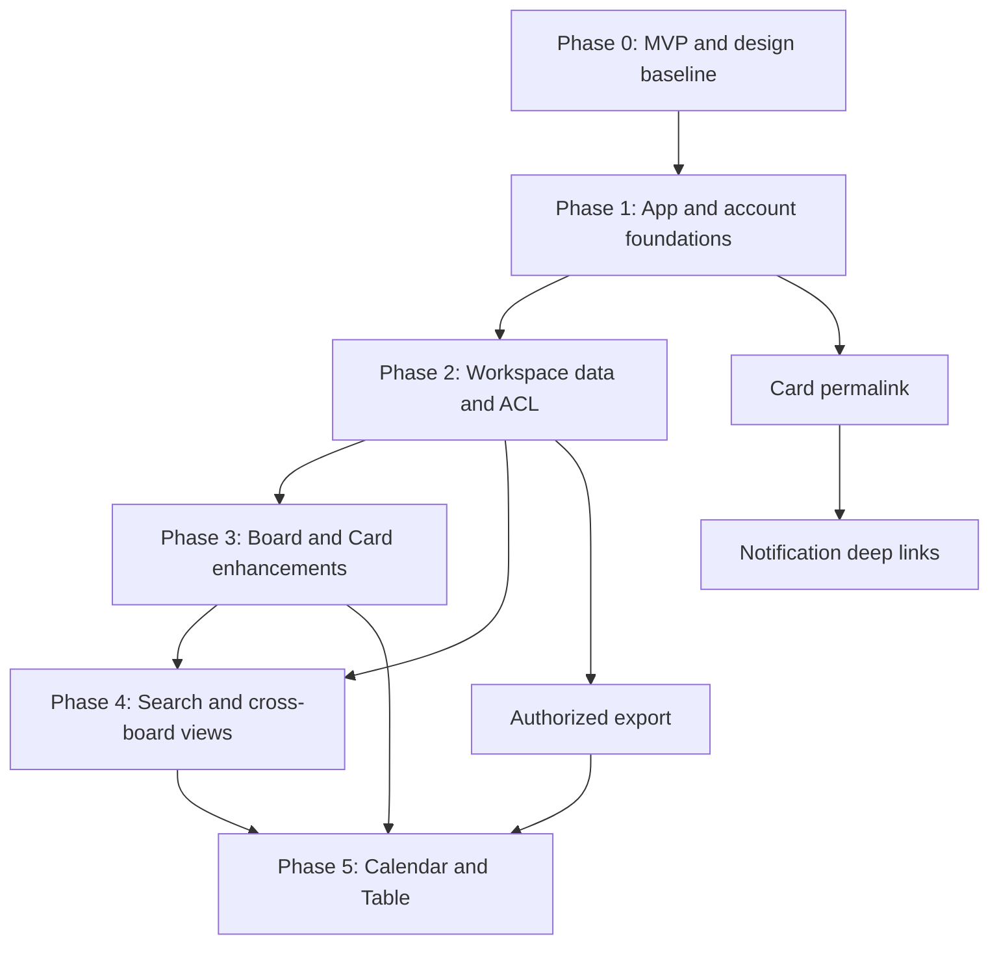

# Kanvexa — Post-MVP Roadmap V1

**Status:** Approved phase structure & 25 feature groups. Individual issues and implementation dates are **not** yet approved.  
**Snapshot:** 2026-10-25; repository `duongkienvn/SE2026-T13`; `main` SHA `800af693cbe0869649cb84ca6442128fa406bebd`.  
**Goal:** Evolve the finished Kanban MVP into a coherent, secure, multi-workspace productivity product without losing data, degrading realtime collaboration, or fragmenting the Kanvexa UX.

## 1. Approved scope — exactly 25 feature/workstream groups

Feature group != GitHub issue; each group can require several vertical, reviewable issues. Requirements in the linked UX documents are also binding.

### A. Workspace — 4

| ID | Group | Functional scope | Acceptance highlights |
|---|---|---|---|
| WS-01 | Workspace Management | Personal/team workspaces; create, rename, describe, icon, leave; one workspace per board; move board with safe permissions | Per-user ownership, no orphan boards, migration-safe |
| WS-02 | Members & Invitations | Workspace ADMIN/MEMBER; role changes, guest access via board membership, pending email invitations and accept/revoke/expire flows | Invitee verification, one-use tokens, no privilege escalation |
| WS-03 | Workspace Settings | General, permissions, member/invite policy, danger zone | Admin-only changes, no deletion with remaining boards/adminless workspace |
| WS-04 | Workspace Overview | Workspace pages for overview, boards, members, settings; counts and recent boards based on accessible data | No leaking hidden private boards or member-only data |

### B. Board — 4

| ID | Group | Functional scope | Acceptance highlights |
|---|---|---|---|
| BD-01 | Board Customization | Color/photo backgrounds, selection/preview, theme contrast, per-board persistence | Stable responsive UX and readable content |
| BD-02 | Board Visibility & Permissions | PRIVATE (default), WORKSPACE_VISIBLE (workspace read-only unless board member); owner/member rules retained | REST/Socket.IO/server queries honor policy; no anonymous access |
| BD-03 | Board Settings | Board General, Permissions, Members, Danger Zone; board menu as entry point | Rights checked server side, archived handling |
| BD-04 | Board Discovery | Star/favorite, recently viewed, search/sort boards, active/archived filtering | User-specific favorites, no access leaks |

### C. Card — 7

| ID | Group | Functional scope | Acceptance highlights |
|---|---|---|---|
| CD-01 | Checklists | Multiple checklists, items, reorder, toggle completion and computed progress | Atomic item updates, concurrency/realtime, readable progress |
| CD-02 | Labels | Workspace/board-aware labels with names/colors; assign multiple to card | Scoped uniqueness/rights, efficient filtering |
| CD-03 | Attachments | URL and secure file/preview attachments; quotas and ownership, optional object storage | Signed/authorized access, file validation, no public leakage |
| CD-04 | Advanced Dates | Start date, due date/time, timezone correct presentation and due status | UTC persistence, IANA TZ handling, DST-safe display |
| CD-05 | Archive/Restore | Browse archived cards, restore when board active, preserve associations | No data loss, ordering/invariants, permission checks |
| CD-06 | Card Quick Actions & Deep Links | Duplicate card (explicit copy rules); copy/share permalink; `/boards/:boardId/cards/:cardId` direct open | Refresh/back/forward, route guard, no cross-board leakage |
| CD-07 | Card Search & Filtering | Board-local search/filter by text, member, label, date and supported state | Query parameters, stable column order, clear/reset filters |

### D. Collaboration & Productivity — 4

| ID | Group | Functional scope | Acceptance highlights |
|---|---|---|---|
| CX-01 | Notifications & Mentions | In-app center, unread/read, assign/mention/invite/due events, user opt-outs, selective email notifications | Per-recipient records, no spam, direct card links, realtime + persistence |
| CX-02 | My Tasks | Assigned cards across authorized boards, overdue/upcoming/later/no due date, filters/sorting | Never guess completion from `Done` column name; no archive in active list |
| CX-03 | Home Dashboard | Up Next, summary, starred and recently viewed boards | User-specific authorized data; no speculative analytics |
| CX-04 | Global Search | Search across authorized workspaces/boards/cards with Ctrl/Cmd+K command palette | Auth-first filtering, debouncing/pagination, deep-link targets |

### E. Account & Application Settings — 3

| ID | Group | Functional scope | Acceptance highlights |
|---|---|---|---|
| AC-01 | Security & Account Management | Password reset/change/set (Google-only), verified email change, account data/deletion, session/devices when backed by server revocation | Re-auth, anti-enumeration, expiry/single-use, ownership and data-retention policy |
| AC-02 | Appearance | Light/Dark/Match System preferences across app | Contrast/accessibility, avoids theme flash, remembers preference |
| AC-03 | Preferences | Language (once translations exist), IANA timezone, date format, first day of week, notification preferences | Accessible defaults, reliable persistence, security emails unaffected |

### F. Data, Views & Experience — 3

| ID | Group | Functional scope | Acceptance highlights |
|---|---|---|---|
| DX-01 | Data Export | Authorized Board export to JSON/CSV; account data export handled in account/security flow | No cross-tenant data, safe spreadsheet escaping, full/clear schema |
| DX-02 | Additional Views | Calendar View and Table View over same Card source of truth | Permission-consistent, no duplicate data model or drifting state |
| DX-03 | Productivity & UX Polish | Shortcuts, accessible interactions, mobile/tablet, empty/loading/error/offline states, onboarding guidance and regression | Keyboard, screen readers, WCAG AA aim, responsiveness, performance |

**Scope clarifications:** Board Templates explicitly excluded. Card Templates, independent Priority, Stickers, Recurrence, Bulk Actions, Card Mirroring, Automation Engine, Enterprise billing and full Public Boards are not approved workstreams. Covers are optional visual enhancement only if specifically scoped and approved. Checklist-item assignees, dedicated completion state and multi-board Card mirroring are **not** implicit.

## 2. Current foundation and release handoff

From code review on `main` at the above SHA, Kanvexa has authentication with Google/email verification, profile and connected accounts, board/column/card CRUD, board member OWNER/MEMBER access, board archive/restore, card archive (not restore), card assignments and due date, realtime/presence, comments and activity; current MVP routes include `/boards`, `/boards/:boardId`, `/boards/:boardId/members`, `/profile`.

On 2026-10-25, PR #85 was merged; public landing-page Issue #84 was still open when checked. **Re-verify live issue/CI/deployment state before assuming MVP stabilization complete.**

## 3. Approved implementation phases

| Phase | Goal | Expected workstreams / outputs | Exit criteria |
|---|---|---|---|
| 0 — MVP Stabilization & Design Handoff | Confirm stable MVP and implementation-ready design | Regression, pending landing-page closure, CI, backups, visual specs, auth/schema reviews | Release checklist passed; UX specs accepted; security/migration plan reviewed |
| 1 — Application & Account Foundation | Reusable navigation/account infrastructure | App Shell V2, tokens/theme, settings framework, AC-01 first security flows, AC-03 foundations, Card permalink, Card restore | Auth regression green, user preferences stable, deep links work, card restore consistent |
| 2 — Workspace & Access Control | Safe multi-workspace domain model | WS-01..04, BD-02 foundations, invite/guest model, Personal Workspace migration, permission matrix | No data loss; access/security matrix proven in REST/Socket.IO; migration rehearsal |
| 3 — Board & Card Enhancements | Rich task management | BD-01/03/04, CD-01/02/03/04/07, complete CD-05/06 UI and Board/Card V2 | APIs/UI/realtime aligned; file security validated; no board/card regressions |
| 4 — Productivity & Collaboration | Personalized cross-board productivity | CX-01..04, Home, My Tasks, global search, mentions, notifications | Cross-board filtering ACL-safe; notifications accurate; no unsupported task-complete semantics |
| 5 — Views, Data & Polish | Complete unified experience | DX-01..03, Calendar/Table, advanced account lifecycle/security tasks, accessibility/performance audit | Export privacy validated, responsive/E2E tests green, rollout/runbook complete |

**Dependency nuance:** IDs are ownership buckets, not rigid sequential release gates. A safe independent card feature can ship earlier; a feature crossing workspace authorization cannot bypass Phase 2's access model. Cross-phase work must cite prerequisites explicitly.

## 4. Dependencies and sequencing

Key decisions:

- Workspace schema → membership/roles → Board visibility/guests → authorized discovery, search, export and notifications.
- Card permalink → share links, My Tasks and Notification Center navigation.
- Checklist/labels/dates → metadata on Card previews and useful filters; Dates → Calendar and deadline reminders.
- Notification event taxonomy and delivery preferences → per-user persisted notification state → realtime UI → optional email delivery.
- Existing Board permissions/realtime must remain valid during migration. `Workspace ADMIN` is **not** implicit access to private boards.

## 5. Data and security migration plan (requirements, not SQL)

1. Prepare backup, documented restore rehearsal and dataset inventory before production migrations.
2. Add Workspace, Workspace Membership, Invitations, board workspace relation and scoped visibility (migration in safe expand/backfill/constrain stages, as necessary).
3. Backfill legacy boards into Personal Workspaces of their creators, preserving original board IDs, members, cards, columns, comments, assignments, positions, activity and archive state.
4. Legacy boards must remain `PRIVATE` throughout cutover; existing Board Members may be board guests in a Personal Workspace rather than accidentally acquiring Workspace membership.
5. Reject invalid board relocation: actor lacking Board OWNER and destination Workspace rights, memberships/guests inconsistent with policy, archived boards where move is forbidden or unauthorized concurrent edits.
6. Maintain transactional/serialized Board domain mutations and Socket.IO room eviction when access is revoked; do not accidentally expose cached content.
7. Migrations must be forward tested on realistic anonymized snapshots, checked for backfill completeness and reversible by backup/roll-forward plan. Destructive rollback is not assumed safe.

## 6. Definition of Done and issue template requirements

Every feature issue/PR must document:

- Requirement ID(s), scope and *explicit non-goals*, backend/frontend/DB/shared contract impact, UI references.
- Actor/permissions, happy path, empty/loading/error/permission-loss/archived states, mobile and keyboard behavior.
- Acceptance criteria precise enough to test, API contract/schema/migration plan as applicable.
- Unit/integration/E2E/security tests proportionate to risk; real database tests for migrations/concurrency; REST/Socket.IO permission tests.
- `pnpm lint`, relevant test suites, build, format checks where configured; disclose unrelated pre-existing failures without hiding them.
- Screenshots at agreed desktop/tablet/mobile viewports and comparison to approved visual references; note intentional mockup deviations.
- PR review, CI, security findings triage, safe deployment/rollback notes and production smoke checks for risky changes.
- No unrelated refactors, magic demo data, fake time-tracking or silent scope expansion. Do not push, open PR, merge or deploy without authorized action.

**Phase checkpoint:** run regression on primary auth, board/column/card permissions, realtime, comments/activity, archive, migrations and newest feature flows; review responsive/a11y and fix blockers before declaring phase stable.

## 7. Release and collaboration policy

- Release incremental, backward-compatible, tested subsets; **no all-or-nothing 25-group launch requirement**.
- Three-person team: assign by reviewable vertical slices, avoid simultaneous schema/ACL edits without owned contracts; issue → branch → meaningful commits → PR → CI/review → merge.
- `main` integration and production rollout remain separately authorized actions. A merged feature does not mandate immediate deploy.
- API authorization, transaction safety and data integrity are never delegated to frontend visibility.
- Post-MVP screenshots are visual references only; no runtime bitmap rendering of the mockup.

## 8. Accepted visuals & source of truth

- `../design/product-ux-blueprint.md` — product/navigation/security/UX decisions.
- `../design/design-guidelines.post-mvp.md` — additive visual rules to be used **with**, not in place of, existing `docs/design/design-guidelines.md`.
- `../design/post-mvp/visual-reference-register.md` — five approved mockups and exclusions.
- Per-screen `ux-spec.md` — interaction/responsive/permissions/states.

## 9. Deferred review backlog (not approved scope)

Public/anonymous Boards; Card/Board Templates; Custom Fields; Recurring Cards; dedicated Priority; Card Covers as independent phase; Stickers; Card Mirroring; sophisticated bulk actions; Full Automation Engine; AI assistant; Enterprise SSO/SAML, billing/subscription; complex analytics/Gantt; activity-everything email digest; speculative client-based task completion. Reopen only via explicit scope decision.

## 10. Immediate next actions (not executed by this package)

1. Confirm MVP release state, pending landing page Issue #84, deployment and data backup.
2. Check Post-MVP design consistency and agree any minor visual token refinements with team.
3. Write *Phase 0* issues and technical RFCs for workspace migration/ACL and auth/session model.
4. Approve phased issues and begin implementation only after explicit authorization.
