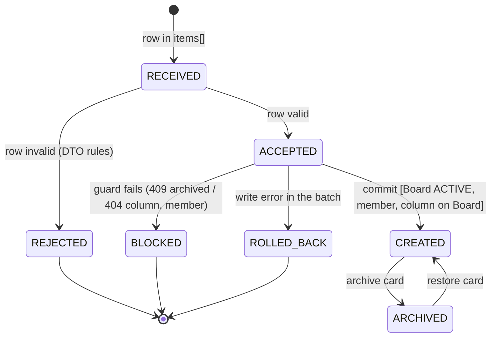

# VT-052 — Bulk Card import with per-row rejection

Branch: `test/bt3-vt052-bulk-import-cards`, baseline `main` at `d0b8ffa`.
Scope: backend vertical slice only (API + service + tests). No frontend, no
shared-contract change, no migration. Course exercise (BT cá nhân 3); bulk
import is not an approved roadmap workstream, so this branch must not be merged
without a team scope decision.

## Contract

`POST /api/boards/:boardId/cards/import` (JWT) — body:

```json
{ "columnId": "<uuid>", "items": [{ "title": "A" }, { "title": "" }] }
```

- `items`: 1–100 entries. Each row uses exactly the `CreateCardDto` rules except
  `columnId` (title trimmed 1–120, description ≤ 2000, ISO deadline with
  timezone, unknown fields rejected).
- `200` → `{ createdCount, rejectedCount, created: CardResponseDto[], rejected: [{ index, details[] }] }`.
  A rejected row never blocks or reorders accepted rows.
- Request-level errors reject everything before any write: `400` (bad
  `columnId`, 0 or > 100 rows, `items` not an array), `401`, `404`
  (non-member, unknown/foreign column — also when every row is invalid),
  `409 BOARD_ARCHIVED`. A database error rolls the whole batch back (`5xx`).
- Accepted rows are appended after the last **active** card, in input order, in
  one transaction under the existing Board lock; overflow rebalances once.
  One `CARD_CREATED` activity per card; `card:created` is published per card
  after commit (existing clients refresh without a contract change).

## State transition model (test design technique)

Each import row moves through one lifecycle; the Board and the Card states
are guards on it. Test cases are derived from this model: every valid
transition, every guard, and the forbidden transitions.



| #   | From → To                         | Trigger / guard                                                                                                                | Test cases             |
| --- | --------------------------------- | ------------------------------------------------------------------------------------------------------------------------------ | ---------------------- |
| T1  | RECEIVED → ACCEPTED               | valid row, normalised like `CreateCardDto`                                                                                     | TC01, TC04             |
| T2  | RECEIVED → REJECTED               | null/string/array row, missing or blank title, 121-char title, 2001-char description, deadline without timezone, unknown field | TC03, TC06             |
| T3  | REJECTED does not affect ACCEPTED | invalid row between valid rows keeps their index and order                                                                     | TC02, TC10, TC14       |
| T4  | ACCEPTED → CREATED                | Board ACTIVE, appended after last **active** card                                                                              | TC05, TC10, TC13, TC14 |
| T5  | ACCEPTED → BLOCKED (409)          | Board ARCHIVED                                                                                                                 | TC07, TC11, TC17       |
| T6  | ACCEPTED → BLOCKED (404)          | non-member or foreign/unknown column, also when all rows invalid                                                               | TC07, TC11, TC12       |
| T7  | ACCEPTED → ROLLED_BACK            | database error mid-batch; no event published                                                                                   | TC08, TC15             |
| T8  | CREATED → ARCHIVED → CREATED      | imported card archive/restore (old behaviour unchanged)                                                                        | TC17                   |
| T9  | Board ARCHIVED → ACTIVE           | import allowed again after Board restore                                                                                       | TC17                   |
| T10 | CREATED under contention          | concurrent imports + single creates on one Board lock                                                                          | TC09 (overflow), TC16  |

Forbidden transitions checked as negative tests: REJECTED → CREATED (TC03,
TC06: nothing saved), BLOCKED → CREATED (TC07, TC11: row count unchanged),
ROLLED_BACK → CREATED (TC08, TC15: no row, no `card:created`).

Test data: boundary values on each row rule (title 120/121 after trim,
description 2000/2001, items 1/100 accepted vs 0/101 rejected), one value per
invalid row kind for T2, and an archived card placed **after** the last
active card (TC13) so the "last active card" guard is distinguishable from
"last card". Mutants M1–M6 each flip one condition of a transition (M1 T1/T2,
M2/M3/M3b T4, M4 T5, M5 T10, M6 T7).

## Run the tests (from repository root)

```bash
npx pnpm install --frozen-lockfile
docker compose up -d postgres                     # needs .env (see .env.example)
cd apps/backend
npx jest --runInBand test/cards                   # unit + API (TC01–TC13), 70 tests
npx pnpm test:cards-import:database               # PostgreSQL TC14–TC17
npx pnpm test:cards-import:load                   # 100 concurrent users, p95 vs 3.0 s
npx pnpm test:cards-import:mutants                # true/false mutants M1–M5 (+M3b, M6)
npx pnpm test:cards:database                      # existing Card regression suite
```

The mutation harness rewrites one source line, runs the card suites and always
restores the file; `MUTANT_SUITES=test/cards/cards.e2e-spec.ts` limits it to the
API level. The load harness exits non-zero when any scenario misses the target.

## Evidence

Logs are in [evidence/bt3-vt052/](evidence/bt3-vt052/): baseline, red before
patch, green after patch, patch diff, mutation runs (including the temporary
branch run), coverage, load, flaky checks, PostgreSQL integration and final
repository checks.

## Known limits

- One hot Board: 100 concurrent imports serialize on the Board row lock; p95
  ≈ 4.9 s on the test machine (target 3.0 s missed). Spread over 10 Boards
  p95 ≈ 1.8–2.1 s. While import transactions wait for the lock they hold pool
  connections (pool 10), so unrelated card reads rose from 42 ms to ~2–4.9 s p95.
- Express JSON limit stays at the default 100 kB; 100 rows with long
  descriptions can exceed it (`413`, whole request rejected).
- No CSV/file upload and no UI.
