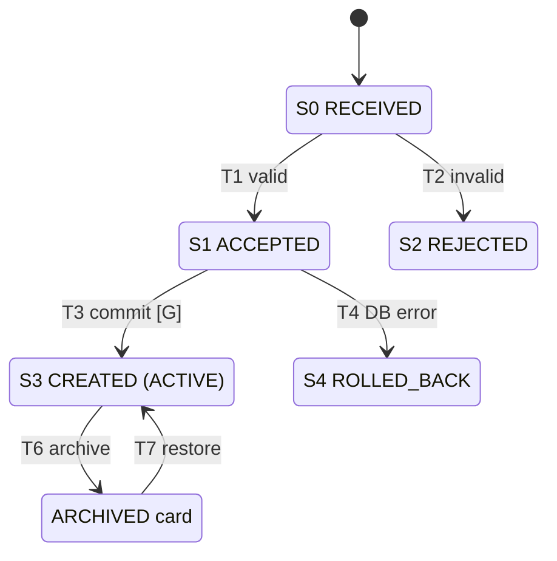

# VT-052 — Bulk Card import with per-row rejection

Branch: `test/bt3-vt052-bulk-import-cards`, baseline `main` at `d0b8ffa`.
Scope: backend vertical slice only (API + service + tests). No frontend, no
shared-contract change, no migration. Course exercise (BT cá nhân 3); bulk
import is not an approved roadmap workstream, so this branch must not be merged
without a team scope decision.

## Contract

`POST /api/boards/:boardId/cards/import` (JWT) — body:

```json
{ "columnId": "<uuid>", "items": [{ "title": "A" }, { "title": "" }] }
```

- `items`: 1–100 entries. Each row uses exactly the `CreateCardDto` rules except
  `columnId` (title trimmed 1–120, description ≤ 2000, ISO deadline with
  timezone, unknown fields rejected).
- `200` → `{ createdCount, rejectedCount, created: CardResponseDto[], rejected: [{ index, details[] }] }`.
  A rejected row never blocks or reorders accepted rows.
- Request-level errors reject everything before any write: `400` (bad
  `columnId`, 0 or > 100 rows, `items` not an array), `401`, `404`
  (non-member, unknown/foreign column — also when every row is invalid),
  `409 BOARD_ARCHIVED`. A database error rolls the whole batch back (`5xx`).
- Accepted rows are appended after the last **active** card, in input order, in
  one transaction under the existing Board lock; overflow rebalances once.
  One `CARD_CREATED` activity per card; `card:created` is published per card
  after commit (existing clients refresh without a contract change).

## State transition model (test design technique)

Same model and numbering as section 2.1 of the report `BT3_23001885_VT-052.pdf`.
One import row moves S0 → S1 | S2; an accepted row then becomes a Card (S3)
or is rolled back (S4). Guard G: the Board is ACTIVE.



| T     | From → To                          | Kind      | Tests                       |
| ----- | ---------------------------------- | --------- | --------------------------- |
| T1    | S0 → S1 (valid row)                | valid     | TC01, TC02                  |
| T2    | S0 → S2 (9 kinds of invalid row)   | valid     | TC03, TC06                  |
| T3    | S1 → S3 when G holds               | valid     | TC05, TC10, TC14            |
| T4    | S1 → S4 (error mid-batch)          | failure   | TC08, TC15                  |
| T5    | S1 → S3 when the Board is ARCHIVED | rejected  | TC07, TC11, TC17            |
| T6/T7 | S3 → ARCHIVED → ACTIVE             | valid     | TC13, TC17                  |
| T8    | S2 → S3                            | forbidden | TC02, TC05, TC14 (DB count) |
| T9    | "S3" created as ARCHIVED           | forbidden | TC05, TC10 (mutant M2)      |

Test data: every transition has at least one representative. T2 covers each
class of invalid row: not an object (`null`, string, array), missing field,
blank after trim, over the boundary (title 121, description 2001), deadline
without timezone, unknown field (whitelist). Boundaries sit exactly on the
edge: title 120/121, rows 0/1/100/101. Invalid rows are placed **between**
valid rows (index 1, 3) to catch index shifts. A `+07:00` deadline checks the
UTC conversion. An archived Card with a **higher** position than the active
one separates "last ACTIVE" from "last any". Position `9999999999.9999999999`
forces the rebalance branch. The failure path uses a real error on the second
Activity write, after the Card INSERT ran. All data is fixed (no random).

## Run the tests (from repository root)

```bash
npx pnpm install --frozen-lockfile
docker compose up -d postgres                     # needs .env (see .env.example)
cd apps/backend
npx jest --runInBand test/cards                   # unit + API (TC01–TC13), 70 tests
npx pnpm test:cards-import:database               # PostgreSQL TC14–TC17
npx pnpm test:cards-import:load                   # 100 concurrent users, p95 vs 3.0 s
npx pnpm test:cards-import:mutants                # true/false mutants M1–M5 (+M3b, M6)
npx pnpm test:cards:database                      # existing Card regression suite
```

The mutation harness rewrites one source line, runs the card suites and always
restores the file; `MUTANT_SUITES=test/cards/cards.e2e-spec.ts` limits it to the
API level. The load harness exits non-zero when any scenario misses the target.

## Evidence

Logs are in [evidence/bt3-vt052/](evidence/bt3-vt052/): baseline, red before
patch, green after patch, patch diff, mutation runs (including the temporary
branch run), coverage, load, flaky checks, PostgreSQL integration and final
repository checks.

## Known limits

- One hot Board: 100 concurrent imports serialize on the Board row lock; p95
  ≈ 4.9 s on the test machine (target 3.0 s missed). Spread over 10 Boards
  p95 ≈ 1.8–2.1 s. While import transactions wait for the lock they hold pool
  connections (pool 10), so unrelated card reads rose from 42 ms to ~2–4.9 s p95.
- Express JSON limit stays at the default 100 kB; 100 rows with long
  descriptions can exceed it (`413`, whole request rejected).
- No CSV/file upload and no UI.
