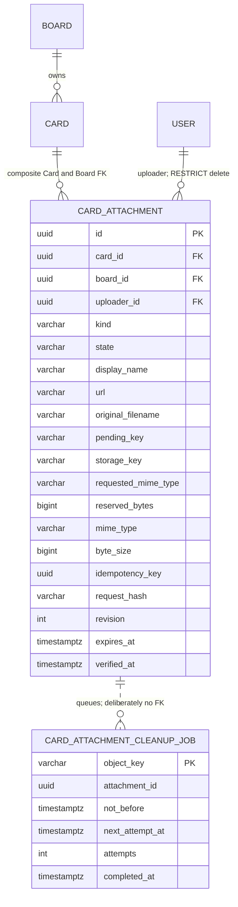
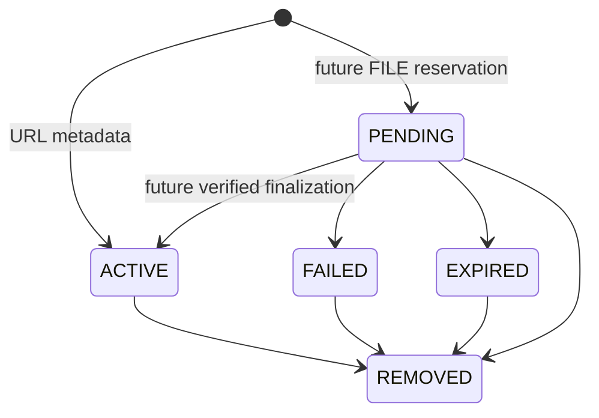

# Card Attachment Foundation — P3-05 / CD-03 part 1

Implements [Issue #158](https://github.com/duongkienvn/SE2026-T13/issues/158).
The foundation provides URL metadata CRUD and a private-file extension boundary.
P3-06 owns actual file transfer/verification; P3-10 owns the UI. No AWS, bucket,
IAM, Compose, frontend upload control or file-byte operation is implemented here.

## Decisions and policy status

| Rule                                                                                                 | Classification and behavior                                                                                  |
| ---------------------------------------------------------------------------------------------------- | ------------------------------------------------------------------------------------------------------------ |
| HTTPS-only URL metadata; never fetch/resolve/proxy/scrape/follow targets                             | Implemented security requirement                                                                             |
| JWT and authoritative Board/Card ACL; private files; no pending metadata or keys in responses/events | Implemented security requirement                                                                             |
| URL cap 2048 normalized characters; display name 1–120                                               | Implemented V1 metadata bounds, following the issue proposal                                                 |
| 20 ACTIVE/PENDING attachment slots per Card, across both kinds                                       | Implemented **provisional technical abuse safeguard**, not owner approval of a production file product limit |
| 10 MiB per file; 100 MiB ACTIVE/PENDING file bytes per Board                                         | **Proposed, requires owner review before production enablement**; no file reservation API is active          |
| PNG/JPEG/WebP/PDF/plain text with matching extensions; raster-only inline preview                    | **Proposed, requires owner review**; not the avatar allowlist or an enabled file capability                  |
| 15-minute intent lifetime, cleanup cadence/backoff/grace and idempotency retention                   | Intent duration is a testable **proposal**, not an operational upload/cleanup schedule                       |
| Owner/global byte quota                                                                              | Not approved or implemented; decide explicitly in P3-06 if needed                                            |

`ATTACHMENT_FILE_POLICY_PROPOSAL` is immutable and explicitly marked
`REQUIRES_OWNER_REVIEW`. It cannot enable file operations. Registering an adapter
alone must not bypass approval, reservation, byte validation or finalization.
The metadata safeguard is enforced in the backend now, including reservations
seeded by internal writers; production file-policy approval remains outstanding.

The scope is roadmap CD-03, existing Card archive/restore and the Board/Card V2
access model. Historical MVP architecture sections predate checklists, labels,
advanced dates and this foundation; executable code and the extension records
are authoritative. No new permissions or completion model are introduced.

## Schema and ownership



Migration `1793923200000-CardAttachments.ts` adds two empty tables, six attachment
indexes, a cleanup index, CHECKs, composite/FK constraints and lifecycle/cleanup
triggers. It leaves all existing Cards, dates, ordering, labels, checklists,
comments and assignments unchanged. TypeORM discovery remains automatic;
`synchronize` and startup migrations remain disabled. Fresh migrations and
populated pre-extension upgrades were tested with final zero ORM drift.

The server generates IDs and fixes Card/Board/uploader identity permanently.
`(card_id,board_id)` references the existing Card composite unique key; changing
scope, kind, uploader, keys, declared reservation or creation/idempotency identity
is rejected by the database. User deletion is RESTRICT while attachments retain
provenance; account deletion needs an explicit retention/anonymization policy.
Card/Board hard deletion cascades metadata but queues FILE cleanup first.
Archive, restore, column moves and Workspace Board Move retain every attachment.
Workspace Move changes access, not attachment ownership.

URL rows have only URL metadata and ACTIVE/REMOVED state; all file fields are null.
FILE rows have no URL and require a bounded sanitized-basename field, requested
MIME, positive safe-integer reserved bytes, finite expiry and two unique opaque
keys: `attachments/v1/pending/{attachmentId}` and
`attachments/v1/active/{attachmentId}`. Keys/IDs must never be reused, even after
hard deletion. PostgreSQL stores neither public/provider URLs nor access grants.

Only ACTIVE files can have verified content: `verified_at`, MIME and byte count
must be consistent; MIME and byte size must equal the reservation. Pending,
failed and expired files have no verified metadata. Every update must advance
`revision` by one; service no-ops do not issue UPDATE. Database transition guards
prevent resurrection and identity reassignment. Trusted internal maintenance can
import verified ACTIVE records; public V1 endpoints cannot create file records.



Terminal states cannot return to PENDING/ACTIVE. ACTIVE retains its content until
removal. Rejected/removed/expired intents cannot be resurrected by retries.

## REST contract

All paths have prefix `/api/boards/:boardId/cards/:cardId/attachments`.

| Method/path                   | Request and result                                                                                                  |
| ----------------------------- | ------------------------------------------------------------------------------------------------------------------- |
| `GET /`                       | `page=1`, `limit=20` (1–100); ACTIVE-only list, standard `data` array and `meta` envelope                           |
| `POST /`                      | `{kind:"URL",url,displayName?}`; 201 safe metadata. Name defaults to normalized hostname, bounded to 120 characters |
| `GET /:attachmentId`          | ACTIVE-only safe metadata; unfinished/terminal/foreign/missing records return 404                                   |
| `PATCH /:attachmentId`        | Required positive `expectedRevision`, at least one of `url`/`displayName`; 200 current metadata                     |
| `DELETE /:attachmentId`       | Optional query `expectedRevision`; 204. Authorized repeated URL deletion returns 204 without another event          |
| `POST /` with `{kind:"FILE"}` | 503 `ATTACHMENT_FILES_NOT_AVAILABLE` after current write ACL/archive checks; creates no intent or grant             |
| `GET /:attachmentId/file`     | Authenticated scope check, then 503 for verified ACTIVE FILE; 404 for hidden/non-file/foreign records               |

FILE edits/removal are unavailable until P3-06. Unfinished files stay 404 even for
public removal, exposing neither intent ownership nor pending metadata. Read-only
access can inspect approved ACTIVE metadata but never initiate a file mutation.
There is no raw multipart route, signed-download endpoint or storage configuration
endpoint. Unknown request/query fields fail with 400 `VALIDATION_FAILED`.

The public allowlist is exactly `id`, `boardId`, `cardId`, `uploaderId`, `kind`,
`state` (ACTIVE only), `displayName`, `url`, `originalFilename`, `mimeType`,
`byteSize`, `revision`, `createdAt`, `updatedAt`. URL rows have null file fields.
Verified file metadata does not promise download availability. Pending keys,
active keys, requested MIME/reservation, expiry, verification internals,
idempotency hashes and provider details are not response fields. Reads and
metadata-bearing mutation responses use `Cache-Control: no-store`.

Pagination orders immutable `createdAt DESC, id DESC`, including ties, and uses
one bounded data query plus count (no child hydration or N+1). Pages are stable
for a fixed dataset; concurrent creates/deletes can shift offset pages, so clients
refetch after invalidation. Unknown state/Card/Board filters are rejected.

Optional `Idempotency-Key` is a UUID v4, scoped to Card and JWT uploader with a
unique index, and a hash of normalized initial URL/name. A matching active retry
returns current metadata (201) without another event, even if later edited.
Different payload reuses fail 409 `ATTACHMENT_IDEMPOTENCY_CONFLICT`; removed
replays fail 409 `ATTACHMENT_REMOVED`. No-key repeated URLs deliberately create
separate attachments. Tombstones/keys have no automatic retention purge yet.

PATCH checks revision before normalized no-op comparison. Stale writes return
409 `ATTACHMENT_REVISION_CONFLICT`; empty edits/invalid fields return 400.
DELETE optionally checks revision on a live URL; an already removed URL remains
an idempotent 204. Slots include ACTIVE and PENDING, even after nominal intent
expiry until a committed terminal transition; URL byte contribution is zero.
Archived Cards/Boards retain reservations. FAILED/EXPIRED/REMOVED release logical
slots/bytes, while cleanup obligations persist independently.

## Authorization and threat model

- JWT/session validity is inherited from the existing guard. Board OWNER/MEMBER,
  including Board-only Guests, can edit all URL attachments on an active Card and
  Board; upload ownership does not create a second URL edit-permission system.
- Authorized Workspace-visible readers can list/detail, including archives, but
  mutations follow existing nonmember 404 semantics. Workspace ADMIN has no
  automatic PRIVATE Board access. Guests gain no Workspace-private access.
- Cross-Board/Card attachment IDs are safe 404s. Archive mutation errors are 409
  `CARD_ARCHIVED` / `BOARD_ARCHIVED`; listing retains metadata for permitted readers.
- Every command uses Board `FOR UPDATE` first, then loads the Card and attachment
  in that scope. Quota aggregation, idempotency checks, partial edits and tombstones
  commit in the same transaction. No process-local queue substitutes for SQL locks.
- URL parsing uses the platform URL parser after explicit HTTPS, length,
  credential, Unicode-control/whitespace and backslash rejection. Encoded ASCII
  controls are rejected too. Host/port/path normalization is syntax-only, including
  IDNA. Both raw and normalized lengths are bounded; errors never echo the URL.
- There is no DNS, HTTP(S), fetch, redirect, scrape, proxy or thumbnail call. HTTPS
  syntax is not a destination-trust or malware claim; arbitrary links can remain
  malicious. Future clients must render names as text and external links with
  `noopener noreferrer`, without auto-fetching previews or leaking credentials.
- File preview bytes, authorization bypasses and filenames as filesystem paths
  are excluded. No file bytes are accepted, sent to AWS or written to static assets.

## Realtime and client handoff

Effective URL create/update/remove publishes exactly one existing `card:updated`
after commit through `BoardEventPublisher`; payload remains only
`{boardId,cardId,columnId}`. No URL, name, uploader, MIME, file path, key, grant or
signed URL is broadcast. No-op, idempotent replay, repeated removal, failed/rolled
back/denied/unavailable operations emit nothing. Delivery false/throw preserves
committed REST success. Existing receive-grant revocation/session reconnect rules
apply. No additional Activity type or synthetic parent Card update is introduced.

The shared Board event list is unchanged. Existing frontend Card query invalidation
and cross-Board isolation tests pass. P3-10 must scope attachment query keys to
session + Board + Card, invalidate them for existing `card:updated`, refetch on
reconnect, and discard metadata/drafts on access loss/logout as appropriate. There
is no attachment query/UI in this delivery and no fake file-upload affordance.

## P3-06 private-file protocol and operator decisions

`AttachmentStorage` is a typed backend port, bound only to
`DisabledAttachmentStorage`. `createUploadGrant`, bounded `read`, immutable
`writeVerified` and idempotent provider `delete` contracts all fail 503 now.
Internal grants are sensitive; they are not metadata contracts. Avatar patterns
inspire disabled behavior, bounded verification and rechecks, not bucket/prefix,
5 MiB policy, visibility or credentials. A separate private provider configuration
and approved allowlist/quotas must precede implementation/production enablement.

1. Under Board lock, recheck editor/Card mutability, normalize declared filename,
   validate an approved MIME/extension/size policy, aggregate slots and Board bytes,
   and create an owned PENDING intent with server-generated keys, expiry, revision
   and idempotency hash. All declared fields are untrusted. PENDING reserves a full
   slot and its declared bytes atomically across Cards in the Board.
2. Commit before any grant/storage I/O. A bounded single-object grant must expire
   within the intent lease. Grant failure transitions to FAILED and queues cleanup;
   never compensate an ambiguous write by deleting a possibly referenced object.
3. Completion checks actor ownership, live Board/Card rights, expiry and expected
   revision, captures a verification lease/revision, then performs bounded byte
   inspection and immutable verified-object write outside transactions. Recheck all
   ACL/archive/expiry/lease conditions under Board lock before publishing ACTIVE
   metadata and one post-commit invalidation. Repeat completion must be idempotent;
   stale/removed/expired work cannot win. Additive lease/digest fields may be added
   by P3-06; do not repurpose public URL fields or relax ownership constraints.
4. Confirm actual byte size/signature/decoded raster, not extension, claimed MIME
   or provider headers. Proposed extensions are `.png`, `.jpg/.jpeg`, `.webp`,
   `.pdf`, `.txt`. Reject executables, scripts, HTML/SVG and archives. Strip path,
   controls/bidi and unsafe filename characters; keep a bounded display basename.
   Only verified raster images may be inline. PDF/text should use attachment
   disposition, safe filename and `X-Content-Type-Options: nosniff`. Recheck read
   authorization per request and after I/O; never make objects publicly readable.
5. Terminal transitions queue both keys transactionally; ACTIVE queues only its
   no-longer-needed pending key. Card/Board hard deletion queues both keys even if
   verification is racing. Jobs have no parent FK, survive deletion and carry an
   initial `not_before` at least as late as intent expiry. No external delete runs
   in these transactions and no worker is enabled in the foundation.
6. A future bounded worker claims due jobs with retry/lease and `SKIP LOCKED`,
   rechecks ACTIVE/PENDING references, and performs provider deletes outside the
   transaction. Never delete referenced keys or reuse identities. Retain/revisit
   tombstones after ambiguous/in-flight writes; choose grace periods longer than
   the maximum provider transfer/verification lifetime. Record retry attempts,
   reschedule failures and retain obligations across restarts. A proposed five-minute
   sweep/backoff and seven-day reconciliation retention require operator/owner
   review; they are not current schedules. Cleanup failures must not fail committed
   REST mutations or prematurely erase recovery metadata.

Operators must approve size/count/Board/owner quotas, MIME/extension rules, expiry,
concurrent verification limits, retry retention and cleanup grace; configure a
separate private store, short-lived least-privilege grants, encryption and pending
lifecycle; monitor backlog, failure rates and storage cost. Logical ACTIVE/PENDING
quotas exclude removed bytes awaiting cleanup, so backlog may exceed physical
storage budgets and should throttle future reservations. Reconcile protected DB
exports against provider inventory before exceptional deletion. No production
configuration, lifecycle rule or provider verification is claimed by this task.

## Rollout and recovery

Apply the additive migration explicitly before enabling URL endpoints. It creates
empty tables/indexes and briefly takes FK/catalog locks; assess rollout timing with
actual data volume. Old applications can continue using Cards; they do not expose
or mutate this new domain. Preserve `synchronize: false`, `migrationsRun: false`.

Down is empty-only and transaction-required; it locks both new tables and refuses
any attachment or cleanup record, including completed/tombstone records. Never
roll back database pointers while discarding file ownership/cleanup obligations.
After files exist, back up metadata and prefer roll-forward. Any exceptional data
export/removal and external byte disposition require explicit operator approval.
No migration or storage operation against production was performed.

## Local verification

Executed on 2026-10-31 using Node 22.17.0, pnpm 10.18.3 and dedicated PostgreSQL
16.15 on loopback port 55458. New integration runner rejects production/non-loopback
settings, requires `ATTACHMENTS_DATABASE_TESTS=local-only`, never reads `.env`, and
creates/drops a random disposable database. Existing runners received the same
explicit local test environment, fake mail and disabled avatar storage. All random
databases were dropped; the dedicated container and its volume were removed
after verification.

| Check                                                                     | Result                                                                                 |
| ------------------------------------------------------------------------- | -------------------------------------------------------------------------------------- |
| Shared build and `pnpm --filter @kanban/shared test`                      | PASS: 16 tests, ESM/CommonJS contracts                                                 |
| Backend build                                                             | PASS                                                                                   |
| `pnpm exec eslint apps/backend packages/shared`                           | PASS                                                                                   |
| Targeted backend regression command below                                 | PASS: 47 suites / 443 tests                                                            |
| Final `pnpm --filter @kanban/backend test --testPathPattern=attachments`  | PASS: 4 suites / 34 tests after final pending-visibility refinement                    |
| New PostgreSQL HTTP/Socket.IO suite                                       | PASS: 16 groups                                                                        |
| Database foundation runner                                                | PASS: source/compiled discovery, historical/fresh migration chain, down/up, zero drift |
| Existing Card / date / checklist / label PostgreSQL suites                | PASS: 13 / 11 / 16 / 15 groups                                                         |
| Workspace API PostgreSQL suite                                            | PASS: lifecycle, ACL, rollback, races and compatibility                                |
| Existing realtime / Board event PostgreSQL suites                         | PASS: 16 scenarios / 10 groups                                                         |
| Frontend `event-invalidation.test.ts`                                     | PASS: 23 tests, event contract and Board isolation                                     |
| Frontend consumer build                                                   | PASS (existing large-chunk warning)                                                    |
| Changed-file Prettier, local Markdown links, UTF-8 and `git diff --check` | PASS                                                                                   |

```sh
pnpm --filter @kanban/shared build
pnpm --filter @kanban/shared test
pnpm --filter @kanban/backend build
pnpm --filter @kanban/backend test '--testPathPattern=(attachments|cards|realtime|columns|board-members|boards|activities|labels|card-checklists|user-preferences)'
pnpm --filter @kanban/backend test --testPathPattern=attachments
# Requires explicitly designated disposable PostgreSQL environment and local-only opt-in:
node apps/backend/test/attachments/attachments.integration.mjs
# Equivalent package command builds backend first:
pnpm --filter @kanban/backend test:attachments:database
pnpm --filter @kanban/frontend test src/features/realtime/event-invalidation.test.ts
pnpm --filter @kanban/frontend build
```

The new database suite covers populated legacy preservation, exact REST allowlists,
no DNS/HTTPS/fetch, true ACLs, archive/restore/Board Move, native shape/FK/state/
revision/idempotency constraints, pending reservations, concurrent capacity edits,
create/delete races, revocation races, rollback after INSERT and at COMMIT, minimal
post-commit sockets, transport failure, reconnect/resync, grant eviction and durable
cleanup after cascading deletion. Existing migration rehearsals were updated only
for the additive migration/metadata counts and empty rollback order; historical
assertions remain intact. A historical fixture-count mismatch and SQL fixture
parameter casts were corrected during verification; selected checks now pass.
Expected injected delivery failures and existing pg introspection deprecation logs
are test diagnostics, not outstanding failures.

Full monorepo/frontend suites, repository-wide formatting, infrastructure/image
checks and production checks were not run, following the requested focused scope.
P3-06 transfer, byte verification, provider operations and background cleanup are
intentionally unavailable and unverified here. No dependencies were added.
