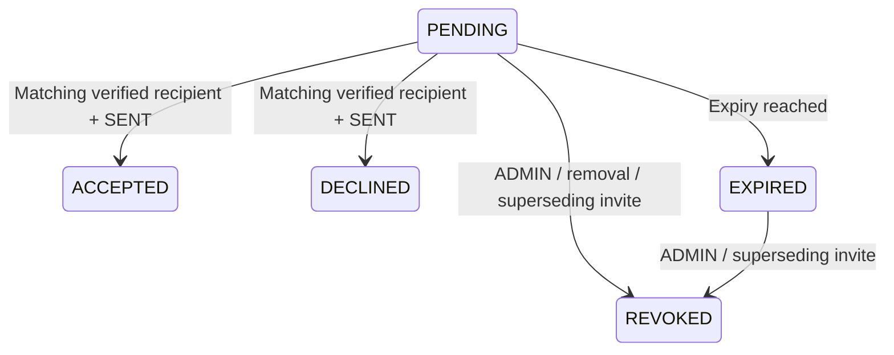

# P2-C03 — Secure Workspace invitation decline

Implements [#133](https://github.com/duongkienvn/SE2026-T13/issues/133), the
recipient-reject subset of WS-02 in the [roadmap](../../roadmap/post-mvp.md) and
[Workspace UX §4](../../design/post-mvp/workspace/ux-spec.md#4-members-page).
Builds on the [existing lifecycle](workspace-members-invitations-api.md) and
[mail delivery contract](workspace-invitation-email-delivery.md). The working
branch `feat/workspace-invitation-decline` already existed, was clean, and matched
freshly fetched `origin/main` (`9648710`) at preparation. This is local source
and test evidence, not deployment evidence.

## API handoff for #136

`POST /api/workspace-invitations/decline` requires Bearer JWT authentication and
a verified account. Body is exactly `{ "proof": "<43-character base64url>" }`.
The DTO inherits Accept's strict string/length/alphabet validation; null,
arrays, whitespace, unsupported characters and extra fields are rejected.
No email, Workspace ID, invitation ID or role is accepted from the client.

Success is **204 No Content** with `Cache-Control: no-store`: no JSON envelope,
membership, invitation identity or proof is returned. Decline never creates or
removes membership, sends mail, or writes Workspace Activity. Only an explicit
recipient action should invoke it; opening/dismissing an invitation page does
nothing. Use the existing ephemeral fragment-proof/sign-in flow, never storage
or query-string persistence. Do not navigate into a Workspace on decline.

| Status/code                        | Meaning for the client                                                                                                                     |
| ---------------------------------- | ------------------------------------------------------------------------------------------------------------------------------------------ |
| 400 / VALIDATION_FAILED            | Malformed request or extra fields.                                                                                                         |
| 401 / UNAUTHORIZED                 | Missing, forged, expired or invalidated JWT, or deleted account.                                                                           |
| 403 / EMAIL_NOT_VERIFIED           | Valid current account must verify email first.                                                                                             |
| 409 / CONFLICT                     | Proof is otherwise eligible but delivery is not confirmed SENT; request a fresh invitation through an ADMIN.                               |
| 410 / INVALID_WORKSPACE_INVITATION | Same generic response for nonexistent, expired, wrong-email, accepted, revoked or already-declined proof. Never infer which case occurred. |
| 429 / TOO_MANY_REQUESTS            | Same policy as Accept: 20 attempts per minute per endpoint/IP.                                                                             |
| 500 / INTERNAL_ERROR               | Existing sanitized unexpected-error contract, without SQL, proof or stack trace.                                                           |

The generic 410 message is `Invitation is unavailable; use the invited account
or request a new invitation`. A successful decline is intentionally not
idempotent: another attempt with that proof gives 410. An uncertain network
retry can therefore return 410 after a successful committed decline; it does
not authorize guessing the winning terminal outcome. Server state remains
authoritative. Swagger documents the exact request, empty success and errors.

There was a source/spec discrepancy: the existing JWT guard rejected unverified
users with 401 before invitation service verification could return 403. The new
decline-specific subclass selects 403 through the existing auth service; JWT
signature/issuer/audience/expiry, existing user and auth-version checks still
run first. Other routes, including Accept, retain their default 401 behavior.
The transaction rechecks verified email under a User share lock as well.

ADMIN history `GET /api/workspaces/:workspaceId/invitations` gains
`status=DECLINED` and nullable ISO `declinedAt`. Existing page/limit, newest-first
createdAt/UUID ordering, envelope and privacy rules remain. Exact response item:

```ts
type WorkspaceInvitationResponseDto = {
  id: string;
  workspaceId: string;
  email: string;
  role: 'ADMIN' | 'MEMBER'; // New invitations remain MEMBER-only; legacy data preserved
  status: 'PENDING' | 'ACCEPTED' | 'EXPIRED' | 'REVOKED' | 'DECLINED';
  sendState: 'UNAVAILABLE' | 'DISPATCHING' | 'SENT' | 'FAILED' | 'UNKNOWN';
  invitedById: string;
  expiresAt: string;
  createdAt: string;
  updatedAt: string;
  consumedAt: string | null;
  revokedAt: string | null;
  declinedAt: string | null;
};
```

UUIDs and timestamps retain existing conventions. No proof/hash is exposed.
`declinedAt` is always present; it is null for other outcomes and for legacy
rows. Render the server's status rather than recalculating expiry: terminal
outcomes win. Add the Declined history label/filter in #136 and invalidate
history after confirmed commands. The current frontend is intentionally
untouched and needs #136 before a coordinated UI rollout of the new status.

## State, transactions and predicates



PENDING/EXPIRED mean all three terminal timestamps are null. ACCEPTED, REVOKED
and DECLINED reflect consumed_at, revoked_at and declined_at respectively and
take precedence over time. At most one terminal timestamp can exist. No action
transitions an accepted or declined row back to open. Repeated ADMIN revoke
on revoked stays 204; revoke of accepted or declined is 409. Reinvitation creates
a new ID/hash after the existing cooldown/quotas; declined history remains intact.

Accept and Decline share the existing proof/email/delivery checks and Workspace
transaction. A candidate is located by SHA-256 proof hash; the transaction
locks Workspace, re-reads/locks the invitation, and locks the User for current
verified normalized-email comparison. Decline conditionally sets declined_at
with PostgreSQL `clock_timestamp()` only when the same hash is open, SENT and
unexpired at the actual update. It does not access the membership insertion
branch. Accept, revoke, issuance and dispatch completion retain Workspace-first
serialization. Reinvitation keeps actor/recipient advisory locks before its
Workspace lock; no new advisory-lock ordering is introduced.

The open predicates in history, accept, issuance/rotation, dispatch completion
and member removal now explicitly exclude declined rows. Declined attempts
still count in the unchanged all-status quota query and deleted-Workspace quota
ledger: 30/inviter/hour, 100/Workspace/hour, 5/recipient/hour. The 60-second
cooldown and five-minute active-dispatch lease remain. A deferred dispatch
callback cannot overwrite declined delivery metadata or revive its proof.

## Migration and rollback

New migration `1793404800000-WorkspaceInvitationDecline.ts` adds nullable
`declined_at timestamptz`, preserves every legacy row/hash/terminal field, extends
`CK_workspace_invitations_terminal` with `num_nonnulls(...) <= 1`, adds named
`CK_workspace_invitations_declined_at` for `[created_at, expires_at)`, and rebuilds
`UQ_workspace_invitations_open_email` over all three null terminal fields.
The replacement index continues to allow at most one truly open row for each
Workspace/email; expired open rows still occupy that slot until superseded.
Previously applied migrations were not edited. Entity metadata matches the
migrated schema; synchronize and implicit migrations remain disabled.

Up and down require an explicit transaction and acquire the invitation table
lock with a five-second lock timeout. No concurrent writer can observe an
unconstrained intermediate schema. Down preserves populated pre-decline rows
and restores the old constraint/index when no declined row exists. It fails
atomically if any declined row exists: dropping that history could make refused
proofs usable or conflict with a replacement open row. Pause writers and take a
verified backup before an authorized rollout. After declines exist, retain the
schema and roll forward; do not deploy an older writer that ignores declined_at.
Rehearsing lock duration on production-sized data remains a deployment step,
not evidence from these small disposable fixtures.

## Focused verification (2026-10-30)

Node v22.17.0 / pnpm 10.18.3. The existing Docker PostgreSQL harness now supports
`--invitations-only`; its dedicated command excludes Guests, Board policy,
Board/socket/browser and unrelated regression suites. It owns a random,
loopback-only PostgreSQL 16 container, fake mail and test credentials, runs
explicit migrations, and removes the container on exit. No app DB credentials
or real mail providers were used.

| Command/check                                                                                                                                                                                                 | Actual result                                                                                                                                                                                                                      |
| ------------------------------------------------------------------------------------------------------------------------------------------------------------------------------------------------------------- | ---------------------------------------------------------------------------------------------------------------------------------------------------------------------------------------------------------------------------------- |
| `pnpm --filter @kanban/backend exec jest --runInBand --runTestsByPath test/workspaces/workspace-invitations.dto.spec.ts test/workspaces/workspace-invitation-dispatch.spec.ts test/auth/auth.service.spec.ts` | PASS: 3 suites / 23 tests. The auth suite is directly relevant to the endpoint-specific verification status.                                                                                                                       |
| `pnpm --filter @kanban/backend test:workspace-invitations:database`                                                                                                                                           | PASS: backend build plus original invitation/member-removal, quota, delivery, acceptance and locking regressions; new decline migration, REST/security/history and concurrency cases; actual 20/min rate-limit parity and Swagger. |
| `pnpm exec eslint apps/backend`                                                                                                                                                                               | PASS.                                                                                                                                                                                                                              |
| Changed-file Prettier with `--end-of-line auto`                                                                                                                                                               | PASS on all changed files; existing Windows line endings are retained. Root-wide formatting was intentionally skipped.                                                                                                             |
| Local documentation links and `git diff --check`                                                                                                                                                              | PASS: 83 local links/paths across four changed documents; working-tree diff check passed.                                                                                                                                          |

Coverage includes 204/no body/no-store/no membership/no mail; strict DTO and
matching verified email; unverified 403 and unchanged Accept 401; generic wrong,
missing, malformed, expired and replay errors; all undelivered states; history
status/filter/page counts and terminal-over-expiry precedence; accepted/revoked
preservation; declined-row reinvite with fresh proof and unchanged cooldown;
five declined attempts exhausting recipient quota; and member removal retaining
the declined outcome.

Real PostgreSQL wait graphs enforce both contender orders for Accept/Decline,
Revoke/Decline and reinvite/Decline, plus repeated Decline. Exactly one terminal
field persists on the old row; accepted membership exists once only when Accept
wins. Decline followed by reinvite can validly succeed on two different rows.
Expiry while waiting rejects without membership. Late-dispatch tests verify
409 while DISPATCHING, then inject a confirmed delivery and a stale DISPATCHING
marker to independently prove declined_at fences delayed completion. This
injection is test-only; public Decline cannot succeed before SENT.

Migration tests perform populated legacy up/down/up, preserve complete old row
snapshots including accepted/revoked data, exercise timestamp and all terminal
pair exclusions, verify the new open unique slot, check no metadata drift and
prove unsafe down leaves schema/history/data intact. Existing migration-count
and historical rollback fixtures were maintained for the additional migration;
the broader database-foundation/Workspace/Core API suites were not run. Their historical policy rollback assertions now step past and reapply the new reversible migration when no decline history exists.

An initial TypeScript overload annotation and three new-test lint issues were
corrected. The initial race assertion only counted direct blockers; PostgreSQL
queued the second contender transitively behind the first. The corrected
recursive wait-graph assertion passed. Original migration tests intentionally
log a duplicate-open migration rejection, and pg emits its existing deprecation
warning in successful runs. Root tests/build/lint/format, frontend suites,
browser/UI QA, unrelated PostgreSQL suites, CI, production migrations and live
provider checks were intentionally not run under this task's scope restrictions.

## Changed files and remaining integration

- Invitation entity/DTO/controller/service, issuance and member-removal predicates,
  API module, and the new decline-specific guard.
- Auth service/JWT guard add the server-selected verification error status while
  preserving default authentication rules; targeted auth unit coverage added.
- Additive migration; new decline migration/lifecycle/race tests; invitation-only
  runner/script; existing DTO and historical migration fixture updates.
- This record, database-design schema note, task index and prior lifecycle link.

No frontend, Activity, shared-package, dependency or applied-migration edits.
One local commit is requested; no remote Git or deployment action is authorized.
#136 owns the UI integration; #134 owns any later Activity event. No unresolved
backend behavior remains beyond the documented rollback/rollout boundaries.
