# Boards and Board Members Frontend (#22)

Task này triển khai các màn hình Board và Board Member trên
`feat/boards-frontend` (PR #24), sử dụng Board API và Membership API thật làm
nguồn dữ liệu.

## Phạm vi đã hoàn thành

- Data layer, query keys, hooks và types cho Board/BoardMember.
- Trang danh sách board với search, role badge, trạng thái rỗng/loading/error
  và phân trang vừa viewport.
- Tạo board, chỉnh sửa board và archive board bằng dialog có validation.
- Trang chi tiết board và điều hướng tới Members/Kanban.
- Trang Board Members cho OWNER và MEMBER với behavior theo quyền.
- OWNER có thể thêm thành viên đã đăng ký, đổi role và xóa thành viên; thao tác
  không hợp lệ được chặn hoặc hiển thị lỗi từ backend.
- Archived board hiển thị notice và vô hiệu hóa các thao tác thay đổi.
- Khi user mất quyền truy cập, cache board bị xóa và UI chuyển sang trạng thái
  "Board not found" thay vì giữ dữ liệu cũ.
- Desktop/mobile responsive và menu tự mở lên trên khi phía dưới không đủ chỗ.

## Quyết định dữ liệu và phân quyền

- Backend là source of truth; frontend không tự suy diễn quyền vượt quá API.
- MVP chỉ dùng role `OWNER` và `MEMBER`.
- Vì API chưa hỗ trợ search phía server, frontend tải toàn bộ các trang với
  giới hạn hợp lệ rồi search/phân trang cục bộ.
- Board/member types ở trong feature cho đến khi có shared contract phù hợp.
- Archive là luồng chính; không thêm hard delete hoặc invitation workflow ngoài
  phạm vi MVP.

## Lịch sử triển khai

| Nhóm commit          | Nội dung                                           |
| -------------------- | -------------------------------------------------- |
| `fe059be`–`54db169`  | Data layer, board list/CRUD/detail và members page |
| `1fc4e1f`, `fe53523` | Sửa lỗi từ self-review và review                   |
| `fbde329`            | Phân trang boards/members để fit viewport          |
| `164bfae`            | Đồng bộ với Board Members API thật                 |
| `9d104cc`            | Hiển thị archived notice trên Members page         |
| `81d0e18`            | Xóa dữ liệu hiển thị khi user mất quyền truy cập   |

## Ảnh kiểm chứng

| Boards desktop                                        | Boards mobile                                       | Boards pagination                                               |
| ----------------------------------------------------- | --------------------------------------------------- | --------------------------------------------------------------- |
| 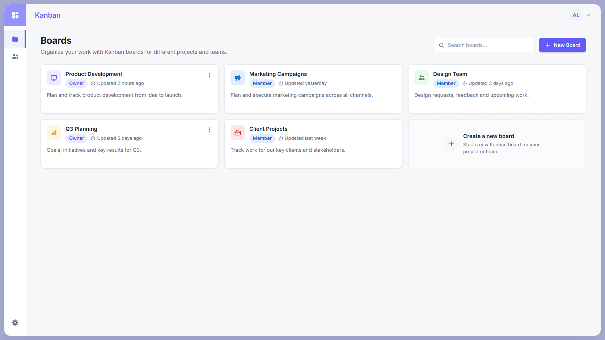 | 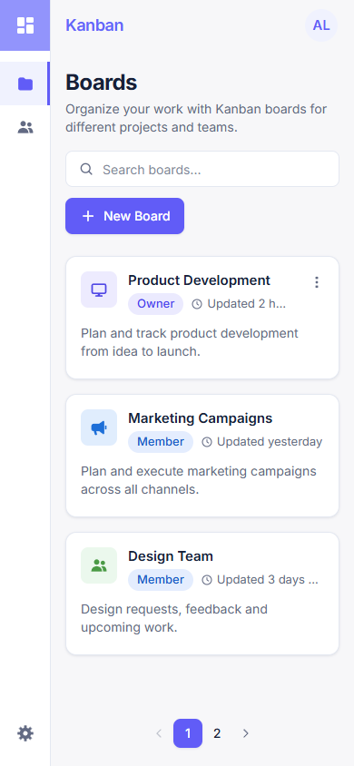 | 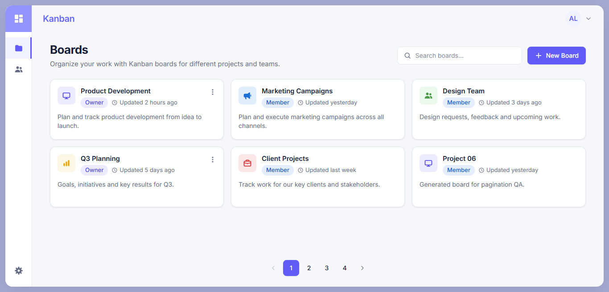 |

| Create board                                       | Archive board                                        | Owner menu                                    |
| -------------------------------------------------- | ---------------------------------------------------- | --------------------------------------------- |
| 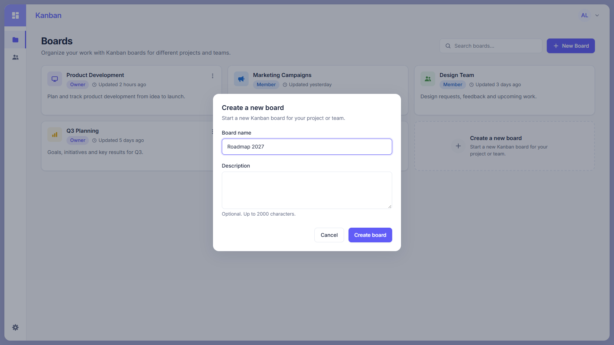 | 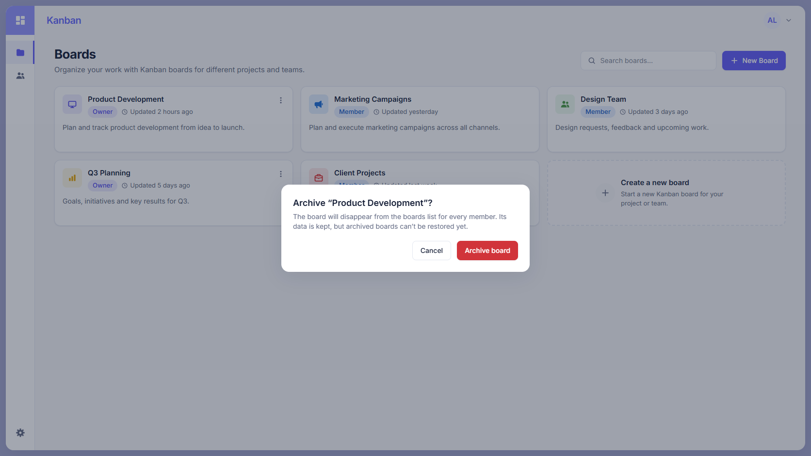 | 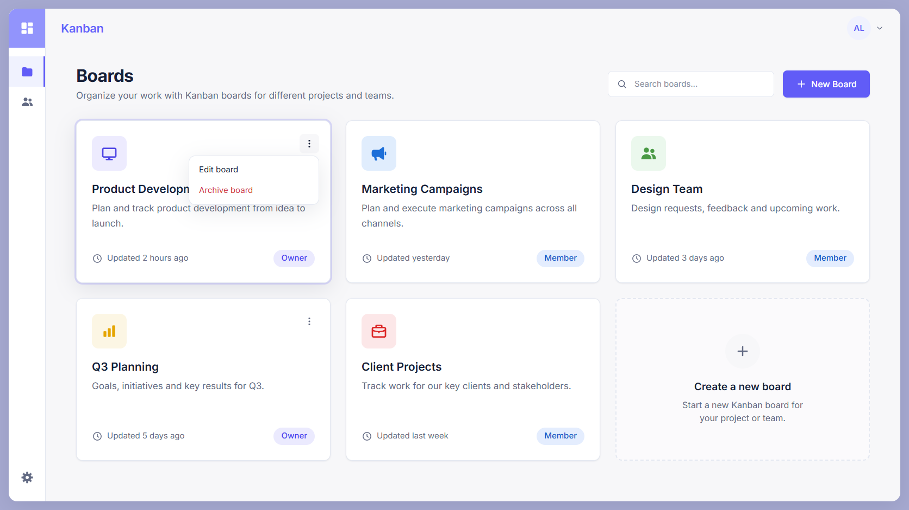 |

| Board detail                                            | Board not found                                          | Add member error                                          |
| ------------------------------------------------------- | -------------------------------------------------------- | --------------------------------------------------------- |
| 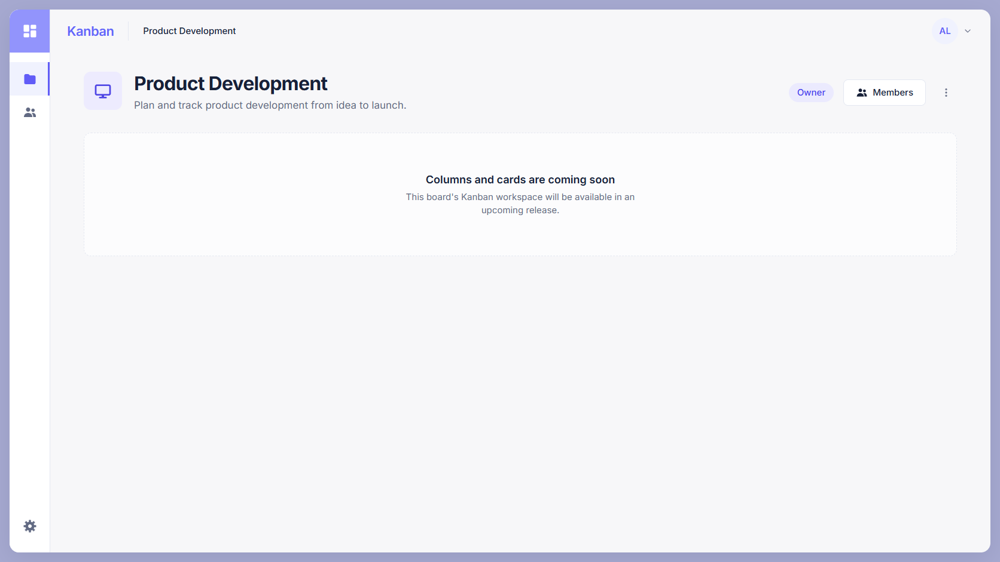 | 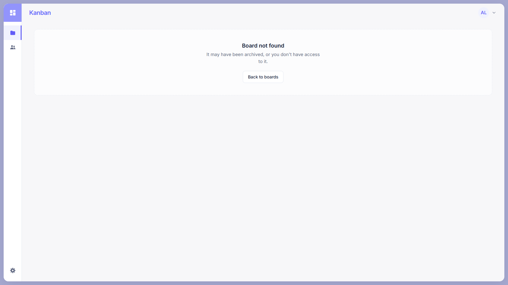 | 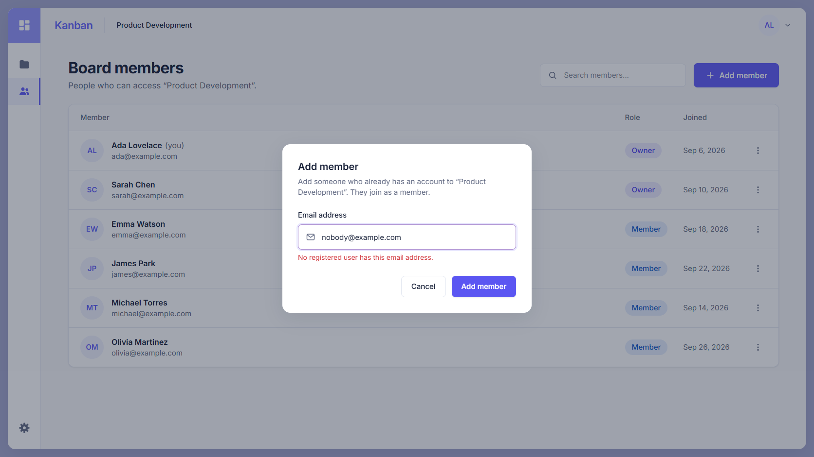 |

| Members owner                                       | Members as member                                           | Blocked member actions                                                 |
| --------------------------------------------------- | ----------------------------------------------------------- | ---------------------------------------------------------------------- |
| 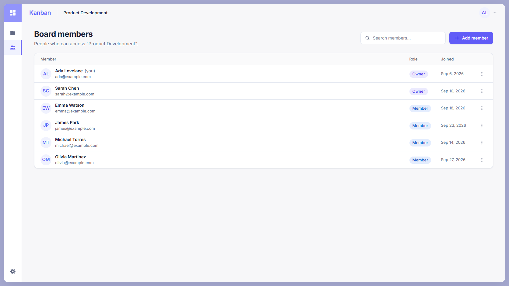 | 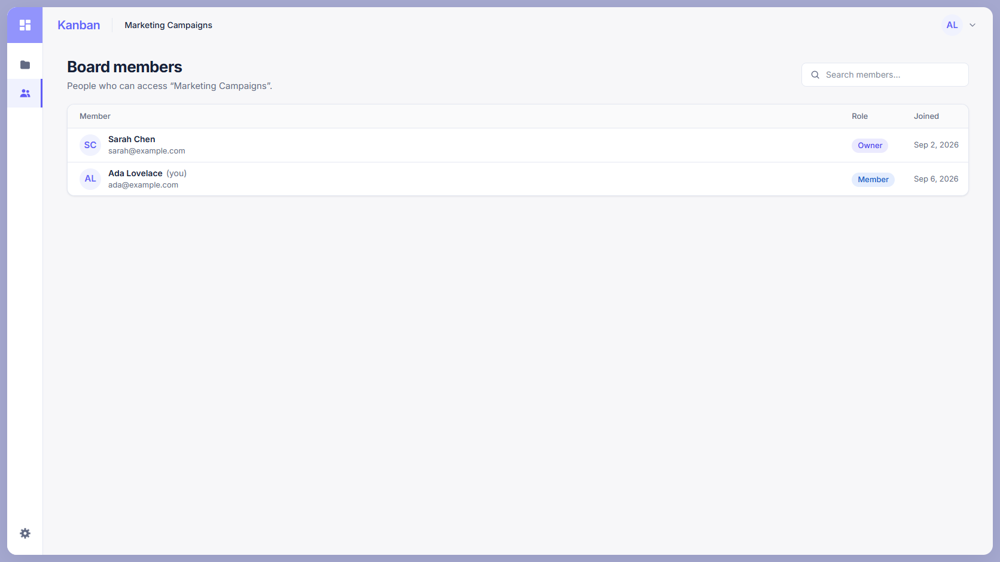 | 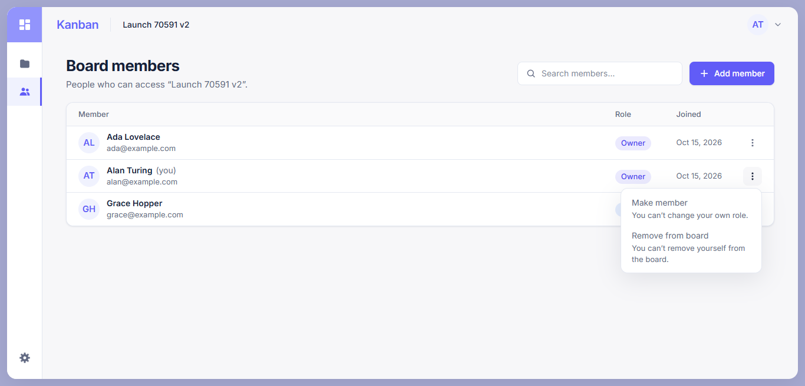 |

| Members mobile                                        | Members pagination/menu                                                   | Archived board members                                          |
| ----------------------------------------------------- | ------------------------------------------------------------------------- | --------------------------------------------------------------- |
| 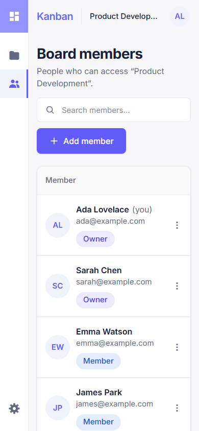 | 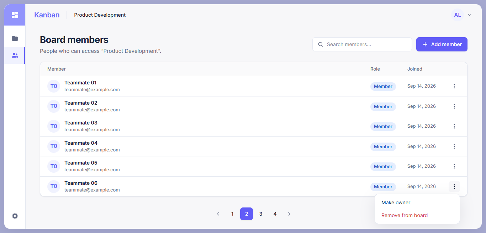 | 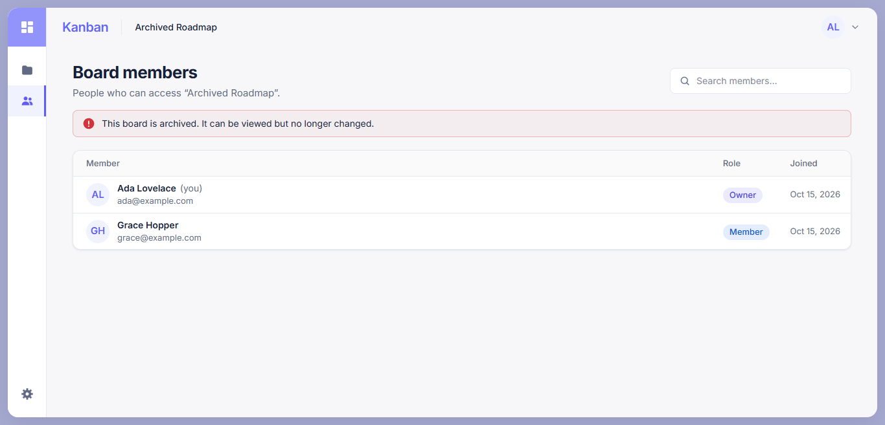 |
