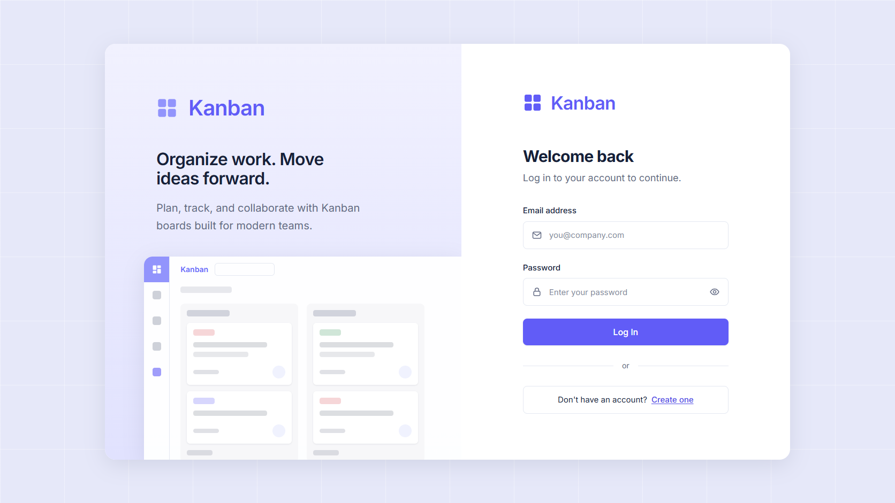
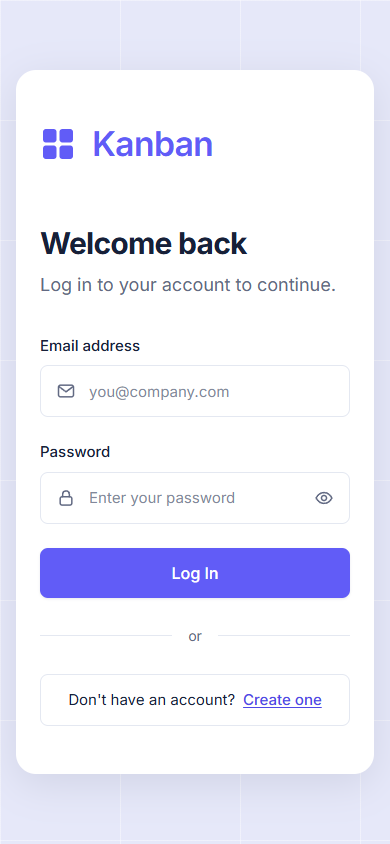
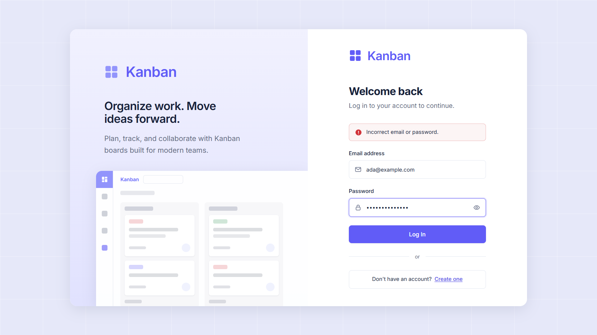
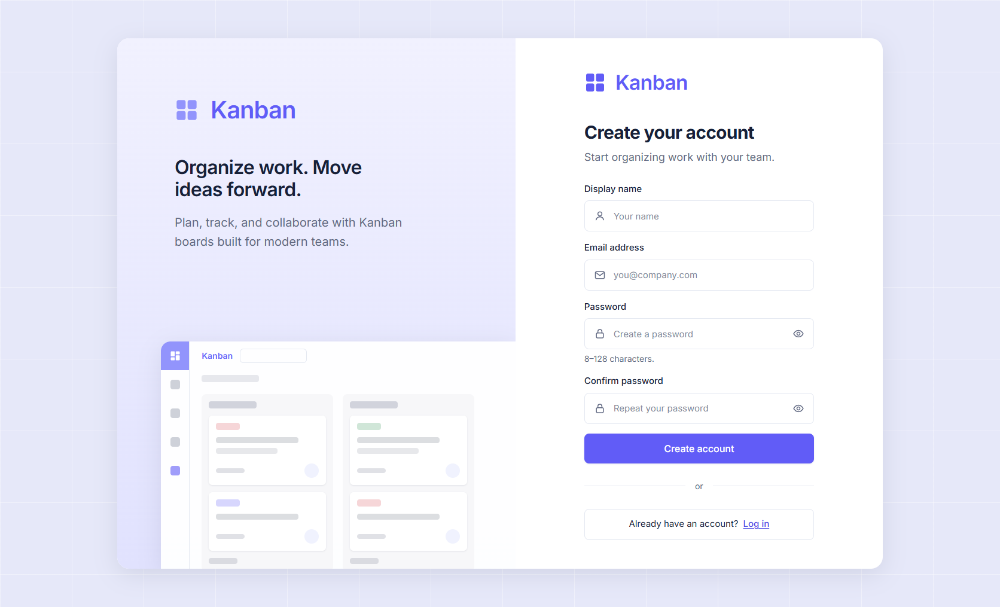
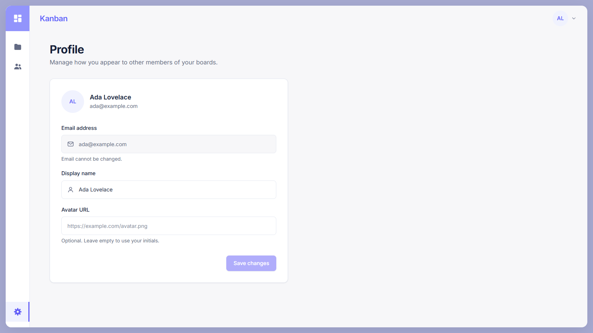
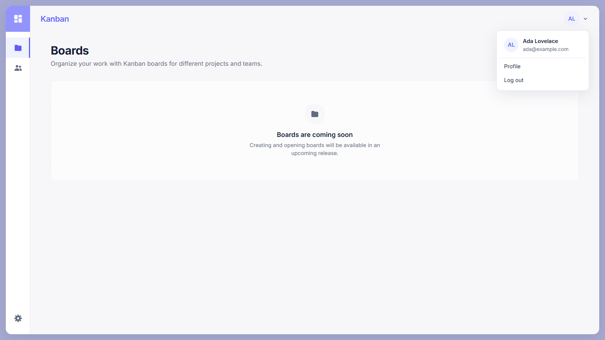
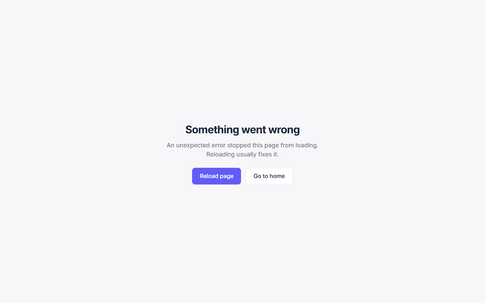

# Frontend Authentication (#17)

Task này triển khai luồng authentication phía frontend trên
`feat/frontend-auth` (PR #23). Việc đối chiếu với backend thật được ghi riêng ở
[`frontend-auth-integration.md`](frontend-auth-integration.md).

## Phạm vi đã hoàn thành

- Các trang Login, Register và Profile theo visual baseline đã duyệt.
- `AuthProvider` quản lý session và phục hồi user bằng `GET /users/me`.
- Route guard cho trang public/protected và redirect an toàn về trang user yêu
  cầu sau khi đăng nhập.
- API client dùng chung xử lý REST envelope, bearer token và lỗi xác thực.
- User menu, avatar fallback, logout và cập nhật profile.
- Route error page an toàn cho lỗi render/navigation.
- Validation phía client, ánh xạ lỗi backend vào field phù hợp và focus field
  không hợp lệ đầu tiên.
- Page title, keyboard navigation và responsive behavior cho desktop/mobile.

## Quyết định về session và bảo mật

- Access token chỉ lưu trong `sessionStorage`, không lưu trong `localStorage`.
- Dữ liệu user cũ được xóa khi session đổi hoặc token bị backend từ chối.
- Redirect sau login chỉ nhận đường dẫn nội bộ để tránh open redirect.
- Logout luôn xóa session phía client kể cả request logout thất bại.
- Lỗi credential không tiết lộ email có tồn tại hay không.

## Lịch sử triển khai

| Commit    | Nội dung                                   |
| --------- | ------------------------------------------ |
| `a99eed6` | Triển khai authentication frontend         |
| `8a64dbf` | Sửa các vấn đề từ self-review              |
| `806cac7` | Thêm route error page an toàn              |
| `36ef926` | Focus field lỗi đầu tiên và đặt page title |
| `91b5261` | Bổ sung coverage cho các edge case còn lại |
| `9060e9c` | Thêm ảnh kiểm chứng authentication         |

## Ảnh kiểm chứng

| Login desktop                                                                      | Login mobile                                                                     | Login error                                                                    |
| ---------------------------------------------------------------------------------- | -------------------------------------------------------------------------------- | ------------------------------------------------------------------------------ |
|  |  |  |

| Register                                                                                 | Profile                                                                                | User menu                                                                  | Route error                                                                    |
| ---------------------------------------------------------------------------------------- | -------------------------------------------------------------------------------------- | -------------------------------------------------------------------------- | ------------------------------------------------------------------------------ |
|  |  |  |  |
