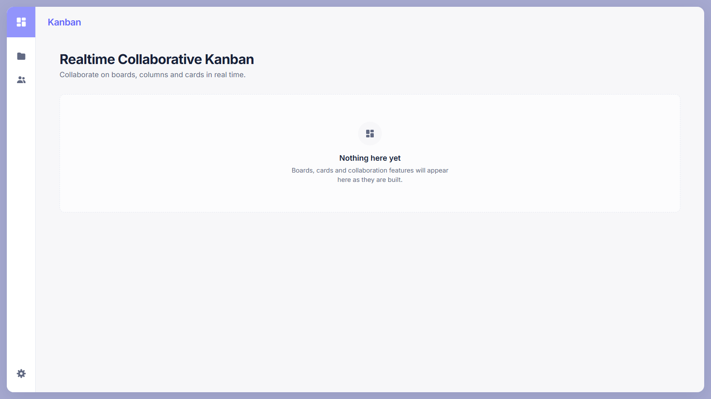
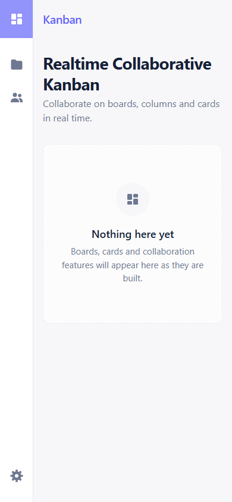

# Frontend Application Foundation (#11)

Task này thiết lập nền tảng dùng chung cho ứng dụng React trước khi các màn hình
nghiệp vụ được triển khai. Phạm vi được thực hiện trên `feat/frontend-foundation`
(PR #18) và hoàn thiện giao diện/accessibility trên PR #19.

## Phạm vi đã hoàn thành

- Tổ chức app-level providers với TanStack Query và cấu trúc sẵn cho các
  provider theo feature.
- Tạo application shell dùng chung gồm side rail, header, vùng nội dung và
  navigation responsive.
- Tạo các UI primitive dùng lại như button, page container, page header,
  loading, empty và error state.
- Thiết lập design token, typography và màu sắc bám theo các màn hình tham
  chiếu trong `docs/design`.
- Bổ sung trạng thái active rõ ràng cho navigation, skip link và các điều chỉnh
  contrast phục vụ accessibility.
- Thêm test cho app shell, navigation và các component nền tảng.

Task này không triển khai authentication, board CRUD hay dữ liệu nghiệp vụ giả.
Các feature về sau sử dụng lại shell và primitive ở đây.

## Quyết định chính

- Frontend giữ cấu trúc feature-based; component dùng chung nằm ngoài feature.
- TanStack Query quản lý server state, còn state tạm thời của giao diện dùng
  React local state.
- Design token được định nghĩa tập trung trong `apps/frontend/src/style.css`.
- Layout phải responsive và không dùng ảnh thiết kế làm background thay cho UI
  thật.

## Lịch sử triển khai

| Commit    | Nội dung                                    |
| --------- | ------------------------------------------- |
| `bbe4f3a` | Thiết lập frontend application foundation   |
| `f10b966` | Cải thiện contrast và ghi lại token mapping |
| `ece0643` | Làm rõ active navigation và thêm skip link  |
| `6f4c98b` | Bổ sung coverage cho app shell              |
| `8debd4d` | Cập nhật ảnh kiểm chứng cuối cùng           |

## Ảnh kiểm chứng

| Desktop                                                             | Mobile                                                            |
| ------------------------------------------------------------------- | ----------------------------------------------------------------- |
|  |  |
