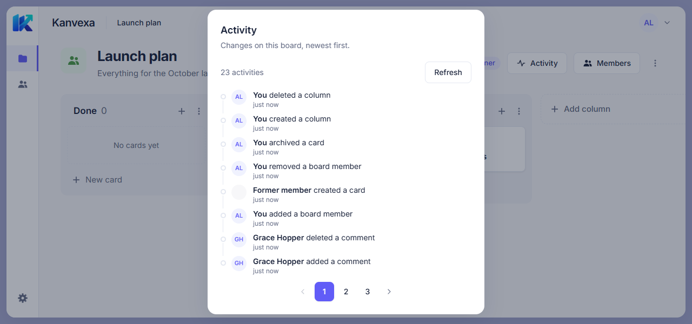
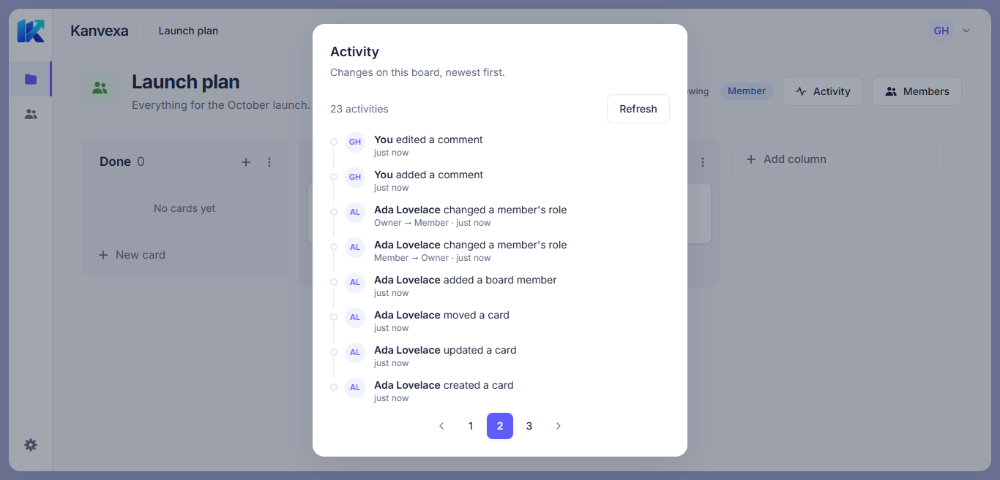
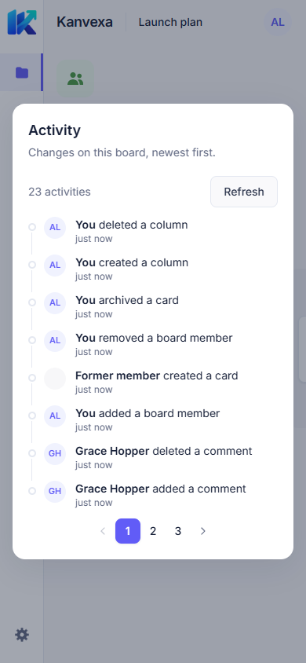

# Activity History Frontend (H2c)

Implements [issue #61](https://github.com/duongkienvn/SE2026-T13/issues/61) on
`feat/activity-history-frontend`, based on `e740461` (`main` at task start).
Backend, shared enums, realtime invalidation and Board DnD are unchanged.

An **Activity** button in the Board header (next to Members) opens a read-only
dialog with the Board's persisted activity records, newest first, as returned
by the H2a API. Every Board member can open it, including on archived Boards.

## API and data layer

```http
GET /api/boards/:boardId/activities?page=1&limit=8
Authorization: Bearer <accessToken>
```

| File                                  | Role                                                                  |
| ------------------------------------- | --------------------------------------------------------------------- |
| `features/activities/types.ts`        | `Activity`, a copy of `ActivityResponseDto` (8 fields, shared enums)  |
| `features/activities/api.ts`          | `listActivities` via `apiRequestPage`; `ACTIVITY_PAGE_LIMIT = 8`      |
| `features/activities/query-keys.ts`   | `[...boardKeys.detail(boardId), 'activities', page]`                  |
| `features/activities/hooks.ts`        | `useActivities(boardId, page, { enabled })`                           |
| `features/activities/format-activity` | `describeActivity`, `resolveActor`, `validTimestamp` (pure functions) |
| `components/ActivityHistoryDialog`    | Dialog, timeline rows, states, Refresh and numbered pages             |

- **Page size 8, not the backend default 20.** This is a deliberate change from
  the issue: one page of 8 rows fits the dialog at 1280×600 without scrolling
  (the app's no-scroll layout rule); 20 rows would not.
- The query runs only while the dialog is open (`enabled`) and never retries
  401/403/404. Reopening the dialog refetches stale data.
- Keys live under the board detail prefix, so the realtime resync after a
  socket (re)join also refreshes a mounted history. No `activity:*` events are
  emitted or consumed; otherwise the history refreshes through Refresh or by
  reopening the dialog.
- While the next page loads, the previous page stays on screen
  (`placeholderData`), but only for the same Board.
- Session changes already clear the whole query cache in `AuthProvider`.

## Labels

Rows read “**actor** action”, following the Activity rail in
[`card-detail.png`](../../design/screens/reference/card-detail.png).

| Action type       | Label                           | Detail from metadata                                |
| ----------------- | ------------------------------- | --------------------------------------------------- |
| `BOARD_UPDATED`   | updated the board               | —                                                   |
| `MEMBER_ADDED`    | added a board member            | —                                                   |
| `MEMBER_REMOVED`  | removed a board member          | — (`targetUserId` is never shown)                   |
| `ROLE_CHANGED`    | changed a member's role         | `Member → Owner` when both are valid                |
| `COLUMN_CREATED`  | created a column                | —                                                   |
| `COLUMN_UPDATED`  | updated a column                | —                                                   |
| `COLUMN_MOVED`    | reordered a column              | —                                                   |
| `COLUMN_DELETED`  | deleted a column                | —                                                   |
| `CARD_CREATED`    | created a card                  | —                                                   |
| `CARD_UPDATED`    | updated a card                  | —                                                   |
| `CARD_MOVED`      | moved a card / reordered a card | “reordered” only when `fromColumnId === toColumnId` |
| `CARD_ARCHIVED`   | archived a card                 | —                                                   |
| `COMMENT_CREATED` | added a comment                 | —                                                   |
| `COMMENT_UPDATED` | edited a comment                | —                                                   |
| `COMMENT_DELETED` | deleted a comment               | —                                                   |
| anything else     | made a change                   | —                                                   |

Card and column names are not shown: the API does not store them, and today's
names may differ from those at the time of the action. Ids, metadata and
email addresses are never rendered. Lookups use own keys only, so values such
as `"__proto__"` in metadata fall back instead of rendering `[object Object]`.

## Actors and times

`actorId` is a **user** id and is matched against `member.user.id` (never the
membership id). The signed-in user is shown as “You”, a current member by
display name and avatar, anyone else as “Former member” with a blank avatar.
The dialog waits for the member list before rendering rows, so current members
never flash as “Former member”.

Times show as relative text (“2 hours ago”) inside
`<time dateTime>`, with the exact local time (“Oct 22, 2026, 8:30 AM”) as its
`title`. An invalid timestamp renders “Unknown time” without a `<time>`.

## States

| Situation                          | UI                                                       |
| ---------------------------------- | -------------------------------------------------------- |
| Loading (activities or members)    | “Loading activity…”                                      |
| No records                         | “No activity yet”                                        |
| First load failed                  | “We couldn’t load activity” + Try again                  |
| Refresh failed with data on screen | Rows kept + “Activity could not be refreshed.”           |
| 403/404                            | Rows hidden, “Activity unavailable”, no retry or Refresh |
| 401                                | Session ends, cache cleared, route guard signs out       |
| Board becomes unavailable          | Board page shows “Board not found”; the dialog unmounts  |
| History shrinks below current page | Moves to the last valid page                             |

## Verification

Automated (Vitest + Testing Library), 74 new tests (71 in
`features/activities/`, 3 in the Board page):

- `api.test.ts`: path, `limit=8`, bearer token, envelope/meta validation,
  401/403/404, network error, abort signal.
- `format-activity.test.ts`: all 15 labels and coverage of every shared enum
  value, unknown actions, same/different column moves, role details, corrupt
  and prototype-key metadata, actor resolution, timestamps.
- `hooks.test.tsx`: disabled until open, cache isolation per Board/page,
  placeholder only within a Board, no retry on 404, refetch on board prefix
  invalidation.
- `ActivityHistoryDialog.test.tsx`: rows/actors/details/times, safe text,
  waiting for members, empty, pages, Refresh, page clamp, 404 and 401 hiding,
  background error, retry, Escape.
- `BoardDetailPage.test.tsx`: open from the header with focus return, archived
  Board readable, dialog gone when the Board returns 404.

New tests were mutation-checked: each targeted break of the implementation made
at least one test fail, except removing 401 from the dialog's access-error
check, which is unreachable because `runAuthorized` ends the session first.

Manual QA ran against a local PostgreSQL and backend. Three verified accounts
acted through the real REST API: Ada (owner) created the Board's columns and
cards and changed Grace's role twice. Grace commented, edited and deleted a
comment. Linus created a card and was then removed. That gave 23 records
covering all 15 action types.

| Check                                                  | Result                                                                          |
| ------------------------------------------------------ | ------------------------------------------------------------------------------- |
| Fit at 1280×600, 1366×657, 1536×730, 1920×945, 390×844 | 8 rows, 0px dialog and page overflow                                            |
| Ada's view                                             | “You …”, “Grace Hopper …”, Linus as “Former member”                             |
| Grace's view                                           | “You edited a comment”, “Ada Lovelace changed a member's role · Owner → Member” |
| Pages 1 → 3, Escape                                    | `page=1`/`page=3` with `limit=8`; focus returns to Activity                     |
| Linus after removal                                    | “Board not found”, no Activity button                                           |
| Header without the dialog                              | No overflow; on 390px the header actions wrap to two lines                      |

A move that leaves a card in the same place is not recorded by the backend, so
“reordered a card” was covered by unit tests only.

## UI evidence

| Desktop 1280×600 (owner)                                                                       | Desktop 1366×657 (member, page 2)                                                                          | Mobile 390×844                                                                                |
| ---------------------------------------------------------------------------------------------- | ---------------------------------------------------------------------------------------------------------- | --------------------------------------------------------------------------------------------- |
|  |  |  |

Compared with `card-detail.png`: same dot timeline, avatar, bold actor plus
verb, muted relative time. The rail is shown as its own dialog because the MVP
records Board-level activity; a per-Card rail is out of scope.
