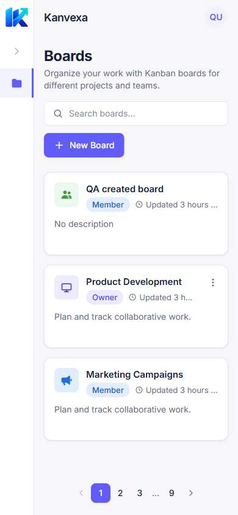
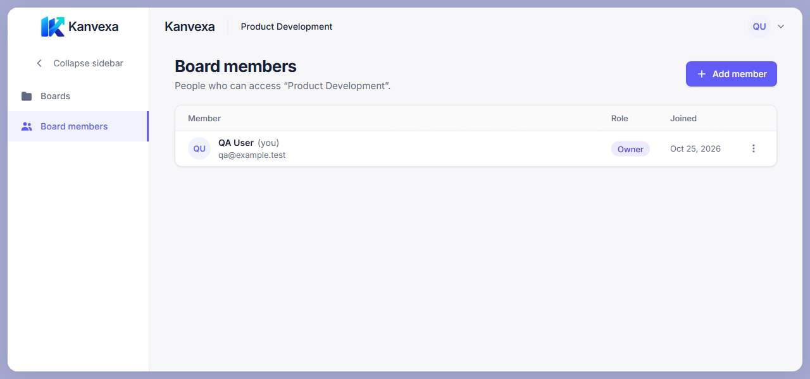

# Sidebar Navigation and Board Creation UX — Issue #81

## Context and scope

Implemented [Issue #81](https://github.com/duongkienvn/SE2026-T13/issues/81)
on `refactor/app-navigation-board-ux`, based on main `f4ab639`.
`git fetch origin` confirmed the existing task branch, local main and origin/main
shared that commit before implementation. The working tree was clean. Main
contains the merges of Google Authentication (#82) and Activity History (#83).
Issue #71 was still open; Archived Boards/Restore was absent from this base.

This is frontend UI polish. Backend, contracts, authentication, Google linking,
Profile business logic, Socket.IO and production configuration are unchanged.
No dependencies were added. Work stays in the user's existing checkout.

## Before and after

| Area                    | Before                                             | After                                                                                |
| ----------------------- | -------------------------------------------------- | ------------------------------------------------------------------------------------ |
| Sidebar                 | Fixed icon rail                                    | 224px desktop labels, optional 60px desktop rail, 56px phone rail                    |
| Board members           | Disabled outside a board, described as coming soon | Hidden until the current board is accessible; points to that board                   |
| Active navigation       | Most specific route selected                       | Preserved; Members is the only active item on the Members page                       |
| Settings                | Sidebar gear opened Profile                        | Removed; Profile and Log out remain in the avatar menu                               |
| Boards with data/search | Header CTA plus creation tile                      | One New Board button in the header; search contains real boards                      |
| Empty Boards            | Header CTA and empty-state CTA                     | One Create board button in the empty state                                           |
| Initial loading/error   | Header creation action already available           | No creation action until data establishes the appropriate state                      |
| Pagination              | Creation tile counted as a record                  | Real boards only; no creation-only final page; clamped URL follows data/grid changes |

Both creation entry points reuse the existing `CreateBoardDialog`. Validation,
mutation, authorization, invalidation and success notices remain intact.
Archive/Edit controls and OWNER/MEMBER behavior are retained.

## Sidebar state, navigation and accessibility

- At widths of at least 1024 CSS pixels, the sidebar defaults to expanded.
  The synchronous initial state reads `kanvexa.sidebar.expanded` in localStorage;
  only the literal `false` selects collapsed. Storage read/write failures fall
  back to in-memory state without interrupting navigation.
- Below 1024px, the rail stays compact and the expansion control is disabled
  with the explanatory title "Sidebar stays compact on narrow screens".
  This temporary responsive state never overwrites the desktop preference.
  Returning to desktop restores the user's previous choice.
- Desktop toggle buttons expose Collapse sidebar / Expand sidebar,
  `aria-expanded` and `aria-controls`. Native buttons support Tab/Enter/Space.
  Focus outlines, nav accessible names, icon titles, active background and
  inset active marker are retained. Only labels disappear on collapse.
- Official artwork keeps its aspect ratio. Expanded labels can wrap; there is
  no width animation or motion preference requirement. The navigation area can
  scroll if unusually short viewports or enlarged text need it.
- Empty secondary navigation does not render an empty list. Boards is always
  present in the authenticated shell. Settings is removed from configuration;
  there are no new Settings, global Members, Teams or Workspace routes.
- Board context comes from the deepest route match and the existing board
  query. Members is hidden while a new board loads and after board 403/404,
  including failed background refreshes with cached data.
- The shell also observes the existing members query with `enabled: false`.
  A members 403/404 hides the scoped navigation and cached header name even if
  it arrives before the next board refetch. The optional `enabled` parameter
  on `useBoardMembers` defaults to true for existing consumers. The shell
  observer does not add a request or change invalidation behavior.

## Board grid and pagination

`CREATE_TILE` and its only component consumer were removed. `paginate` receives
the filtered Board array directly. Out-of-range pages are reflected back into
`?page=` only after data loads and the grid measures its container and row
height, preserving unrelated query parameters. Empty results can normalize to
page 1 without a row. Initial loading and fallback layout do not discard a
requested page. Search still returns to page 1.

`useFitGrid` already observes the content container with ResizeObserver. Its
production implementation needed no change: sidebar width changes trigger a
new column/page-size calculation. A new observer test covers shrinking and
restoring the container width. Page clamp also handles refreshed data shrinking
below the current page and returning to the empty-state action.

## Files changed

All source/test paths below are under `apps/frontend/src/`:

- Source: `app/layout/Sidebar.tsx`, `useSidebarPreference.ts`, `navigation.ts`,
  `AuthenticatedLayout.tsx`; `features/board-members/hooks.ts`;
  `features/boards/components/BoardCard.tsx`; `features/boards/pages/BoardsPage.tsx`.
- Tests: `app/layout/Sidebar.test.tsx`, `AuthenticatedLayout.test.tsx`;
  `features/boards/pages/BoardsPage.test.tsx`, `BoardManagement.test.tsx`,
  `BoardDetailPage.test.tsx`; `hooks/useFitGrid.test.tsx`.
- Documentation: this record and `docs/tasks/README.md`.
- Evidence: four JPEGs under
  `docs/design/screens/implementation/app-navigation-board-ux/`, linked below.

## Automated verification

### PR #85: completed grid measurement before URL normalization

The P2 review identified a cached-list Back navigation race: the initial
4-row/3-column fallback gives 12 boards per page. For 14 cached boards, it
incorrectly normalizes a valid `?page=5` to page 2 before the actual two-board
capacity is measured. A layout-effect update does not cancel a passive effect
captured by the earlier render.

`useFitGrid` now exposes the additive `isMeasured` result. It becomes true only
after reading a nonzero container width/height and row height, including when
the measured capacity happens to equal the fallback. Width-only measurements
remain incomplete. Unmeasurable containers/rows clear the flag. Other consumers
keep the existing rows, columns, pageSize and ref behavior.

BoardsPage waits for loaded data and this completed measurement before
normalizing a nonempty result. A genuinely empty loaded/filter result can
normalize to page 1 without waiting for a nonexistent row. There are no timers
or special page sizes in the production fix.

Regression tests use the real hook with controlled geometry/ResizeObserver:
cached list → board → Back to page 5, both synchronous and deferred measurement;
fallback 12 → measured 2; partial width-only measurement; invalid page 99 → 7;
empty data; preserved unrelated query parameters; and capacity changes while
toggling the sidebar. Existing jsdom tests that expect URL normalization now
provide actual row/container geometry rather than treating fallback as measured.

Follow-up verification on 25 October 2026:

- Before the fix, the cached Back regression failed with `?page=2` instead of
  `?page=5`; the incomplete-measurement invalid-page regression also failed.
- Targeted hook/BoardsPage/BoardManagement/BoardMembersPage: **65 tests passed**.
- `pnpm lint`, `pnpm build`, changed-file Prettier with `--end-of-line auto`
  and `git diff --check`: passed. Existing build warnings remain.
- `pnpm test`: **588 frontend tests passed, 3 unchanged auth tests failed**
  (the ProfilePage status query and two RegisterPage status queries described
  below); shared tests passed. No auth tests/configuration were changed.
- `pnpm format:check`: reported **469 files** in the current checkout, including
  files outside this follow-up. Unrelated formatting review feedback on the
  landing-page design documentation was left outside this pagination fix.
- Chrome with synthetic APIs and 14 boards: at 390×700, page 5 shows boards
  9–10 and survives opening a board then browser Back; instrumented history
  recorded no replacement URL. Page 99 normalizes to 7 with `view=grid` intact.
  At 1040×600, collapsing the sidebar changes capacity from 4 to 6 and clamps
  page 4 to page 3. Inspected screenshots had no main overflow; console checks
  after navigation were clean. This verifies browser rendering/history with
  fixture data, not backend authentication end-to-end behavior.

### Initial Issue #81 verification

Executed on Windows on 25 October 2026:

| Check                                                                  | Result                                                                                                                                  |
| ---------------------------------------------------------------------- | --------------------------------------------------------------------------------------------------------------------------------------- |
| Targeted layout, Boards, Board members, grid and UserMenu tests        | 15 files, 129 tests passed                                                                                                              |
| `pnpm lint`                                                            | Passed                                                                                                                                  |
| `pnpm build`                                                           | Passed; existing NODE_ENV and chunk-size warnings remain                                                                                |
| `pnpm test` with local configuration                                   | Failed in three unchanged auth tests: one ProfilePage status query and two RegisterPage status queries encounter the GIS loading status |
| Full frontend with test-process Google config disabled and two workers | 66 files, 583 tests passed                                                                                                              |
| Backend suite                                                          | 47 suites, 447 tests passed                                                                                                             |
| Shared tests in workspace run                                          | 6 passed                                                                                                                                |
| `pnpm format:check`                                                    | Failed: 470 files reported in the Windows checkout                                                                                      |
| Changed source/test files with Prettier `--end-of-line auto`           | Passed                                                                                                                                  |
| `git diff main --check`                                                | Passed                                                                                                                                  |

The passing full frontend command was:

```powershell
$env:VITE_GOOGLE_CLIENT_ID=''
pnpm --filter @kanban/frontend test --maxWorkers=2
```

This overrides the environment of that test process only; `.env` and production
configuration were not edited. Google-specific tests provide their own fake GIS
configuration. An unrestricted concurrent run also encountered an auth test
timeout while checks competed for CPU; the bounded run above completed.
`git diff --quiet main -- apps/frontend/src/features/auth` confirmed no auth
source or tests changed. The default workspace failure is reported, not hidden
by the separate successful run.

Targeted command:

```sh
pnpm --filter @kanban/frontend test src/app/layout src/features/boards src/features/board-members src/hooks/useFitGrid.test.tsx src/features/auth/components/UserMenu.test.tsx
```

Coverage includes desktop defaults, toggle/remount persistence, blocked storage,
responsive restoration, current board routes, revoked access with cached data,
Profile via the account menu, empty secondary navigation, creation from both
states, notices, validation, Edit/Archive permissions, loading/error/search,
12/13/25-board pagination boundaries, URL clamp and ResizeObserver callbacks.
The multi-route integration test has a scoped 15-second timeout for busy full
suite runs; assertions and route coverage remain intact.

## Browser QA and evidence

Chrome DevTools ran the real Vite frontend against a temporary localhost-only
synthetic REST/Socket.IO server, with fixture accounts, boards, columns and
cards. No production data or credentials were used. This verifies rendered
behavior, not real backend or Google authentication end-to-end behavior.

All four routes (Boards, Board Detail, Board members, Profile) were loaded and
DOM-measured at each viewport below: 24 route/viewport checks. Actual
`innerWidth`/`innerHeight` were checked; mobile used device emulation because
resizing the desktop Chrome window alone stops at a minimum width.

| CSS viewport | Sidebar | Boards / Detail / Members main overflow (horizontal, vertical) | Profile main overflow |
| ------------ | ------- | -------------------------------------------------------------- | --------------------- |
| 1280×600     | 224px   | 0, 0                                                           | 0, 73px               |
| 1366×657     | 224px   | 0, 0                                                           | 0, 32px               |
| 1536×730     | 224px   | 0, 0                                                           | 0, 0                  |
| 1920×945     | 224px   | 0, 0                                                           | 0, 0                  |
| 390×844      | 56px    | 0, 0                                                           | 0, 3px                |
| 320×844      | 56px    | 0, 0                                                           | 0, 23px               |

There was no document-level horizontal overflow. The Kanban canvas retains
its intentional horizontal scroll for columns. Profile uses the existing
single main scrollbar on short/narrow screens; this task does not redesign its
form or Connected Accounts section.

Additional browser checks actually performed:

- Enter collapses the desktop rail; Space expands it. Focus stays on the toggle.
  Reload restores the collapsed 60px rail. Desktop → mobile → desktop restores
  the expanded preference. Route transitions keep the preference.
- Boards page 2 updates `?page=2`; a no-results search resets the URL and keeps
  exactly one New Board action. Empty/error states show the expected sole
  Create board / Try again action respectively.
- Creation succeeds through the header and through the empty-state CTA.
  At 320px, the create dialog spans x=16..304 with no internal overflow.
  Creating the first board shows its card, success notice and one header CTA.
- Keyboard Card DnD moved cards between columns with both sidebar widths;
  the fixture server recorded two successful move mutations. No DnD production
  code changed.
- Navigation to Members selects only Board members. Final console checks after
  the observer fix contained no errors/warnings. Normal fixture API calls
  returned 200; development StrictMode/navigation cancellation also produced
  aborted requests. The deliberate error-state request returned 403.
- Avatar → Profile displays Connected Accounts without sidebar Members/Settings.
  Log out returns to `/login` and removes authenticated navigation.

Screenshots were visually inspected. `boards.png` in the approved reference
directory was inspected alongside the rendered board list: colors, typography,
border/active treatment and compact cards remain consistent. The expanded
sidebar and absent dashed tile are intentional departures required by #81.
Reference files were not edited.

| Desktop Boards                                                                                              | Mobile Boards                                                                                            |
| ----------------------------------------------------------------------------------------------------------- | -------------------------------------------------------------------------------------------------------- |
|  |  |

| Board Detail                                                                                    | Members                                                                                                  |
| ----------------------------------------------------------------------------------------------- | -------------------------------------------------------------------------------------------------------- |
|  |  |

## Remaining manual checks and limitations

- **NOT VERIFIED:** real backend multi-user permissions, real GIS/Google linking
  and production end-to-end behavior. Their implementation was not changed.
- **NOT VERIFIED:** successful pointer/touch DnD mutation. The browser pointer
  drag attempt did not produce a confirmed mutation; keyboard DnD did.
- **NOT VERIFIED:** actual 200% browser zoom and screen-reader speech output.
  Follow-up: zoom each authenticated route, Tab through controls, check long
  labels/text scaling and announce expanded/current-page states with a reader.
- **NOT VERIFIED:** Archived Boards/Restore (#71), which is not on this base.
  Recheck overlap with BoardsPage when that feature lands.
- Repository-wide formatting and the local-config auth test failures remain
  outside this task. No unrelated formatting or auth fixes were included.

## Local delivery and PR draft

Seven meaningful local commits cover sidebar UI, responsive preference,
navigation, the creation action, pagination, regression tests, and final access
handling/documentation/evidence. No push, PR creation, merge or deployment is
authorized or performed.

Title: `refactor(ui): polish sidebar navigation and board creation UX`

### Summary

- Add an accessible desktop sidebar with a persisted compact preference and
  responsive rail.
- Limit Members navigation to accessible board context and keep Profile in the
  account menu.
- Show one board creation action per state and paginate real boards only.
- Add regression coverage and Chrome QA evidence.

### Testing

- Targeted tests: 129 passed; full frontend with test-process Google config
  disabled and two workers: 583 passed.
- Lint and build passed; shared tests passed. See the verification table for
  backend results and the default workspace/format limitations.
- Chrome: six viewports, four routes, preference/reload, keyboard toggle,
  search/pagination, creation and keyboard Card DnD with synthetic APIs.

Closes #81
