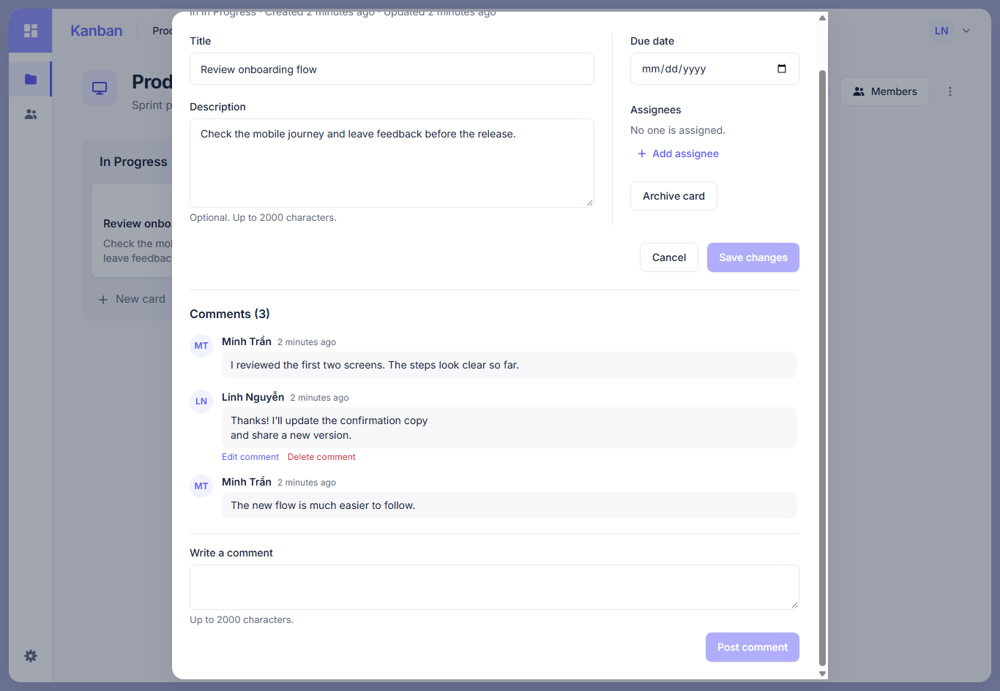
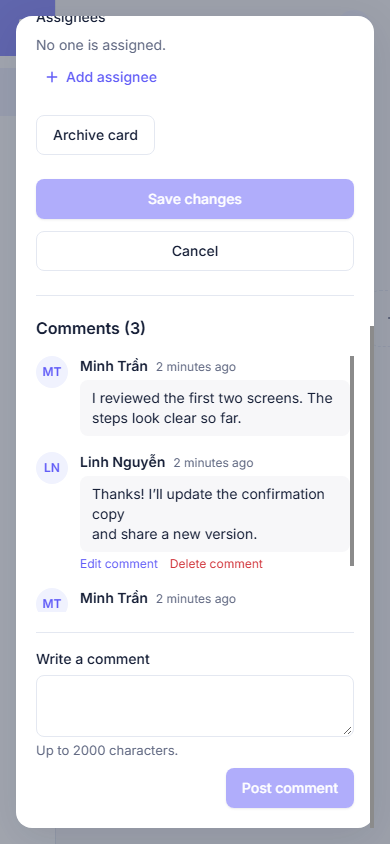

# Comments in Card Detail (H1b)

The Card Detail dialog loads the H1a REST comments list in ascending order, 20 per page. A signed-in Board member can post comments and edit or soft-delete their own comments. Author names and avatars are resolved from Board Members or the current User; unavailable authors appear as “Former member”. Archived Boards and Cards remain readable without write controls. The backend still enforces every permission.

The comments section is separate from the Card edit form. After a successful REST mutation, the pages of that Board/Card are invalidated; posting navigates to the last page. Closing and reopening the dialog refetches stale comments. Session changes clear private query data through the existing AuthProvider.

H1b does not implement comment Socket.IO events or Activity integration. Another browser sees changes on refetch/reopen, not automatically; realtime comments belong to H1c.

## UI evidence

Captured from the running frontend at 1366×945 and 390×844 with a local PostgreSQL/backend. Two test accounts, a Board, a Card and three Comments were created through the actual REST API for the captures (not static mock responses). The Card Detail dialog is scrolled to the Comments section so the list and composer are visible.

| Desktop                                                                                         | Mobile                                                                                        |
| ----------------------------------------------------------------------------------------------- | --------------------------------------------------------------------------------------------- |
|  |  |
