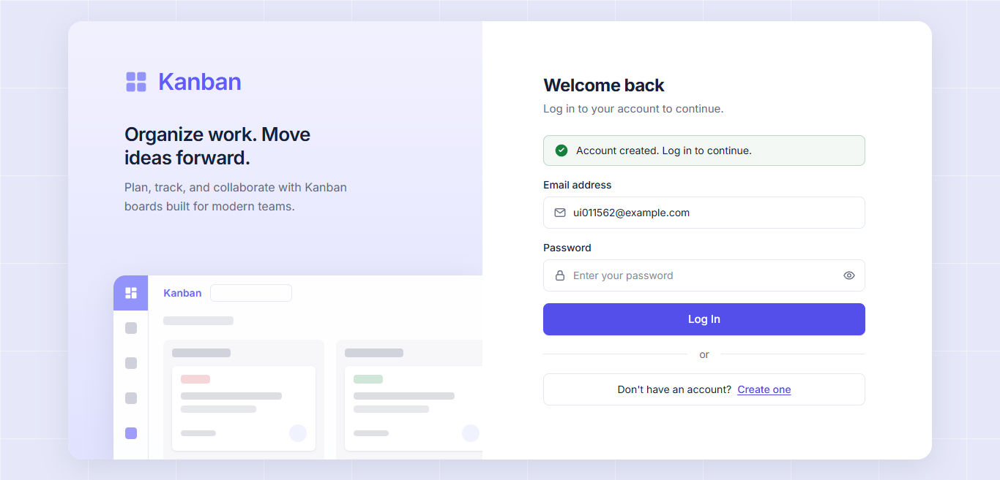
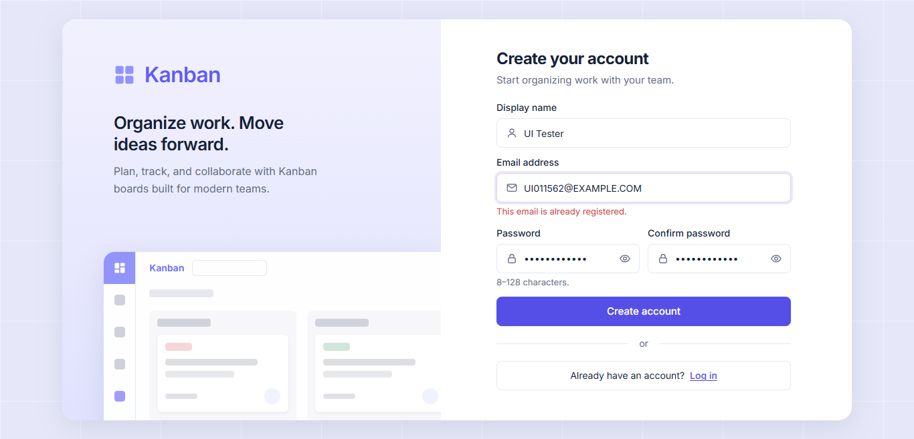
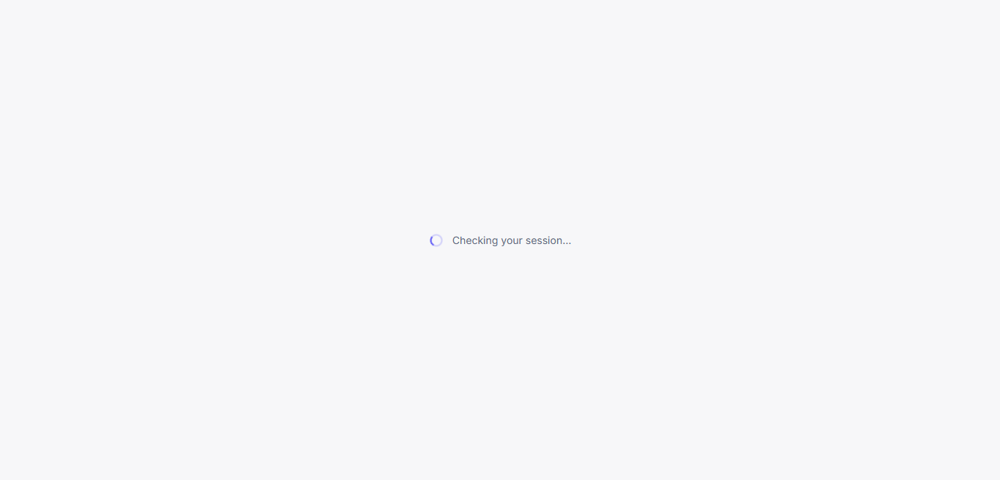
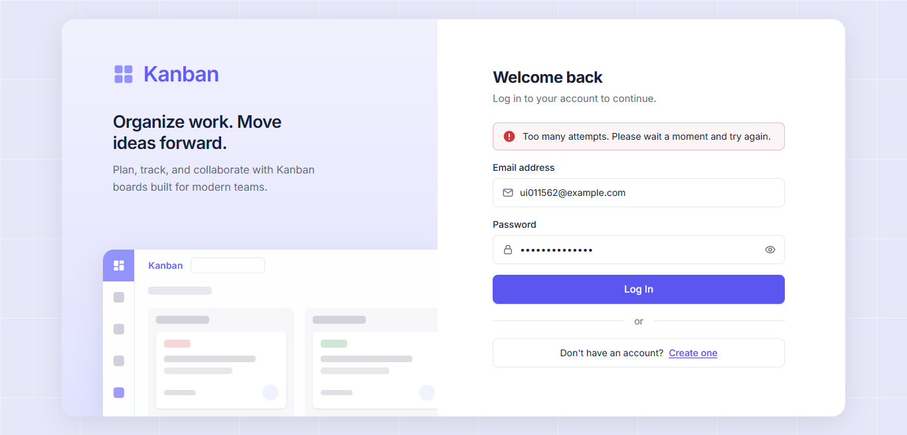

# Frontend Authentication ↔ real backend (#25)

Follow-up of #17 (PR #23), which was merged against contract mocks before
Backend Authentication (#16) existed. This records the run against the real
backend. No frontend code had to change.

## Setup — 2026-10-15

- `main` at `3c5127a` (includes #16 via PR #26 and the #29 hotfix).
- `.env` copied from `.env.example` with a random `JWT_SECRET`;
  `docker compose up -d`; `pnpm --filter @kanban/backend migration:run`.
- Backend `pnpm --filter @kanban/backend dev` on `:3000`, frontend
  `pnpm --filter @kanban/frontend dev` on `:5173`
  (`VITE_API_BASE_URL=http://localhost:3000/api`).
- Checks were scripted (Node `fetch` for the API, Playwright with local Chrome
  for the UI) so they can be repeated. Login is limited to 10 requests per
  minute per IP, so runs were spaced at least a minute apart.

## Contract vs frontend assumptions — 23/23 match

| Assumption (`features/auth`, `form-errors`)                          | Real backend                                                                |
| -------------------------------------------------------------------- | --------------------------------------------------------------------------- |
| `POST /auth/logout` → `204`                                          | `204`, empty body                                                           |
| `expiresIn` in seconds                                               | `3600`, equal to the JWT `exp − iat`                                        |
| `EMAIL_ALREADY_EXISTS` (409)                                         | ✔ (also for the same email in another case)                                 |
| `INVALID_CREDENTIALS` (401)                                          | ✔ — same code and message for an unknown email                              |
| `TOO_MANY_REQUESTS` (429)                                            | ✔ (message is the raw `ThrottlerException: Too Many Requests`, never shown) |
| `VALIDATION_FAILED` (400), details `"<field>: <message>"`            | ✔ e.g. `"password: password must be longer than or equal to 8 characters"`  |
| `LoginResponse` `{ accessToken, tokenType, expiresIn, user }`        | ✔ identical keys, `tokenType: "Bearer"`                                     |
| `User` `{ id, email, displayName, avatarUrl, createdAt, updatedAt }` | ✔ identical keys                                                            |
| Register returns the user, no token                                  | ✔ email trimmed and lowercased, display name trimmed                        |
| `PATCH /users/me` partial; `avatarUrl` HTTPS or `null`               | ✔ `http://` rejected (400), `null` clears it, empty body rejected (400)     |
| Rejected token → `401 UNAUTHORIZED`                                  | ✔ for tampered, expired and missing tokens                                  |

`packages/shared` still has no auth types, so the frontend keeps its copies in
`apps/frontend/src/features/auth/types.ts`.

## End-to-end in Chrome — 36/36 pass

- **Register** → Login with "Account created. Log in to continue."; nothing is
  stored, so the user is not signed in.
- **Duplicate email** (typed in uppercase) → "This email is already
  registered." on the email field.
- **Wrong password** and **unknown email** → the same "Incorrect email or
  password."
- **Login** → `/boards`; the token is in `sessionStorage` only (nothing in
  `localStorage`), expiring 3600 s after login.
- **Reload** with `GET /users/me` delayed by 1.5 s → only "Checking your
  session…" is shown (no protected content, no login form), then the session
  is restored.
- **Profile** sends only what changed: `{"displayName": …}`,
  `{"avatarUrl": "https://…"}`, or `{"avatarUrl": null}` when cleared. An
  `http://` avatar is rejected before any request. Changes persist after a
  reload.
- **Logout** calls `POST /auth/logout`, clears the token and returns to
  Login; `/boards` then redirects to Login. With the logout request forced to
  fail (500) the user is still signed out locally.
- **Switching users** never shows the previous user's data.
- **Token rejected by the server** (a correctly signed but expired JWT, while
  the stored expiry still looked valid) → session cleared, back to Login;
  after logging in again the user returns to the page they asked for.
- **Stored expiry passing** while the tab is open → back to Login.
- **429** after repeated failed logins → "Too many attempts. Please wait a
  moment and try again."; the raw throttler message never appears.
- Browser console: only the expected HTTP statuses (401, 409, 429, the forced
  500, and the existing favicon 404).

## Notes

- Logout is stateless by design ([backend authentication](../backend/backend-authentication.md)): the
  token stays valid on the server until `exp`. The frontend clears it locally
  in every case.

## Screenshots

| Account created                                                                                       | Duplicate email                                                                                       |
| ----------------------------------------------------------------------------------------------------- | ----------------------------------------------------------------------------------------------------- |
|  |  |

| Reload: session check                                                                             | Rate limited (429)                                                                              |
| ------------------------------------------------------------------------------------------------- | ----------------------------------------------------------------------------------------------- |
|  |  |
