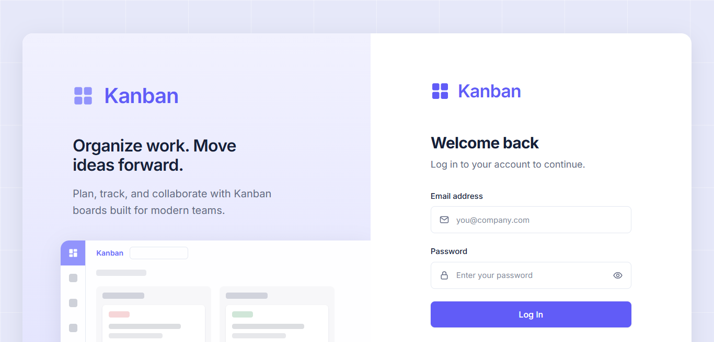
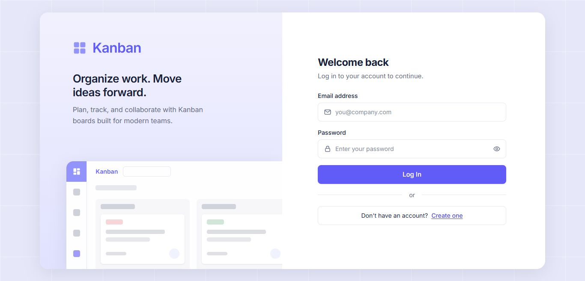
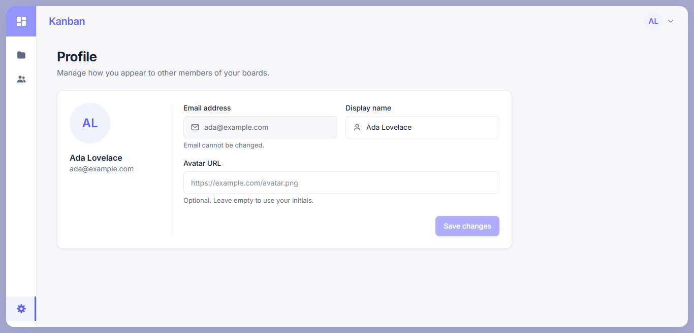
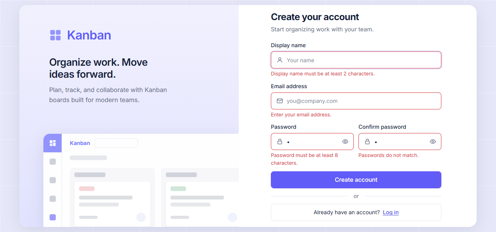
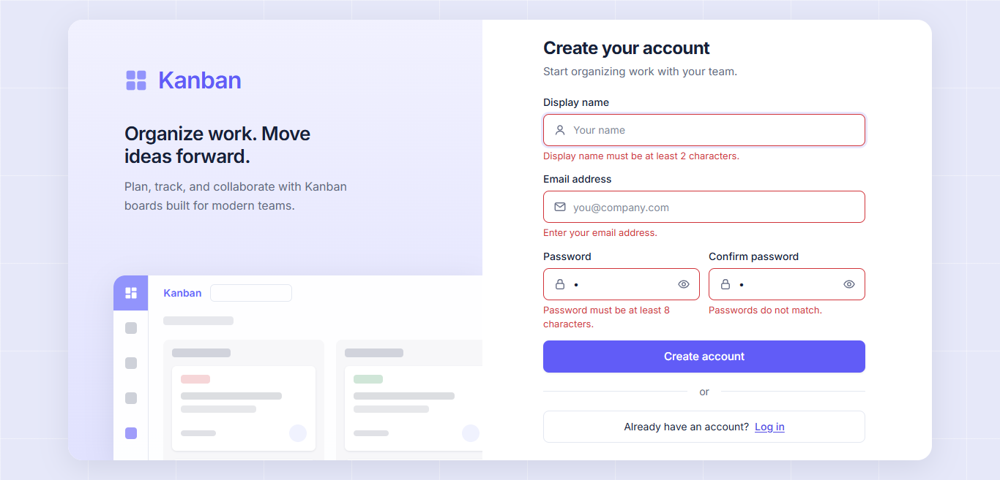
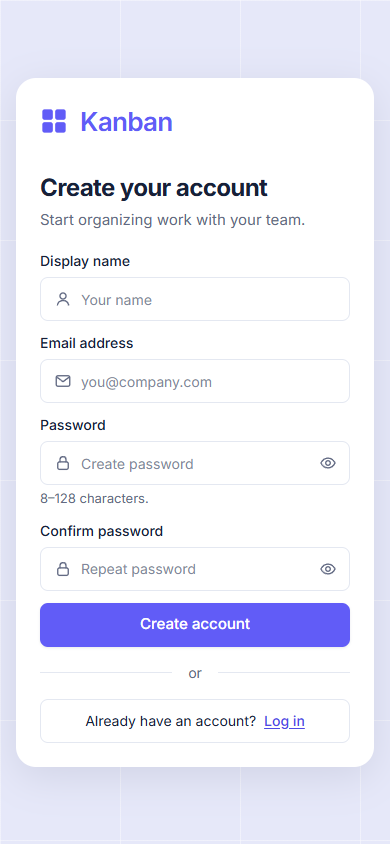

# Frontend Compact Layout

Task `fix/frontend-compact-layout` (PR #28) điều chỉnh các màn hình đã có để sử
dụng tốt trên laptop có viewport thấp, thay vì sao chép nguyên kích thước của
ảnh thiết kế 1672 px rồi tạo page scroll.

## Vấn đề được xử lý

- Login và Register bị tràn chiều cao ở viewport 1280×600 hoặc 1366×657.
- App shell và Profile dùng khoảng cách quá lớn so với chiều cao khả dụng.
- Error state của Register có thể đẩy form ra ngoài màn hình.
- Các breakpoint theo chiều rộng chưa đủ để xử lý màn hình thấp.

## Thay đổi đã hoàn thành

- Thu gọn control, khoảng cách và chiều cao của auth frame nhưng vẫn giữ visual
  hierarchy từ thiết kế tham chiếu.
- Đặt hai password field của Register cạnh nhau từ breakpoint `sm`.
- Thêm biến thể Tailwind `short:` cho viewport cao tối đa 640 px.
- Thu gọn header, side rail, Profile và các vùng content của app shell.
- Quy định màn hình nghiệp vụ không page-scroll; danh sách dài dùng phân trang,
  còn vùng Kanban tự scroll theo trục phù hợp.
- Ghi lại các viewport kiểm chứng trong design guidelines.

## Lịch sử triển khai

| Commit    | Nội dung                                       |
| --------- | ---------------------------------------------- |
| `b14a39b` | Fit Login và Register mà không page-scroll     |
| `5364d32` | Thu gọn app shell và Profile                   |
| `2d3c480` | Ghi lại fit-to-viewport rule và ảnh kiểm chứng |

## Ảnh kiểm chứng

| Trước khi sửa                                                                                                   | Login 1366×657                                                                                   | Profile 1366×657                                                                                     |
| --------------------------------------------------------------------------------------------------------------- | ------------------------------------------------------------------------------------------------ | ---------------------------------------------------------------------------------------------------- |
|  |  |  |

| Register errors 1280×600                                                                                                 | Register errors 1366×657                                                                                                 | Register mobile                                                                                     |
| ------------------------------------------------------------------------------------------------------------------------ | ------------------------------------------------------------------------------------------------------------------------ | --------------------------------------------------------------------------------------------------- |
|  |  |  |
