# Kanban Board UI and drag-and-drop (#35)

E3 of Phase E. It replaces the "Columns and cards are coming soon" placeholder
on `/boards/:boardId` with a working Kanban board on top of the Column (#33)
and Card (#34) APIs. Everything is saved through REST, and the backend stays
the source of truth. Realtime sync is #43.

## What is built

- **Board:** columns in `position, id` order, each with its active cards and
  their count. A card shows its title, a two-line description preview, its
  due date ("Overdue" in red once the day has passed) and up to three
  assignee avatars plus "+N". The page never scrolls: the board scrolls
  sideways and each column scrolls down inside itself.
- **Columns:**
  - An "Add column" tile after the last column, and a button in the empty
    board state.
  - A ⋮ menu to rename or delete a column. Delete asks for confirmation, and
    it is unavailable while the column holds active cards.
- **Cards:**
  - "+ New card" at the bottom of a column, or "+" in its header, opens a
    title box. Enter adds the card and keeps the box open; Escape closes it.
  - Clicking a card opens the detail dialog. There you edit the title,
    description and due date (one Save button), assign or remove board
    members, and archive the card after a confirmation shown inside the same
    dialog.
- **Drag-and-drop (dnd-kit):**
  - Reorder columns. Reorder cards in a column, or move them to another
    column, into an empty column, or below the last card.
  - Mouse drags start after a 6 px move, so a click still opens the card.
    Touch drags start after a 250 ms hold, so swipes still scroll.
  - Keyboard: each card and column has a grip button. Space picks the item
    up, the arrow keys move it, Space drops it and Escape cancels. Screen
    readers hear what moved where.
- **Read-only cases:**
  - On an archived board, every change control is hidden and the card dialog
    is read-only.
  - An archived card opened in the dialog is read-only too.
  - If access to the board is lost (403 or 404), the existing "Board not
    found" screen is shown and no cached columns or cards remain on screen.

Left out on purpose (not in the MVP or without an API): priority, labels,
checklist, attachments and status from the designs. Comments and Activity
belong to Phase H. No placeholder controls were added for any of them.

## Decisions

| Topic            | Decision                                                                                                                                                                                                                                                                                                                                                                                                                       |
| ---------------- | ------------------------------------------------------------------------------------------------------------------------------------------------------------------------------------------------------------------------------------------------------------------------------------------------------------------------------------------------------------------------------------------------------------------------------ |
| Overflow         | Board scrolls horizontally, columns vertically. This is an exception to the numbered-pages rule, because dragging across pages would not work.                                                                                                                                                                                                                                                                                 |
| Card detail      | Dialog state only, no new route (`routes.tsx` unchanged).                                                                                                                                                                                                                                                                                                                                                                      |
| Due date         | Date only. A picked day is stored as 23:59:59.999 that day in the user's timezone, sent as ISO with `Z`. Re-saving the same day keeps the stored time.                                                                                                                                                                                                                                                                         |
| Saving edits     | One "Save changes" button that sends only the changed fields (never an empty PATCH). A blank description is sent as `null`. Assignees apply straight away.                                                                                                                                                                                                                                                                     |
| Optimistic moves | While dragging, and until the move is saved, the board shows a local preview of the new order. Nothing computes `position` on the client. The request carries only the anchor (`toColumnId` + `beforeCardId`, or `beforeColumnId`), taken from the item after the dragged one. A drop that changes nothing sends nothing. Further drags wait for the save. A failure drops the preview (rollback), refetches and explains why. |
| Types            | `@kanban/shared` has no Column or Card types, so the frontend keeps copies in `features/columns/types.ts` and `features/cards/types.ts`, as it does for boards.                                                                                                                                                                                                                                                                |

## Contract notes (real backend on `main` at `5482f89`)

The implementation matches the contract in the issue. These details differ or
were left out of it:

- `description` is not trimmed by the backend. The UI trims it and sends
  blank as `null`.
- Every UUID in a request body or query must be a v4 UUID.
- Archiving an already archived card returns 409 `CARD_ARCHIVED`.
- `POST …/assignees` returns the assignee (`{ userId, assignedById, createdAt }`),
  not the card, and assignees carry no user details. Names and avatars come
  from the board's member list.
- A non-member always gets 404, never 403.
- OWNER and MEMBER may make every column and card change.
- `DELETE` on a column returns 409 `COLUMN_NOT_EMPTY` while **any** card,
  including an archived one, is in it. Since there is no card restore UI yet,
  a column that ever held an archived card cannot be deleted at all. The UI
  explains this. **Team decision needed** if that should change.

## Validation — 2026-10-17

Local setup as in `frontend-auth-integration.md`: Docker Postgres, backend
`:3000`, frontend `:5173`. Each run used a freshly seeded board, built through
the API: 5 columns and 11 cards, OWNER ada, MEMBERs grace and alan.

- `pnpm lint`, `pnpm build`, `prettier --check` on the changed files: pass.
- **Frontend tests: 241 pass.** They cover precision-safe position ordering,
  every page of results being loaded, the move-anchor maths, all hooks, and
  the UI flows. Mutation checks: I broke the code on purpose 27 times, and a
  test failed every time; for 2 of them (the save lock and the rollback) the
  failing test was the browser script.
- **Root `pnpm test` stops before reaching the frontend.** This is not caused
  by this branch: on `main`, `packages/shared`'s
  `test/realtime-contracts.ts` imports `src/index.js`, which does not exist
  (`ERR_MODULE_NOT_FOUND`).
- **Browser checks** (Playwright with local Chrome against the real backend,
  all passing on the final code):
  - Columns, as MEMBER: create (trimmed, appended last), rename (Save disabled
    until the name changes), delete an empty column, delete blocked while
    active cards exist, the 409 when only archived cards are left, and the
    order kept after a reload. MEMBER can also reorder columns.
  - Cards, as OWNER:
    - The add box stays open for the next card.
    - Edit description and due date (2026-10-30 saved as
      `2026-10-30T16:59:59.999Z`, which is 23:59 in UTC+7).
    - Assign and remove persisted, and the board updates behind the dialog.
    - An archived card is archived on the server and gone from the board.
  - Drag-and-drop (16 checks):
    - Reorder to the top of a column, move into the middle of another column,
      into an empty column and to the end of a column, and reorder columns.
    - A click still opens the card. Escape sends nothing. A keyboard move
      down saves, and screen readers hear the announcement.
    - A forced 500 rolls back with a message. The new order shows at once,
      with dragging locked until the save finishes. The order survives a
      reload.
    - Grips are hidden until hover or focus with a mouse.
    - Also checked: keyboard ArrowRight into the next column, and on touch a
      quick swipe scrolls while a press-and-hold drags.
  - Remaining issue checks (12):
    - No page scroll at 1280×600, 1366×657, 1536×730, 1920×945 and 390×844.
    - A card archived by someone else and then dragged gives "The board
      changed…" and the card disappears.
    - A MEMBER removed while the page is open sees "Board not found" on
      refocus, with no cards left on screen.
    - A non-member sees "Board not found" and nothing else.
    - 105 cards in one column (two API pages) all appear, in order.
    - On an archived board there are no change controls and the dialog is
      read-only.
  - Browser console: only the expected 404/409 responses, the forced 500, and
    the existing `/favicon.ico` 404.
- Bugs found during these checks and fixed before the final runs:
  - "Maximum update depth exceeded" when dragging a card across columns.
    The fix is the last-target caching from dnd-kit's multi-container
    example.
  - A rotated drag preview broke keyboard ArrowDown, because keyboard moves
    measure the preview's box.
  - Visually hidden text inside cards below the fold made the page scroll.
  - `TextAreaField` had no disabled styling.

Not covered: real phones and tablets. Touch was tested with Chrome's DevTools
touch emulation.

## Screenshots

| Board, 1366×657                                                                    | Board, 1920×945                                                                    | Phone, 390×844                                                                   |
| ---------------------------------------------------------------------------------- | ---------------------------------------------------------------------------------- | -------------------------------------------------------------------------------- |
| 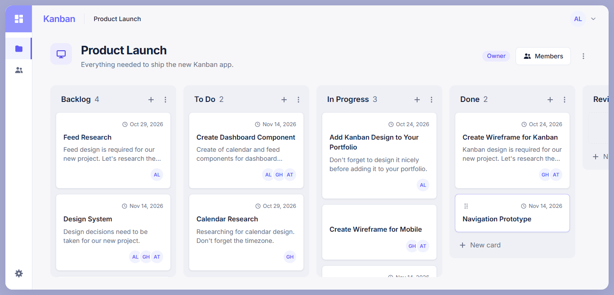 | 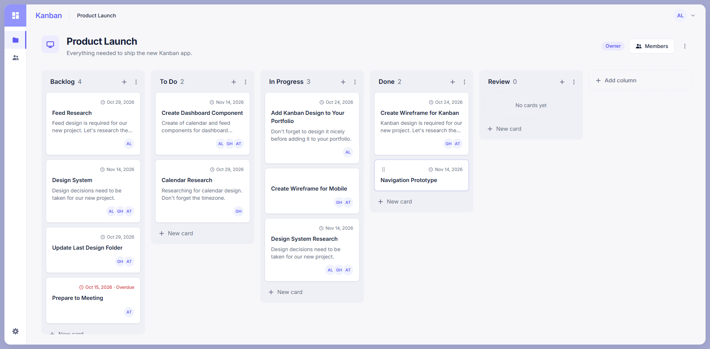 | 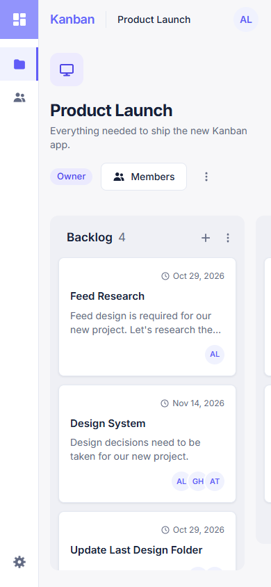 |

| Card detail                                                                      | Adding a card                                                              | Archive confirmation                                                               |
| -------------------------------------------------------------------------------- | -------------------------------------------------------------------------- | ---------------------------------------------------------------------------------- |
| 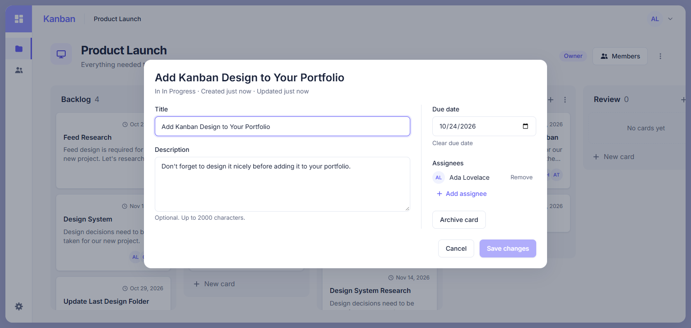 | 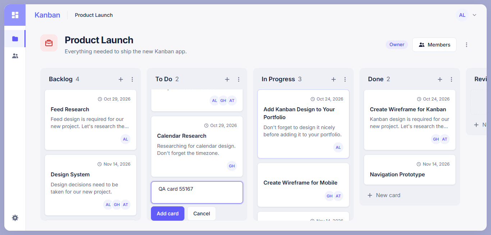 | 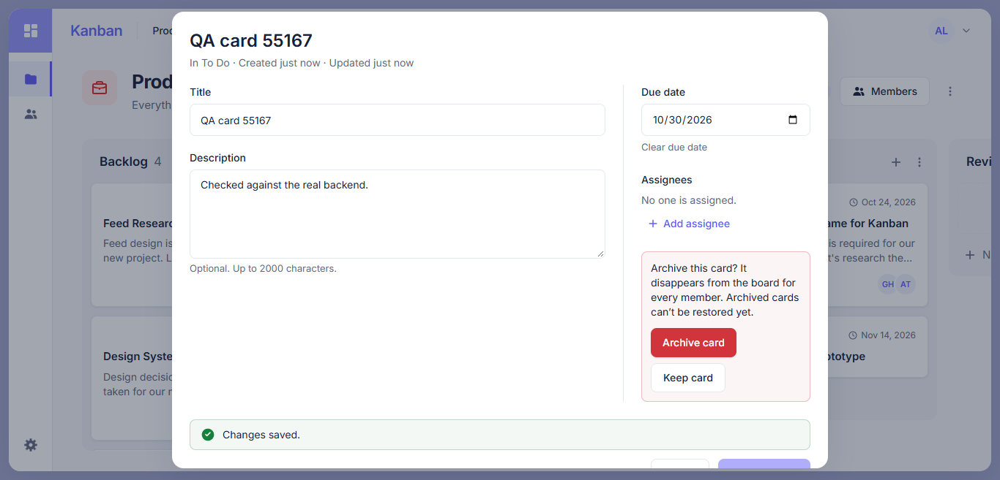 |

| Dragging across columns                                                    | Move failed (500), rolled back                                                         | Board changed meanwhile                                                               |
| -------------------------------------------------------------------------- | -------------------------------------------------------------------------------------- | ------------------------------------------------------------------------------------- |
| 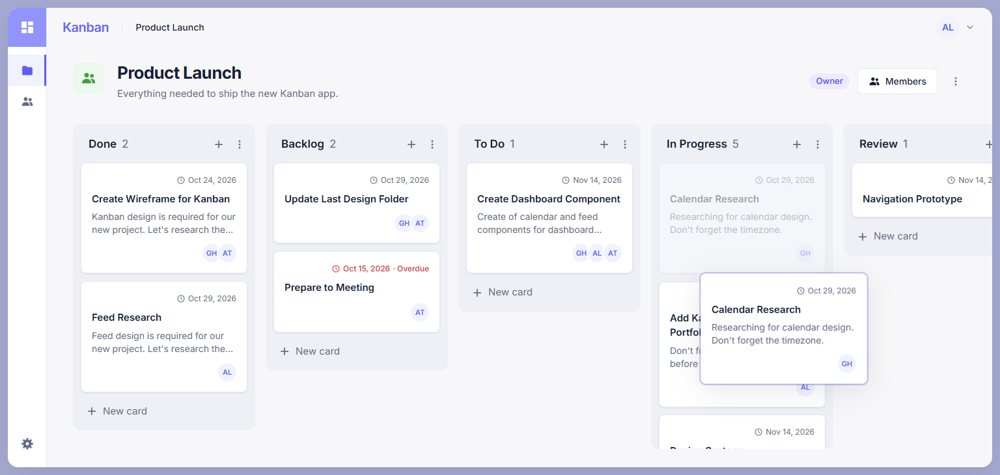 | 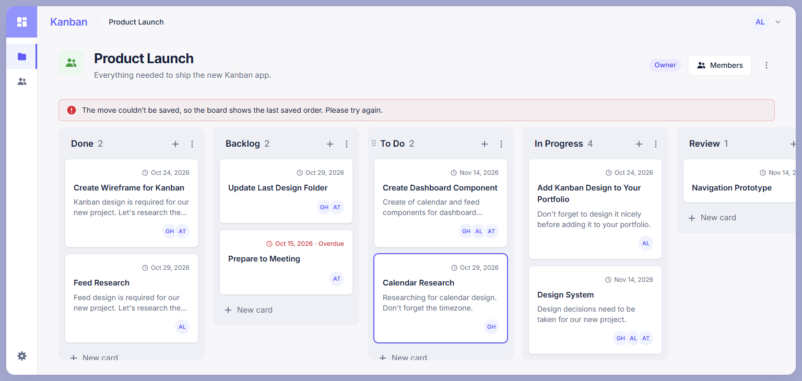 | 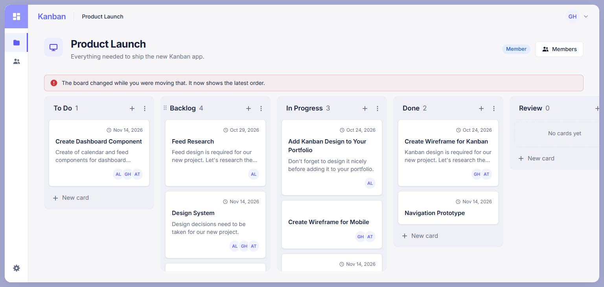 |

| Column with archived cards                                                                    | Archived board (read-only)                                                             |
| --------------------------------------------------------------------------------------------- | -------------------------------------------------------------------------------------- |
| 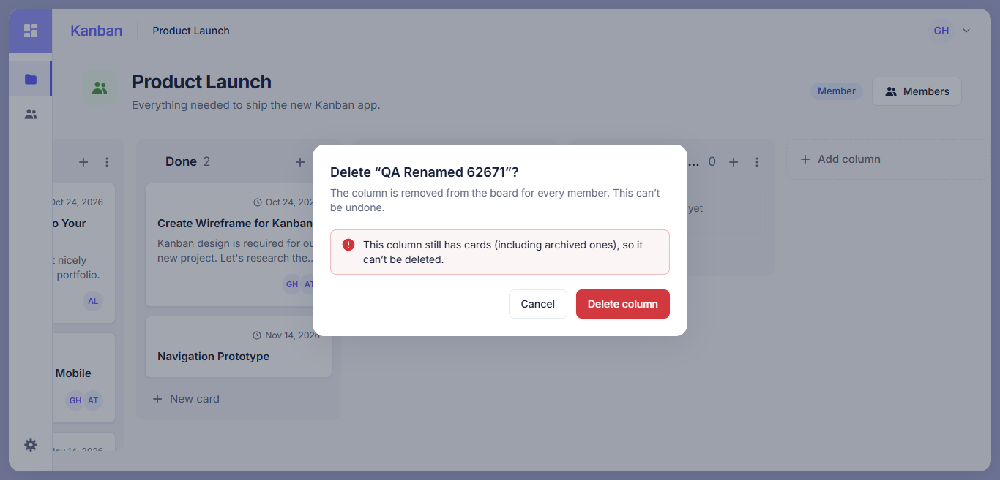 | 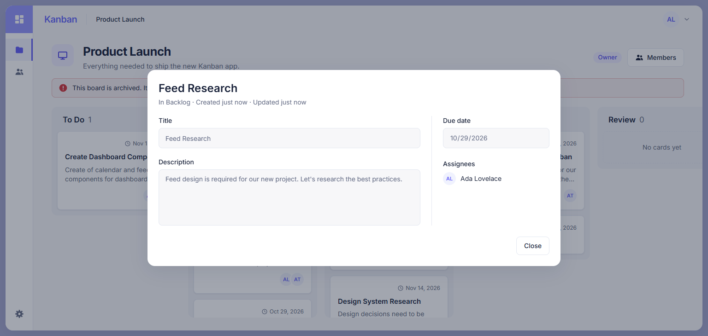 |
