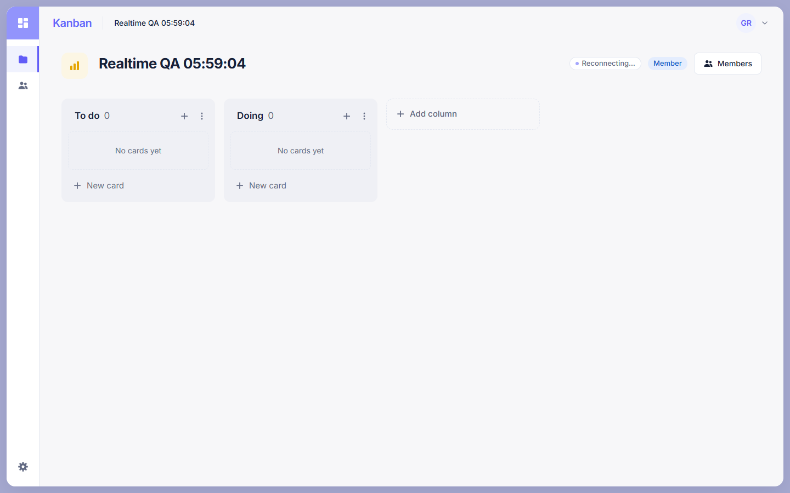
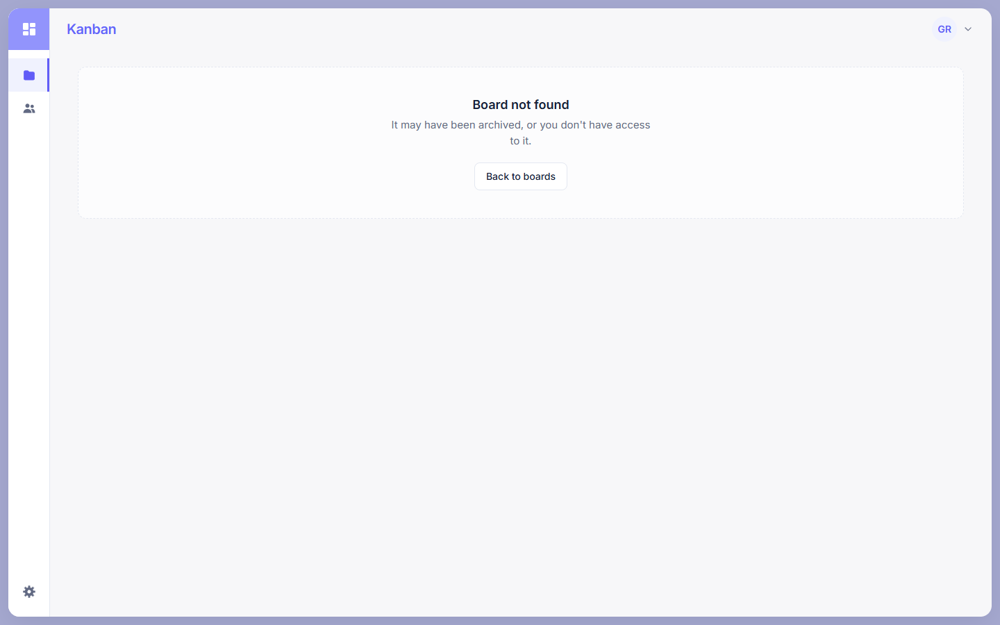
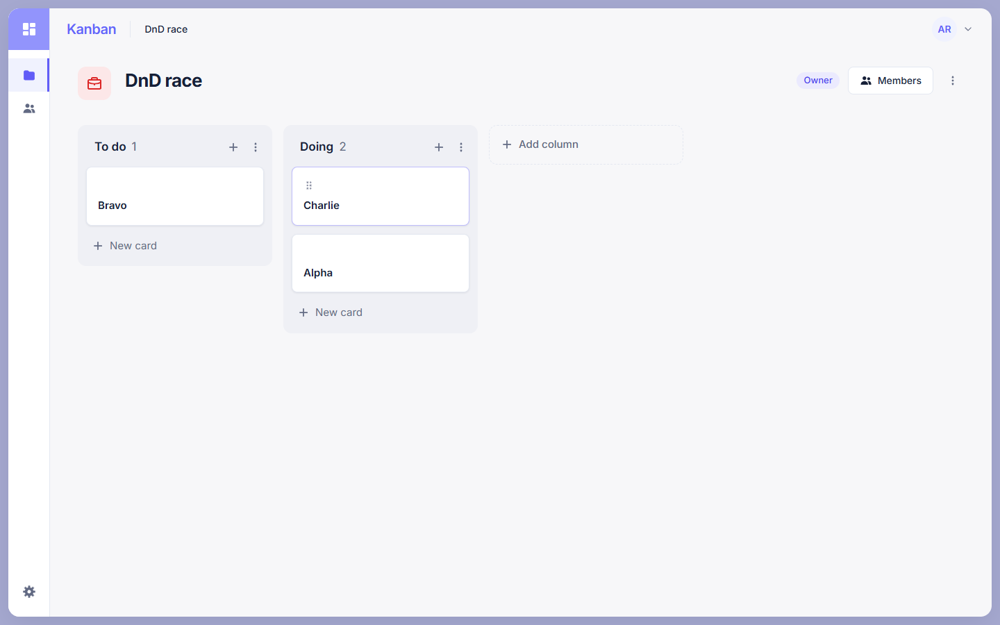

# Realtime frontend synchronization (#43)

F2b of Phase F. When another user changes a Column, Card or BoardMember
through REST, everyone who has that board open sees the change without
reloading. It builds on the Socket.IO foundation (#36) and the board events
of F2a (#40). Socket events are only hints: the frontend refetches the
affected data through REST, and PostgreSQL stays the source of truth.

## What is built

- **One connection per signed-in session.** `RealtimeProvider` (inside
  `AuthProvider` in `AppProviders`) creates a `BoardRealtimeClient` for the
  current session. Sign-in, sign-out and token expiry replace it, so a socket
  never outlives the token it was opened with. The socket opens only while a
  board page is open, and closes 10 s after the last one is left.
- **Board pages watch their board.** `BoardDetailPage` and
  `BoardMembersPage` call `useBoardRealtime(boardId)` once the board has
  loaded, and stop as soon as REST answers 403/404 for it.
- **Join, then catch up.** A board is live only after a `board:join` ACK with
  `success: true` for that board (10 s timeout). After every successful join,
  first or after a reconnect, the whole board is refetched, because events
  sent while the client was away are never replayed.
- **Events → refetches.** Each of the 12 F2a events invalidates the matching
  TanStack Query keys (table below). Invalidations are coalesced for 100 ms
  and held while any mutation is pending.
- **Status pill.** Next to the role chip, shown only while live updates are
  interrupted: "Reconnecting…", or "Live updates paused" with **Retry** once
  retries give up. Hidden while connecting for the first time and while live.

## Event → refetch matrix

`boardKeys` (`features/boards/query-keys.ts`) nests members, columns and cards
under the board's detail key, so the board itself is always invalidated with
`exact: true`. Column card counts are computed from the card list, which
holds the whole board.

| Event                                                                                   | Refetched                                                                  |
| --------------------------------------------------------------------------------------- | -------------------------------------------------------------------------- |
| `column:created`, `column:updated`, `column:moved`, `column:deleted`                    | columns                                                                    |
| `card:created`, `card:updated`, `card:moved`, `card:archived`, `card:assignees-changed` | card list (exact) + that card's detail                                     |
| `member:added`                                                                          | members                                                                    |
| `member:role-changed`                                                                   | members, board (exact), board list (the signed-in user's role lives there) |
| `member:removed`                                                                        | members, board (exact), board list, every card (assignments are removed)   |
| successful `board:join` (initial or rejoin)                                             | everything under the board's key                                           |

Only empty columns can be deleted, so `column:deleted` never changes cards.
`card:moved` refetches the full card list, which updates both the source and
the destination column.

## Decisions

| Topic               | Decision                                                                                                                                                                                                                                                                                   |
| ------------------- | ------------------------------------------------------------------------------------------------------------------------------------------------------------------------------------------------------------------------------------------------------------------------------------------ |
| Owner of the socket | A provider plus a hook. One socket per session is shared by the board pages; switching boards swaps rooms instead of reconnecting. Presence (G1/G2) can reuse the same client.                                                                                                             |
| Endpoint            | The origin of `VITE_API_BASE_URL` without its path (`http://localhost:3000/api` → `http://localhost:3000`), path `/socket.io`. No new env variable.                                                                                                                                        |
| Token               | Read again through `runAuthorized` for every handshake and sent only in `auth.accessToken`, never in a URL, payload or log. `runAuthorized` refuses once its session has ended, and the socket then stops instead of retrying.                                                             |
| Board id case       | The server lowercases `boardId` in ACKs and events. Ids are compared case-insensitively; query keys keep the id from the page URL.                                                                                                                                                         |
| Stale results       | Every join and every disconnect bumps an attempt counter. A late ACK from an earlier attempt, an earlier connection or a board no longer watched is ignored. Events of a board that is not live (including before its ACK) are dropped; the resync after the ACK covers them.              |
| StrictMode / switch | Watch changes are applied once per task (`queueMicrotask`), so a mount → unmount → mount or an A → B → A within one tick sends no join/leave pairs that cancel out.                                                                                                                        |
| Retries             | Failed joins (timeout, `TOO_MANY_REQUESTS`, `INTERNAL_ERROR`, ACK for another board) retry after 1 s, 2 s, 4 s… up to 30 s, five times, then pause. Paused boards resume on `online`, on the tab becoming visible, or with Retry. Network errors are left to Socket.IO's own reconnection. |
| `NOT_FOUND`         | No retry. The board is marked unavailable and its detail query refetched, so the page shows its usual "Board not found" state from REST.                                                                                                                                                   |
| `UNAUTHORIZED`      | A refused handshake, an `UNAUTHORIZED` ACK or a server-side disconnect re-checks the session with `GET /users/me`. A 401 there ends the session (and the client); otherwise the socket reconnects with a freshly read token, with the same backoff.                                        |
| Drag-and-drop       | E3 keeps a local preview until its move request settles. Event refetches wait until no mutation is pending, so they land after the move and show the server's order. No event ever patches the cache directly.                                                                             |
| Pill colors         | Existing tokens only (`line`, `muted`, `brand-soft`), so the palette in `design-guidelines.md` is unchanged.                                                                                                                                                                               |

## Known limitations

- **Best effort only.** No replay and no outbox: a client that was away
  catches up by refetching after it rejoins. There is no global ordering of
  events, and delivery is single-instance (whatever F1/F2a guarantee).
- **A removed member is not told.** The backend removes their sockets from
  the room without an event or a disconnect, so their open page keeps showing
  the last data until a REST call fails: returning to the tab (TanStack's
  focus refetch), their next change (404), or the resync after any
  reconnect. Each switches the page to "Board not found" and leaves the room.
  No polling was added. A possible backend follow-up is to send an
  "access revoked" notice to the removed user's sockets before evicting them.
- **Detecting a dead connection** can take up to Socket.IO's heartbeat
  timeout (about 45 s) when the network disappears silently, for example
  with Chrome DevTools' offline mode.
- **Archived boards** have no realtime event; the page notices through REST
  as before.

## Tests

- `event-invalidation.test.ts`: every event against a real query cache,
  including that another board's queries are never touched.
- `socket-client.test.ts`: origin and path, `autoConnect: false`, a fresh
  token on every handshake, stopping when the session has ended.
- `board-realtime-client.test.ts` (with `test/fake-socket.ts`): ACK
  success/failure/timeout/wrong board, backoff and pause, `NOT_FOUND`,
  `UNAUTHORIZED`, StrictMode, A → B → A with stale ACKs, events before the
  ACK and of other boards, reconnect → rejoin → resync, refused handshakes,
  dispose.
- `invalidation-queue.test.ts`: bursts, waiting for pending mutations.
- `useBoardRealtime.test.tsx`: no socket while signed out or disabled, token
  from the session, a REST refetch after an event, StrictMode, sign-out,
  server disconnect → session re-check.
- `BoardDetailPage.realtime.test.tsx`: another user's card appears, the role
  chip updates, the pill appears and disappears, and lost access hides the
  board and leaves its room.

`test/setup.ts` replaces `createRealtimeSocket` with `FakeSocket` in every
test, so no test opens a real connection; created sockets are listed in
`createdSockets`.

## Two-browser check against the real backend

Run on 2026-10-17 against `main` with F1 and F2a, Chrome driven by Playwright,
two users on the same board. Every step passed:

| Scenario                                                                                    | Result                                                   |
| ------------------------------------------------------------------------------------------- | -------------------------------------------------------- |
| Column created, renamed, moved, deleted by Ada → Grace's board                              | updates in ~200 ms                                       |
| Card created in Grace's UI, then updated, moved, assigned, archived → Ada's board           | updates in ~200 ms; both column counts right after move  |
| Member added → members page; Grace's role changed to Owner and back → her role chip         | updates                                                  |
| Change on another board                                                                     | no frame of that board reaches the browser               |
| Grace offline, Ada adds a card, Grace back online                                           | pill shown; rejoin sent; card appears                    |
| Ada switches A → B → A → B → A (60 ms apart)                                                | joins/leaves alternate, ends in A only; B events ignored |
| Grace removed, then returns to the tab                                                      | REST 404 → "Board not found"; `board:leave` sent         |
| Ada drags Alpha to Doing while Grace moves Charlie to Doing through REST at the same moment | both browsers show the database order, no ghost card     |
| Ada's page reloaded during all of the above                                                 | never                                                    |
| Ada logs out                                                                                | socket closed                                            |

Removed member and the drag race:

### Reproducing by hand

1. `docker compose up -d`, then `pnpm dev` (backend on `:3000`, frontend on
   `:5173`).
2. Register two users. As the first, create a board, add two columns and add
   the second user as a member.
3. Open the board as user 1 in a normal window and as user 2 in a private
   window (each has its own `sessionStorage` session).
4. In one window, add, rename, move and delete columns; add, edit, drag,
   assign and archive cards. The other window follows without a reload.
5. In window 2, open DevTools → Network → Offline. After up to ~45 s the
   "Reconnecting…" pill shows. Make a change in window 1, then go back
   online in window 2: the pill disappears and the change appears.
6. Remove user 2 from the board in window 1. Switch away from window 2 and
   back: it shows "Board not found".
7. Reload both windows: everything matches what was shown live.
8. Log out in a window: the `socket.io` connection closes (Network → WS).
